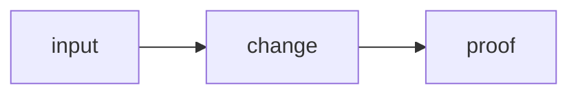

# Template — single AI plan task

> **Rule (phase-03 onward):** one markdown file = one task a single AI session can finish. No multi-day mega-cards. If it needs more than ~2–3 hours or two specialists in parallel, **split**.

Copy into `Docs/plan/<product>/phase-NN/<id>-<slug>.md`. Index it from that phase’s `README.md`.

```markdown
---
title: "<id> — <short name>"
description: "One-line outcome"
created: YYYY-MM-DD
updated: YYYY-MM-DD
tags:
  - plan
  - <product>
  - phase-NN
  - task
---

# <id> — <short name>

> **Status:** todo | in progress | done  
> **Phase:** [[README]] · Parent feature: [[…/{app}-F####-…\|{app}-F####]] · As-built after ship: [[…tech_space…]]

## Routing (who / how long / which model)

| | |
|--|--|
| **Parent feature** | `{app}-F####` (required — from `feature_list/<app>/INDEX`) |
| **Suggested agent** | mimir → sindri \| saga \| heimdall \| apollo \| docs_man |
| **Companion skills** | 1–3 paths under `.agents/skills/` or `.cursor/skills/` |
| **Suggested model** | e.g. `composer-2.5-fast` (small) · `gpt-5.6-sol-medium` · `claude-sonnet-5-5-high` |
| **Est. time** | 30–90 min (wall clock for one focused session) |
| **Parallel?** | **No** — one AI at a time on this file |

## Goal

One paragraph: the single outcome.

## Why now

Link the parent **feature id** (e.g. [[jord-F0013]]).

## Context (read before coding)

- Intent: …
- As-built: …
- Code paths: `path/to/file.ts`
- Overlap / do not break: …

## In scope

- …

## Out of scope

- … (explicit; push to the next task file)

## Diagram



## Steps (do in order)

1. …
2. …
3. Run proof commands below
4. docs_man: update tech_space category + tick this card + STATUS if phase status changed

## Done when (acceptance)

- [ ] …
- [ ] Tests / commands pasted in **Proof**

## Proof

| Date | Command | Result |
|------|---------|--------|
| | | |

## After ship

| Update | Path |
|--------|------|
| tech_space category | `Docs/tech_space/<product>/<category>/README.md` |
| feature_list done (if contract changed) | `Docs/feature_list/<product>/done/<category>.md` |
| Phase README row | this folder’s `README.md` |
```

## Sizing checklist (before you create a card)

- [ ] One agent hat owns it (others only review)
- [ ] Est. ≤ ~3 hours
- [ ] Acceptance is testable with pasted commands
- [ ] Out of scope names the next card if needed
- [ ] Diagram fits on one screen
