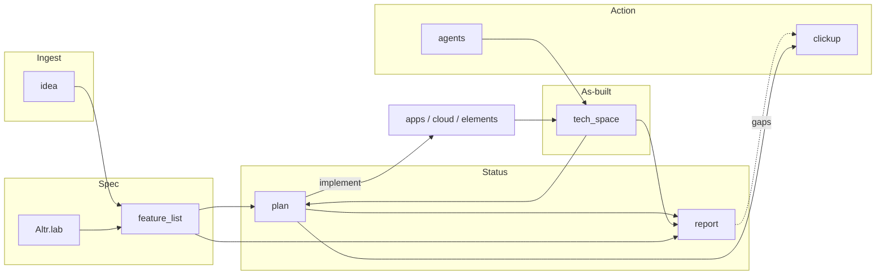
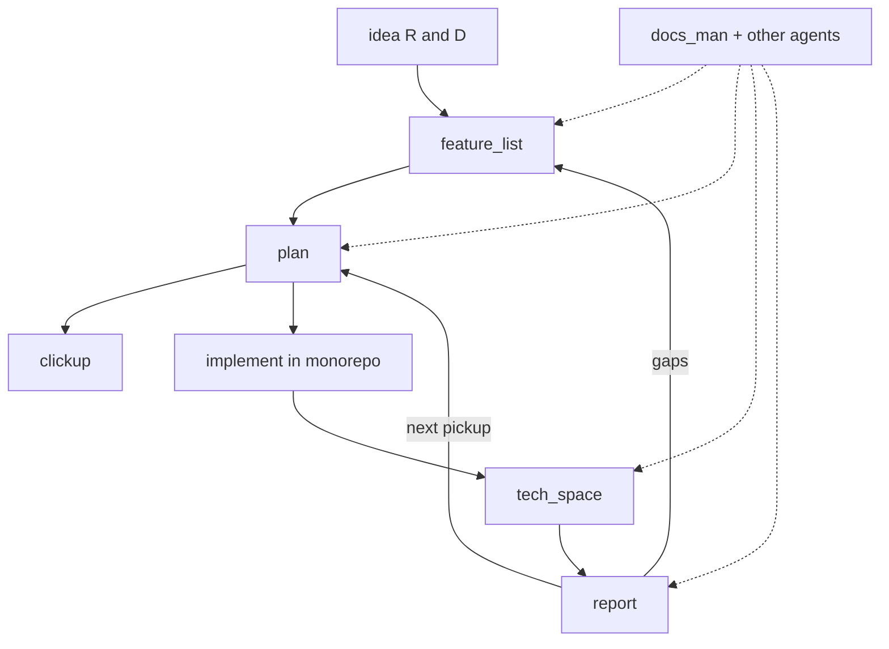

# Docs Brain — living map

> Open this file first. It is the shared map for people in Obsidian and agents in Cursor.

**Agents:** [[../agents/docs_man/00-index|docs_man]] · [[../agents/apollo/00-index|apollo]] · [[../agents/mimir/00-index|mimir]] · **Folder hub:** [[00-Docs-Hub]]

**Triggers:** `update_docs` / `document it` → **docs_man**. `apollo` / `build apolyx` → **apollo** (Apolyx UI kit). `mimir` / `build jord` → **mimir** (Jord **program master**: sindri / saga / heimdall; Studio → apollo; vault → docs_man).

---

## How to read this vault

| You want | Go here |
|----------|---------|
| Every docs folder explained | [[00-Docs-Hub]] |
| Monorepo structure / commands / stack | [[../Altr.lab/README]] · [[../Altr.lab/structure]] · [[../Altr.lab/commands]] · [[../Altr.lab/stack]] |
| Agent skills / Graft | [[../Altr.lab/agent-skills]] · [[../Altr.lab/graft]] |
| Raw R&D ideas | [[../idea/README]] · catalog [[../idea/2026-10-18-product-catalog]] |
| Product intent (what to build) | [[../feature_list/README]] |
| Build plans (next steps) | [[../plan/README]] |
| Complete vs remaining | [[../report/README]] · [[../report/STATUS]] |
| As-built notes (how it was coded) | [[../tech_space/README]] |
| ClickUp / task cards | [[../clickup/README]] |
| AI sub-agents | [[../agents/README]] · [[../agents/docs_man/00-index]] · [[../agents/apollo/00-index]] |
| AI run prompts for the repo | [[../Altr.lab/prompts]] |

Truth order when they disagree: **code** (`apps/`, `cloud/`, `elements/`) > **tech_space** > **report/plan** > **feature_list**. Spec still wins for “what we intend to build.”

---

## Product / work loop

Deep dives: [[../Altr.lab/stack]] · [[../idea/README]] · [[../report/STATUS]]

---

## Repo surfaces the docs describe

| Surface | Path | Docs |
|---------|------|------|
| Apolyx docs app | `apps/apolyx` | [[../tech_space/ui-kit/05-docs-app]] |
| PocketBase (optional) | `cloud/pocketbase` | Altr.lab/stack |
| Removed 2026-10-18 | `apps/hub`, `apps/web`, `apps/dashboard`, `apps/trading-ui`, `cloud/hono-server`, `cloud/ai-bot-agent` | [[../tech_space/03-sample-apps-removed]] |
| Design system (**Apolyx**) | `elements/ui-kit` (`@altr/apolyx`) · `apps/apolyx` · `elements/apolyx-cli` | Intent: [[../feature_list/ui-kit/00-intent]] · S0005 closed: [[../feature_list/ui-kit/06-apolyx-s0005-product-gate]] · As-built [[../tech_space/ui-kit/10-s0005-product-gate]] · Sprints [[../plan/ui-kit/README]] · Apolyx-first: `.cursor/rules/apolyx-first.mdc` · Builder: [[../agents/apollo/00-index]] |
| Data plane (**Jord**) | `elements/jord` · `cloud/jord` · `apps/jord-studio` · `data/jord.db` (gitignored) | Intent: [[../feature_list/Jord/00-intent]] · Engine [[../tech_space/jord/00-s0001-slice0]] · Studio through [[../tech_space/jord/10-s0011-realtime]] · Track [[../plan/Jord/README]] · Builder: [[../agents/mimir/00-index]] |
| Shared libs | `elements/base` (`@altr/base` **leaf**) | Rules: [[../feature_list/00-elements-dependency-rules]] · base README · historical [[../tech_space/01-hub-ui-kit-base]] |

**Lab sequence:** [[../plan/00-roadmap-apolyx-jord-artemis]] — Apolyx-S0005 (**done**) → Jord-S0001–**S0011** (**done**) → Studio S10 or Artemis.

Primary DB: **Jord** — libSQL and optional Postgres + Studio + auth + APIs + jobs/logs + policies/triggers + realtime SSE ([[../tech_space/jord/10-s0011-realtime]]). Studio intent [[../feature_list/Jord/03-jord-studio]] · Track [[../plan/Jord/README]]. PocketBase stays optional.

---

## Status snapshot

| Layer | Role | Freshness |
|-------|------|-----------|
| `idea/` | Raw R&D before promotion | Catalog v2.3: [[../idea/2026-10-18-product-catalog]]. Apolyx · Jord · API client · Search · **Tia** ([[../idea/Tia (Map Engine)/README]], promoted). Sharpen: [[../idea/Tia (Map Engine)/2026-10-19-sharpen]] |
| `feature_list/` | Intent / what to build | [[../feature_list/ui-kit/README]] · S0005 shipped [[../feature_list/ui-kit/06-apolyx-s0005-product-gate]] · **Jord:** [[../feature_list/Jord/00-intent]] · **Tia:** [[../feature_list/tia/README]] · Carryovers: [[../feature_list/ui-kit/01-apolyx-s0001-carryovers]] |
| `plan/` | Checkbox overlay + next steps | Jord track: [[../plan/Jord/README]] (S0001–**S0011** done) · Roadmap: [[../plan/00-roadmap-apolyx-jord-artemis]] · Closed Apolyx: S0001–**S0005** |
| `report/` | Audited complete vs remaining | Latest: [[../report/STATUS]] (**Jord-S0011 done**; next S10 or Artemis) |
| `tech_space/` | Implementation narrative | Latest Jord: [[../tech_space/jord/10-s0011-realtime]] · Engine: [[../tech_space/jord/00-s0001-slice0]] · Apolyx: [[../tech_space/ui-kit/10-s0005-product-gate]] · index [[../tech_space/README]] |
| `clickup/` | External task sync notes | Edit when extracting work |
| `agents/` | Sub-agent defs (docs_man, …) | Edit when agent behaviour changes |
| `Altr.lab/` | Root turbo how-tos | Edit when structure/commands change |
| `brain/` | This living map | Update when folders or truth order change |

**Latest durable audit:** [[../report/STATUS]].

---

## Companion skills

How-to: [[../Altr.lab/agent-skills]] · Graft: [[../Altr.lab/graft]] · MCP: `.cursor/mcp.json`

| Skill | Location | Use |
|-------|----------|-----|
| `docs-man` | `.agents/skills/docs-man/` · `.cursor/skills/docs-man/` | Vault update order, frontmatter, wikilinks |
| `apollo` | `.agents/skills/apollo/` · `.cursor/skills/apollo/` · [[../agents/apollo/00-index]] | Build Apolyx UI kit |
| `mimir` | `.agents/skills/mimir/` · `.cursor/skills/mimir/` · [[../agents/mimir/00-index]] | Build Jord data plane (sindri / saga / heimdall) |
| `docs-brain` | `.cursor/skills/docs-brain/` | Keep this living map honest |
| `pdf` | `.agents/skills/pdf/` | Read/create/merge PDFs |
| `doc-coauthoring` | `.agents/skills/doc-coauthoring/` | Large new specs with guided loop |
| `graft` | `.agents/skills/graft/` | Codebase graph before blind grep |
| `design-taste-frontend` | `.agents/skills/design-taste-frontend/` | Anti-slop frontend taste |
| `impeccable` | `.agents/skills/impeccable/` | Critique / polish / design commands |
| `playwright-cli` | `.agents/skills/playwright-cli/` | Browser automation via Playwright CLI |
| `context7-*` / `find-docs` | `.agents/skills/` | Up-to-date library docs |
| `ui-skills-*` / `baseline-ui` | `.agents/skills/` | UI routing + polish / a11y |
| `img2threejs` | `.agents/skills/img2threejs/` | Image → procedural Three.js |
| Strix pack | `.agents/skills/*strix*` / security skills | Authorized AppSec only |
| awesome-design aesthetics | `.agents/skills/<aesthetic>/` | One named visual language |
| `find-skills` | user skills | Find and install more from skills.sh |

Project installs: `npx skills list` · lockfile: `skills-lock.json`.

Vendored copies live under `.agents/skills/` so the repo stays portable without a global install.

---

## Maintainers

When you add a durable doc:

1. Use the frontmatter template in [[../agents/templates/structured-note]]
2. Add a wikilink on [[00-Docs-Hub]] and here
3. Keep graphs honest
4. Prefer updating existing files over inventing parallel trees
5. Route doc work through **docs_man** (`update_docs` / `document it`)
