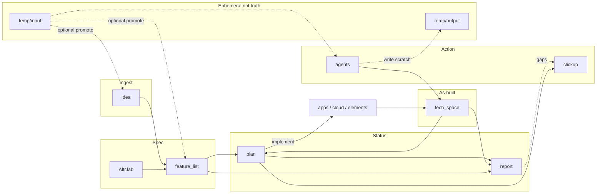
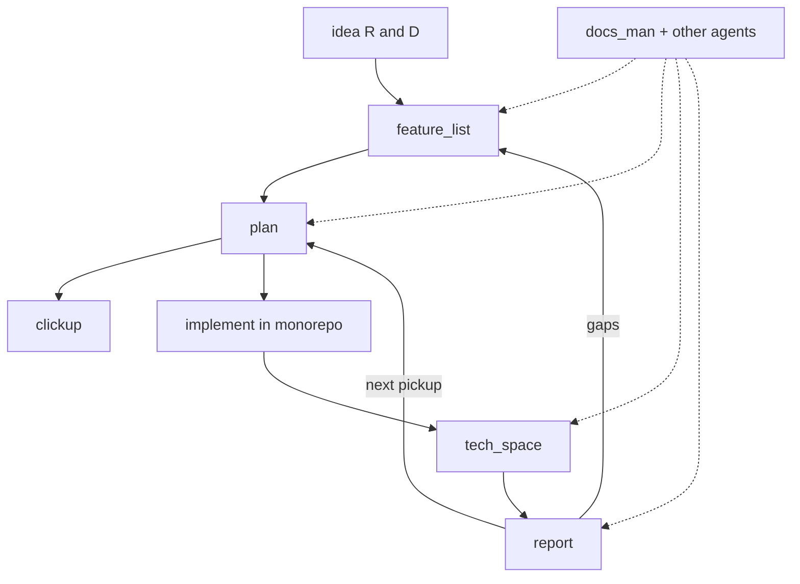

# Docs Brain — living map

> Open this file first. It is the shared map for people in Obsidian and agents in Cursor.

**Agents:** [[../agents/docs_man/00-index|docs_man]] · [[../agents/apollo/00-index|apollo]] · [[../agents/mimir/00-index|mimir]] · **Folder hub:** [[00-Docs-Hub]]

**Triggers:** `update_docs` / `document it` → **docs_man**. `apollo` / `build apolyx` → **apollo** (Apolyx UI kit). `mimir` / `build jord` → **mimir** (Jord **program master**: sindri / saga / heimdall; Studio → apollo; vault → docs_man).

---

## How to read this vault

| You want | Go here |
|----------|---------|
| Every docs folder explained | [[00-Docs-Hub]] |
| Monorepo structure / commands / stack | [[../Altr.lab/README]] · [[../Altr.lab/structure]] · [[../Altr.lab/commands]] · [[../Altr.lab/stack]] |
| Agent skills / Graft | [[../Altr.lab/agent-skills]] · [[../Altr.lab/graft]] |
| Raw R&D ideas | [[../idea/README]] · catalog [[../idea/2026-10-18-product-catalog]] |
| Product intent (what to build) | [[../feature_list/README]] |
| Build plans (next steps) | [[../plan/README]] |
| Complete vs remaining | [[../report/README]] · [[../report/STATUS]] |
| As-built notes (how it was coded) | [[../tech_space/README]] |
| ClickUp / task cards | [[../clickup/README]] |
| AI sub-agents | [[../agents/README]] · [[../agents/docs_man/00-index]] · [[../agents/apollo/00-index]] |
| AI run prompts for the repo | [[../Altr.lab/prompts]] |
| Ephemeral staging (not truth) | [[../temp/README]] · [[../temp/input/README\|input]] · [[../temp/output/README\|output]] |

Truth order when they disagree: **code** (`apps/`, `cloud/`, `elements/`) > **tech_space** > **report/plan** > **feature_list**. Spec still wins for “what we intend to build.” **`temp/` is never truth** — scratch only.

---

## Product / work loop

Deep dives: [[../Altr.lab/stack]] · [[../idea/README]] · [[../report/STATUS]]

---

## Repo surfaces the docs describe

| Surface | Path | Docs |
|---------|------|------|
| Apolyx docs app | `apps/apolyx` | [[../tech_space/ui-kit/05-docs-app]] |
| PocketBase (optional) | `cloud/pocketbase` | Altr.lab/stack |
| Removed 2026-10-18 | `apps/hub`, `apps/web`, `apps/dashboard`, `apps/trading-ui`, `cloud/hono-server`, `cloud/ai-bot-agent` | [[../tech_space/03-sample-apps-removed]] |
| Design system (**Apolyx**) | `elements/ui-kit` (`@altr/apolyx`) · `apps/apolyx` · `elements/apolyx-cli` | Intent: [[../feature_list/ui-kit/00-intent]] · S0005 closed: [[../feature_list/ui-kit/06-apolyx-s0005-product-gate]] · As-built [[../tech_space/ui-kit/10-s0005-product-gate]] · Sprints [[../plan/ui-kit/README]] · Apolyx-first: `.cursor/rules/apolyx-first.mdc` · Builder: [[../agents/apollo/00-index]] |
| Data plane (**Jord**) | `elements/jord` · `elements/jord-client` · `cloud/jord` · `apps/jord-studio` · `data/jord.db` · `data/blobs/` (gitignored) | Manual: [[../tech_space/jord/README]] · Intent: [[../feature_list/Jord/README]] · Plans [[../plan/Jord/README]] · Review [[../report/Jord-implemented-review]] · Builder: [[../agents/mimir/00-index]] |
| Shared libs | `elements/base` (`@altr/base` **leaf**) | Rules: [[../feature_list/00-elements-dependency-rules]] · base README · historical [[../tech_space/01-hub-ui-kit-base]] |

**Lab sequence:** [[../plan/00-roadmap-apolyx-jord-artemis]] — Apolyx-S0005 (**done**) → Jord **phase-01** S0001–**S0020** (**done**) → Jord **phase-02** accepted → **phase-02.5** / **02.75** closed → **phase-03** [[../plan/Jord/phase-03/README]] (**active**: **63 one-file AI cards S0034–S0096**; **S0034–S0044 done** under [[../plan/Jord/phase-03/done/README|done/]] — **jord-F0013** closed; wave B: next [[../plan/Jord/phase-03/S0045-project-scoped-routes|S0045]]; intent [[../feature_list/Jord/INDEX]]). Template: [[../agents/templates/plan-task]]. Functions v2 **runtime** still gated ([[../tech_space/jord/apis/ADR-functions-v2]]).

**Studio v2 intent** added 2026-10-28 (features only, no plan cards): `jord-F0021`…`jord-F0030` — projects/provisioning + dashboard, three-pane shell (schema picker, ordered table sidebar, workspace tabs), column model v2, DataGrid tables workspace (primitive [[../feature_list/ui-kit/apolyx-F0008-datagrid|apolyx-F0008]]), live client data, ERD canvas, SQL editor v2, per-bucket storage providers, auth console. Table: [[../feature_list/Jord/INDEX]].

Primary DB: **Jord** — libSQL / Turso / Postgres + Studio control plane through phase-01. Intent [[../feature_list/Jord/README]] ([[../feature_list/Jord/done/README\|done]] / [[../feature_list/Jord/todo/README\|todo]]) · Phase-02 shipped [[../feature_list/Jord/done/README]] · Plans [[../plan/Jord/README]]. PocketBase stays optional.

---

## Status snapshot

| Layer | Role | Freshness |
|-------|------|-----------|
| `idea/` | Raw R&D before promotion | Catalog v2.3: [[../idea/2026-10-18-product-catalog]]. Apolyx · Jord · API client · Search · **Tia** ([[../idea/Tia (Map Engine)/README]], promoted). Sharpen: [[../idea/Tia (Map Engine)/2026-10-19-sharpen]] |
| `feature_list/` | Intent (`{app}-F####`) | [[../feature_list/README#feature-ids]] · Jord [[../feature_list/Jord/INDEX]] · Apolyx [[../feature_list/ui-kit/INDEX]] · Tia [[../feature_list/tia/INDEX]] |
| `plan/` | One-file AI tasks (phase-03+) + archived sprints | Jord: [[../plan/Jord/README]] · [[../plan/Jord/phase-03/README\|phase-03]] · template [[../agents/templates/plan-task]] · Roadmap: [[../plan/00-roadmap-apolyx-jord-artemis]] |
| `report/` | Audited complete vs remaining | [[../report/STATUS]] · phase-01 review [[../report/Jord-implemented-review]] · phase-02 rollup [[../plan/Jord/phase-02/00-task-rollup]] · as-built [[../tech_space/jord/README]] |
| `tech_space/` | Living system manuals by category | Jord: [[../tech_space/jord/README]] · Apolyx: [[../tech_space/ui-kit/10-s0005-product-gate]] · index [[../tech_space/README]] |
| `clickup/` | External task sync notes | Edit when extracting work |
| `agents/` | Sub-agent defs (docs_man, …) | Edit when agent behaviour changes |
| `Altr.lab/` | Root turbo how-tos | Edit when structure/commands change |
| `temp/` | Ephemeral input/output staging | **Not truth** · [[../temp/README]] · payloads gitignored |
| `brain/` | This living map | Update when folders or truth order change |

**Latest durable audit:** [[../report/STATUS]].

---

## Companion skills

How-to: [[../Altr.lab/agent-skills]] · Graft: [[../Altr.lab/graft]] · MCP: `.cursor/mcp.json`

| Skill | Location | Use |
|-------|----------|-----|
| `docs-man` | `.agents/skills/docs-man/` · `.cursor/skills/docs-man/` | Vault update order, frontmatter, wikilinks |
| `apollo` | `.agents/skills/apollo/` · `.cursor/skills/apollo/` · [[../agents/apollo/00-index]] | Build Apolyx UI kit |
| `mimir` | `.agents/skills/mimir/` · `.cursor/skills/mimir/` · [[../agents/mimir/00-index]] | Build Jord data plane (sindri / saga / heimdall) |
| `docs-brain` | `.cursor/skills/docs-brain/` | Keep this living map honest |
| `pdf` | `.agents/skills/pdf/` | Read/create/merge PDFs |
| `doc-coauthoring` | `.agents/skills/doc-coauthoring/` | Large new specs with guided loop |
| `graft` | `.agents/skills/graft/` | Codebase graph before blind grep |
| `design-taste-frontend` | `.agents/skills/design-taste-frontend/` | Anti-slop frontend taste |
| `impeccable` | `.agents/skills/impeccable/` | Critique / polish / design commands |
| `playwright-cli` | `.agents/skills/playwright-cli/` | Browser automation via Playwright CLI |
| `context7-*` / `find-docs` | `.agents/skills/` | Up-to-date library docs |
| `ui-skills-*` / `baseline-ui` | `.agents/skills/` | UI routing + polish / a11y |
| `img2threejs` | `.agents/skills/img2threejs/` | Image → procedural Three.js |
| Strix pack | `.agents/skills/*strix*` / security skills | Authorized AppSec only |
| awesome-design aesthetics | `.agents/skills/<aesthetic>/` | One named visual language |
| `find-skills` | user skills | Find and install more from skills.sh |

Project installs: `npx skills list` · lockfile: `skills-lock.json`.

Vendored copies live under `.agents/skills/` so the repo stays portable without a global install.

---

## Maintainers

When you add a durable doc:

1. Use the frontmatter template in [[../agents/templates/structured-note]]
2. Add a wikilink on [[00-Docs-Hub]] and here
3. Keep graphs honest
4. Prefer updating existing files over inventing parallel trees
5. Route doc work through **docs_man** (`update_docs` / `document it`)
