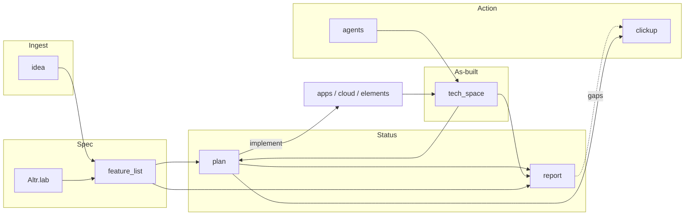
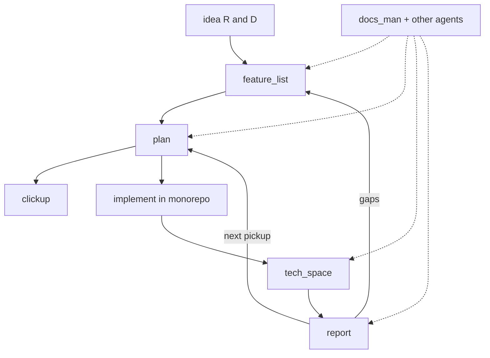

# Docs Brain — living map

> Open this file first. It is the shared map for people in Obsidian and agents in Cursor.

**Agent:** [[../agents/docs_man/00-index|docs_man]] · **Skill:** `.agents/skills/docs-man/` · **Cursor skill:** `.cursor/skills/docs-man/` · **Folder hub:** [[00-Docs-Hub]]

**Triggers:** say `update_docs` or `document it` → docs_man runs this vault workflow.

---

## How to read this vault

| You want | Go here |
|----------|---------|
| Every docs folder explained | [[00-Docs-Hub]] |
| Monorepo structure / commands / stack | [[../Altr.lab/README]] · [[../Altr.lab/structure]] · [[../Altr.lab/commands]] · [[../Altr.lab/stack]] |
| Agent skills / Graft | [[../Altr.lab/agent-skills]] · [[../Altr.lab/graft]] |
| Raw R&D ideas | [[../idea/README]] |
| Product intent (what to build) | [[../feature_list/README]] |
| Build plans (next steps) | [[../plan/README]] |
| Complete vs remaining | [[../report/README]] · [[../report/STATUS]] |
| As-built notes (how it was coded) | [[../tech_space/README]] |
| ClickUp / task cards | [[../clickup/README]] |
| AI sub-agents | [[../agents/README]] · [[../agents/docs_man/00-index]] |
| AI run prompts for the repo | [[../Altr.lab/prompts]] |

Truth order when they disagree: **code** (`apps/`, `cloud/`, `elements/`) > **tech_space** > **report/plan** > **feature_list**. Spec still wins for “what we intend to build.”

---

## Product / work loop

Deep dives: [[../Altr.lab/stack]] · [[../idea/README]] · [[../report/STATUS]]

---

## Repo surfaces the docs describe

| Surface | Path | Docs |
|---------|------|------|
| Landing hub | `apps/hub` | [[../tech_space/01-hub-ui-kit-base]] · [[../feature_list/01-hub-ui-kit-base]] |
| Extra Next scaffold | `apps/web` | Altr.lab/structure |
| Admin dashboard | `apps/dashboard` | Altr.lab + future tech_space |
| Trading UI | `apps/trading-ui` | Altr.lab + future tech_space |
| Hono API | `cloud/hono-server` | Altr.lab/stack · tech_space |
| PocketBase (optional) | `cloud/pocketbase` | Altr.lab/stack |
| AI bot agent | `cloud/ai-bot-agent` | Altr.lab · agents |
| Design system (**Helix**) | `elements/ui-kit` · future `apps/helix` + CLI | Intent: [[../feature_list/ui-kit/00-intent]] · Idea: [[../idea/ui-kit/README]] · As-built v0: [[../tech_space/01-hub-ui-kit-base]] · [[../tech_space/02-ui-kit-storybook]] |
| Shared libs | `elements/base` | [[../tech_space/01-hub-ui-kit-base]] · base README |

Primary DB decision: **Turso / libSQL** (see [[../Altr.lab/stack]]). PocketBase for quick admin/auth side projects. Postgres only when a project needs it.

---

## Status snapshot

| Layer | Role | Freshness |
|-------|------|-----------|
| `idea/` | Raw R&D before promotion | Latest track: [[../idea/ui-kit/README]] (Helix) |
| `feature_list/` | Intent / what to build | App tracks: [[../feature_list/ui-kit/README]] · Latest: [[../feature_list/ui-kit/00-intent]] |
| `plan/` | Checkbox overlay + next steps | App folders `plan/<app>/` while sprinting; Helix plan not opened yet |
| `report/` | Audited complete vs remaining | Latest: [[../report/STATUS]] (2026-09-21) |
| `tech_space/` | Implementation narrative | Latest: [[../tech_space/02-ui-kit-storybook]] |
| `clickup/` | External task sync notes | Edit when extracting work |
| `agents/` | Sub-agent defs (docs_man, …) | Edit when agent behaviour changes |
| `Altr.lab/` | Root turbo how-tos | Edit when structure/commands change |
| `brain/` | This living map | Update when folders or truth order change |

**Latest durable audit:** [[../report/STATUS]].

---

## Companion skills

How-to: [[../Altr.lab/agent-skills]] · Graft: [[../Altr.lab/graft]] · MCP: `.cursor/mcp.json`

| Skill | Location | Use |
|-------|----------|-----|
| `docs-man` | `.agents/skills/docs-man/` · `.cursor/skills/docs-man/` | Vault update order, frontmatter, wikilinks |
| `docs-brain` | `.cursor/skills/docs-brain/` | Keep this living map honest |
| `pdf` | `.agents/skills/pdf/` | Read/create/merge PDFs |
| `doc-coauthoring` | `.agents/skills/doc-coauthoring/` | Large new specs with guided loop |
| `graft` | `.agents/skills/graft/` | Codebase graph before blind grep |
| `design-taste-frontend` | `.agents/skills/design-taste-frontend/` | Anti-slop frontend taste |
| `impeccable` | `.agents/skills/impeccable/` | Critique / polish / design commands |
| `playwright-cli` | `.agents/skills/playwright-cli/` | Browser automation via Playwright CLI |
| `context7-*` / `find-docs` | `.agents/skills/` | Up-to-date library docs |
| `ui-skills-*` / `baseline-ui` | `.agents/skills/` | UI routing + polish / a11y |
| `img2threejs` | `.agents/skills/img2threejs/` | Image → procedural Three.js |
| Strix pack | `.agents/skills/*strix*` / security skills | Authorized AppSec only |
| awesome-design aesthetics | `.agents/skills/<aesthetic>/` | One named visual language |
| `find-skills` | user skills | Find and install more from skills.sh |

Project installs: `npx skills list` · lockfile: `skills-lock.json`.

Vendored copies live under `.agents/skills/` so the repo stays portable without a global install.

---

## Maintainers

When you add a durable doc:

1. Use the frontmatter template in [[../agents/templates/structured-note]]
2. Add a wikilink on [[00-Docs-Hub]] and here
3. Keep graphs honest
4. Prefer updating existing files over inventing parallel trees
5. Route doc work through **docs_man** (`update_docs` / `document it`)
