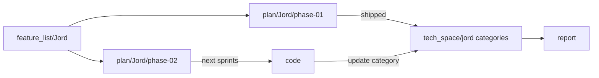

# feature_list / Jord

> **Intent layer** for Jord (engine) and Jord Studio (control plane). Open this first when deciding *what* Jord is meant to be. As-built detail lives in `tech_space/jord/`. Sprint cards live in `plan/Jord/`.

Map: [[../../brain/00-Docs-Brain]] · Idea: [[../../idea/Jord/README]] · Plan: [[../../plan/Jord/README]] · As-built: [[../../tech_space/jord/README]] · Review: [[../../report/Jord-implemented-review]] · Builder: [[../../agents/mimir/00-index|mimir]]

## How to read this folder

| Note | Role | Status |
|------|------|--------|
| [[00-intent]] | Slice 0 foundation contract (file libSQL, WAL, OCC `records`) | **Shipped** — keep as the locked baseline |
| [[04-phase-01-capabilities]] | **What we have after phase-01** (capability inventory) | **Authoritative shipped intent** |
| [[02-architecture]] | Ports, dialects, concurrency, seams | Current (matches phase-01 code) |
| [[03-jord-studio]] | Studio surfaces and build order | Phase-01 Studio **shipped** |
| [[01-phase-02-candidates]] | Unshipped / promote-only candidates for phase-02 | Open for next report → plan |

## Truth map (phase-aware)

| Layer | Path | Phase |
|-------|------|-------|
| Intent (this folder) | `feature_list/Jord/` | Living |
| Shipped plans | [[../../plan/Jord/phase-01/README\|plan/Jord/phase-01]] | **phase-01 done** (S0001–S0020) |
| Next plans | [[../../plan/Jord/phase-02/README\|plan/Jord/phase-02]] | Empty queue — backlog only |
| As-built | [[../../tech_space/jord/README]] | Living categories (not sprint files) |
| Code | `elements/jord` · `cloud/jord` · `apps/jord-studio` · `data/jord.db` · `data/blobs/` | Source of truth |

## Gate

1. ~~Apolyx-S0005~~ — closed.
2. ~~Jord phase-01 (S0001–S0020)~~ — closed 2026-10-24.
3. Phase-02 opens only when a candidate is promoted into `plan/Jord/phase-02/`.
4. Apps stay Apolyx-first (`.cursor/rules/apolyx-first.mdc`).
