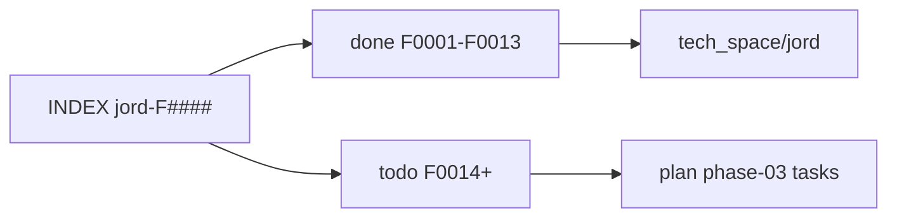

# feature_list / Jord

> Intent for Jord + Studio. **Feature ids:** [[INDEX]] (`jord-F0001`…). Brain: [[../../brain/00-Docs-Brain]]. As-built: [[../../tech_space/jord/README]]. Plans: [[../../plan/Jord/README]]. Status: [[../../report/STATUS]].

## Layout

| Folder | Role | Open |
|--------|------|------|
| [[INDEX]] | Stable `jord-F####` table | Cite IDs from plan / tech_space |
| [[done/README\|done/]] | Shipped `jord-F0001`…`F0013` | [[done/jord-F0013-production-ops]] |
| [[todo/README\|todo/]] | Open `jord-F0014`… | [[todo/jord-F0014-typed-dx]] · tasks [[../../plan/Jord/phase-03/README]] |

## Gate

1. ~~Phase-01 / 02 / 02.5 / 02.75~~ — closed or accepted.
2. **Phase-03** — implement plan tasks under parent feature **jord-F0014+** ([[../../plan/Jord/phase-03/README]]); wave A / **jord-F0013** closed.
3. Apps stay Apolyx-first.

## Studio v2 intent (added 2026-10-28)

`jord-F0021`…`jord-F0030` describe the next Studio generation: multi-project provisioning + dashboard · three-pane shell with schema picker, ordered table sidebar and workspace tabs · richer columns/relations · Apolyx DataGrid tables workspace · app-facing realtime · ERD canvas · SQL editor v2 · per-bucket storage providers · Supabase-style auth console. Index: [[INDEX|INDEX]]. No plan cards yet — split into phase-04 one-file tasks when scheduled.
