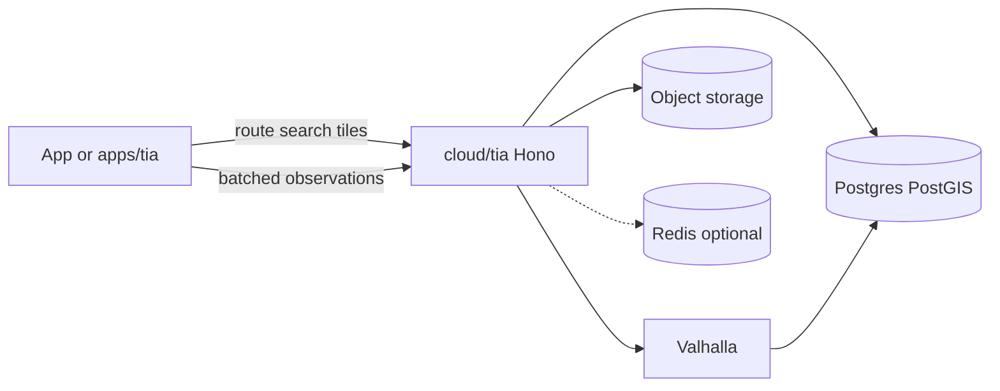
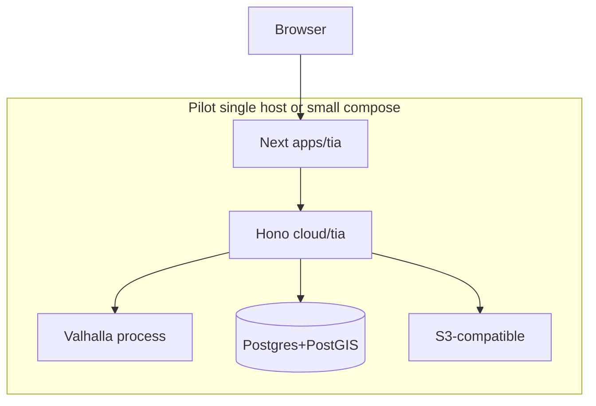

# Tia — architecture

> Index: [[README]]. Product: [[00-intent]]. Jord: [[../Jord/done/overview]] · [[../Jord/done/dialects]] · [[../Jord/todo/05-phase-03-candidates]].

## Actual repository integration points (**Verified repo** 2026-10-19)

| Surface | Path today | Tia use |
|---------|------------|---------|
| UI kit | `elements/ui-kit` (`@altr/apolyx`) | Chrome around map: sheets, inputs, buttons — not the GL map core |
| Docs app pattern | `apps/apolyx` | Pattern reference for a future `apps/tia` |
| Shared utils | `elements/base` | Env/errors helpers only; **no** geographic types |
| Cloud | `cloud/pocketbase` only | Unused by Tia; not Jord |
| Jord packages | Missing | **Blocker** for “Jord-managed DB” until Jord-S0001+ Postgres path exist |
| Removed samples | Former `cloud/hono-server`, trading apps | Do not cite as live APIs |

Stack narrative: [[../../Altr.lab/stack]].

## Tia versus Jord responsibility matrix

| Concern | Owner | Status |
|---------|-------|--------|
| `JordDriverPort`, adapters, connection URL selection | Jord | Slice 0 = libSQL only (**intent**); Postgres adapter **later** |
| PostGIS types, spatial indexes, road geometries | **Tia schemas** on Postgres | **Proposed**; PostGIS not in Jord docs |
| Provisioning / naming a **dedicated** DB instance for Tia | Jord (when multi-DB / Postgres exists) | **Proposed** product rule; **Unresolved** mechanization |
| Jobs, retries, ack, replay, DLQ, backpressure | Jord later pillars / Studio S5 | **Deferred** — not available |
| CDC / SSE / WebSocket fan-out infrastructure | Jord later ([[../Jord/todo/05-phase-03-candidates]]) | **Deferred** |
| Redis-compatible ephemeral store | Jord “Cache” later row | **Deferred**; Tia may introduce a Redis URL as **Proposed** interim |
| Object storage (traces, tiles, graphs) | Jord blob pillar later **or** Tia-configured S3-compatible | **Proposed** env for Tia until Jord blobs exist |
| Routing engine (Valhalla), map matching, traffic ML | **Tia** | **Proposed** |
| MapLibre styles, Persian labels, offline packs | **Tia** | **Proposed** |
| Auth product identity | App / future shared auth | **Unresolved**; Tia authorizes trip/location access on top |

**Rule:** keep Tia-specific geographic logic out of Jord and `@altr/base`.

## Explicit Jord capability verification

Inspection date: **2026-10-19**. Sources: filesystem (`elements/jord`, `cloud/jord` absent) + Docs `feature_list/Jord/*`.

| Capability | In Slice 0 intent? | In later docs? | In code? | Tia implication |
|------------|--------------------|----------------|----------|-----------------|
| libSQL file `data/jord.db` | Yes | — | No | Unsuitable as Tia primary spatial DB |
| `PostgresAdapter` | Seam only | Yes | No | Required for PostGIS path — **Unresolved** timeline |
| PostGIS extension | **Not mentioned** | No | No | **Unresolved** — must be added to Jord Postgres plan or run as Tia-owned Postgres with PostGIS |
| Jobs / cron | No | Studio S5 | No | Tia Phase 0–2: in-process timers or external cron **Proposed** interim |
| Retries / ack / replay / DLQ / backpressure | No | Not specified | No | Design in Tia ingest **Proposed**; migrate to Jord jobs when real |
| WebSocket / SSE | No | CDC realtime later | No | Batched HTTP first; WS/SSE **Proposed** on `cloud/tia` or later Jord |
| Redis | No | Cache later | No | Optional ephemeral store **Proposed** |
| Blob / object storage | No | Local blob pillar later | No | S3-compatible URL **Proposed** for Tia |

**Do not claim** Jord already provides PostGIS, jobs, or WebSockets.

## Minimal initial deployment (**Proposed**)

One small deployable unit, package boundaries ≠ microservices:

```text
[apps/tia] ──HTTP──► [cloud/tia]
                         │
                         ├── Postgres+PostGIS (dedicated; Jord-managed when possible)
                         ├── Valhalla (sidecar or same host)
                         ├── Object storage (tiles, graphs, raw traces)
                         └── Redis-compatible (optional; traffic hot state)
```

Later scaling options (**Deferred**): separate tile CDN, Valhalla replicas, partition traffic tables, Jord-owned WS gateway, dedicated matching workers.

## Data-flow (pilot)



Durable ingestion path writes observations to Postgres (and archives to object storage) **independently** of any WebSocket fan-out (**Proposed**).

## Deployment sketch



## Proposed interfaces (clearly labeled **Proposed**)

```ts
// @altr/tia-contracts — Proposed sketches, not shipped

/** WGS84 GeoJSON position: [longitude, latitude] */
export type LonLat = [number, number];

export interface RoutingProvider {
  route(req: RouteRequest): Promise<RouteResponse>;
  /** Optional; may throw UnsupportedError */
  matrix?(req: MatrixRequest): Promise<MatrixResponse>;
}

export interface RouteRequest {
  origin: LonLat;
  destination: LonLat;
  waypoints?: LonLat[];
  graphVersion: string;
  trafficVersion?: string | null;
  costing: "auto" | "motorcycle" | "pedestrian" | "bicycle";
}

export interface TrafficPublisher {
  /** Publish versioned speeds into the routing engine */
  publish(input: {
    trafficVersion: string;
    graphVersion: string;
    edges: Array<{ edgeId: string; speedKph: number; confidence: number }>;
  }): Promise<void>;
}

export interface ObservationIngest {
  /** Idempotent batch; clientDedupKey required */
  ingestBatch(batch: LocationObservationBatch): Promise<{ accepted: number; rejected: number }>;
}
```

Valhalla is the **initial** `RoutingProvider` implementation candidate. Neshan (or others) may implement the same interface for A/B only — never as the sole durable graph source.

## Links

- Schemas: [[03-schemas]] · Realtime: [[08-realtime-infra]] · ADRs: [[12-adrs]]
