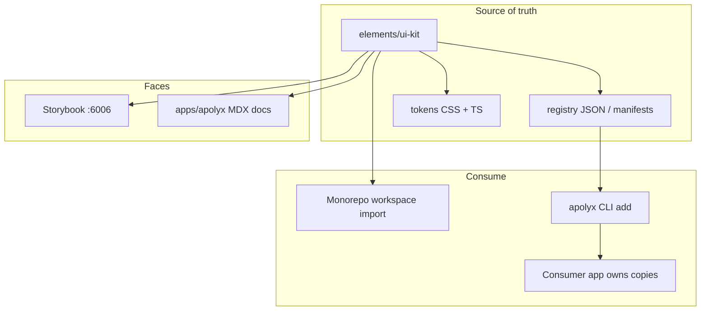

# Apolyx UI kit — intent

> Who: anyone planning or building the design system. This is **intent**, not as-built. Code truth still wins for what already exists in `elements/ui-kit`.

Promoted from [[../../idea/Apolyx (ui-kit)/2026-10-10-apolyx-portable-ui-kit]].

## Why

Reuse one high-quality UI system across altr.lab apps and outside projects, with:

- **Ownable source** via CLI (shadcn / Smooth UI model)
- **Custom tokens + themes** (light / dark / variants)
- **Motion + charts** in the same kit
- **Docs** that feel as clean as shadcn’s site
- **No Radix / Base UI** — Apolyx primitives we control

Developers should restyle and compose through tokens, variants, and composition props without touching kit source when consuming as a package; when they `apolyx add`, the file lives in their app and they own it.

## Product name

**Apolyx** — candidate name chosen 2026-10-11. A blend of *Apollo* (Greek god of music, poetry, art and light) with a crisp *-yx* ending. Replaces the earlier working name "Helix", which another UI kit already uses.

`apolyx.com`, `apolyx.dev`, `apolyx.app` and the npm name `apolyx` were all unregistered on 2026-10-11. Register them before going public. Domain checks and the other candidates are in [[../../idea/Apolyx (ui-kit)/2026-10-11-naming-and-domains]].

| Surface | Location |
|---------|----------|
| Kit source / registry | folder `elements/ui-kit` · package `@altr/apolyx` (renamed from `@altr/ui-kit`, see "Package name — decided") |
| Public docs app | `apps/apolyx` (Next.js + MDX) |
| Component workshop | Storybook (existing on ui-kit) |
| CLI | `elements/apolyx-cli` · npm `apolyx` · `npx apolyx add <component>` |
| Component prefix (optional) | `Ap` — e.g. `<ApButton />` |

### Package name — decided: folder `ui-kit`, package `@altr/apolyx`

The folder says **what** it is; the package name says **which brand** it is.

- **Folder stays `elements/ui-kit`.** Anyone browsing the monorepo sees at once that it is the UI kit, next to `elements/base`. Folder names describe roles; the brand can change without moving files.
- **Package becomes `@altr/apolyx`.** Imports read `import { Button } from "@altr/apolyx"`, and the `@altr` scope matches every other workspace package.
- **Make the role detectable in metadata too:** `package.json` gets `"description": "Apolyx — altr.lab UI kit"` and `"keywords": ["ui-kit", "design-system"]`, and the kit README starts with "Apolyx UI kit".
- **Stays private.** The kit is never published under `@altr`; outside users get its code through the `apolyx` CLI. If the kit is ever published as an installable package, use a brand scope (e.g. `@apolyx/react`), not the personal `@altr` scope.

Migration cost: about 30 files reference `@altr/ui-kit` today (app `package.json` deps, `next.config.ts` `transpilePackages`, `globals.css` imports, layout/page imports, READMEs). It is a mechanical find-and-replace; do it as one task in the first sprint, not mixed with feature work.

### Themes — decided: 3 families × light/dark

Every **theme family** ships with both **light** and **dark** modes. v1 families:

| Family (product name) | Token id | Intent |
|-----------------------|----------|--------|
| **Default** | `default` | Neutral Apolyx baseline (current kit light/dark evolved) |
| **PowerBlue** | `power-blue` | Strong blue accent / energy — brandable “power” look |
| **PowerGreen** | `power-green` | Strong green accent — sibling to PowerBlue |

That is **6 palettes** at v1: `default`×light/dark, `power-blue`×light/dark, `power-green`×light/dark.

#### How it works (intent)

- **Two axes, not one:** `theme` (family) and `mode` (light | dark). Do not invent six separate theme names like `powerBlueDark` as the only API.
- **DOM contract:** `data-theme="default" | "power-blue" | "power-green"` on `<html>` (or provider root) plus existing `.dark` class (or `data-mode="dark"`) for mode. Prefer keeping `.dark` if next-themes (or successor) stays for mode.
- **CSS:** each family defines the same semantic tokens (`--background`, `--primary`, `--chart-*`, …) for light and for dark. Components only use semantics — never hard-code PowerBlue hex in Button.
- **Provider API (sketch):** `theme="power-blue"` + `mode="dark" | "light" | "system"` (system only affects mode, not family).
- **Docs / Storybook:** switcher for both family and mode so all six combinations are demoable.
- **Later themes** (e.g. trading) can add another family with its own light/dark without changing component APIs.

Exact OKLCH / HSL values for PowerBlue and PowerGreen are implementation detail for plan / tech_space — not locked here.

### Consume path — decided: workspace import in monorepo, CLI outside

**What this question meant:** there are two ways to use Apolyx.

| Who | How they get components | Why |
|-----|-------------------------|-----|
| **altr.lab apps** (`apps/apolyx` today; future product apps the same way) | Workspace package: `import { Button } from "@altr/apolyx"` | One shared source in `elements/ui-kit`; fix a bug once, every app picks it up via pnpm workspace |
| **Other projects / publish users** | CLI: `npx apolyx add button` (copy files into *their* repo) | They own the source; no dependency on your private monorepo package |

You keep monorepo apps on **workspace import**. You do **not** run `apolyx add` inside an altr.lab app just to use the kit — that would duplicate copies and fight the monorepo.

Optional later: an altr.lab app *may* still use the CLI for a one-off experiment, but the default and supported path is workspace import.

## Goals

1. Treat `elements/ui-kit` as the **canonical registry** of components, tokens, motion, and charts.
2. Ship a **CLI** that installs a component (and deps) into a target project — copy source, not a black-box npm-only API.
3. Ship **`apps/apolyx`** — clean docs shell + MDX per component (API, variants, a11y, copy-paste / CLI usage).
4. Keep **Storybook** for isolated workshop + a11y addon.
5. Build **Apolyx primitives** (focus, overlay, portal, dismissable, listbox patterns as needed) — **no Radix, no Base UI**.
6. **Custom CSS tokens** (Tailwind v4 `@theme` / variables) with light, dark, and named theme variants.
7. First-class **Motion** recipes and **chart** components installable like buttons.
8. APIs aimed at max utility: `cva` variants, token overrides, `asChild`/slot-equivalent we own, composition — customize without forking the registry.

## Out of scope (this intent phase)

- Full component catalog (only the first wave below)
- npm publish / public registry hosting (design for it; ship later)
- Migrating every monorepo app off workspace imports
- Sprint task breakdown → lives in [[../../plan/ui-kit/README]]
- Replacing Storybook with the docs app (both stay)

## Infrastructure we need

| Piece | Purpose |
|-------|---------|
| `elements/ui-kit` | Components, primitives, tokens, motion, charts, Storybook |
| Registry manifests | shadcn-like `registry` entries (file list, deps, docs slug) |
| CLI package | `init` (tokens + config) · `add <name>` · later `diff` / `update` |
| `apps/apolyx` | Marketing + MDX docs (layout like shadcn: nav, component page, preview, code) |
| Turbo scripts | `dev` docs, Storybook, typecheck kit, optional registry build |
| Theme contract | `data-theme` (family) + `.dark` / light (mode) — see "Themes — decided" |
| A11y helpers | Shared focus-trap / id / keyboard utils **inside** Apolyx (not Radix) |

### Docs app expectations (`apps/apolyx`)

- Clean, content-first UI (shadcn docs energy — not a dashboard)
- MDX for each component: overview, anatomy, variants, tokens used, a11y notes, CLI install line
- Live previews (import from `@altr/apolyx` in monorepo)
- Theme switcher: theme family (`default` / `power-blue` / `power-green`) × light / dark
- Later: search, changelog, “blocks” / recipes

### CLI expectations (first useful slice)

- `apolyx init` — write config, pull base tokens/globals, set paths (e.g. `components/ui`)
- `apolyx add button` — copy files from registry + ensure peer deps listed
- Works against monorepo registry path first; remote URL later for publish

### CLI location — decided: `elements/apolyx-cli`

The CLI is its own workspace package, published to npm as `apolyx` (so `npx apolyx add button` works). It does **not** live as a `bin` inside `elements/ui-kit`.

| Package | Owns | Runtime | Published |
|---------|------|---------|-----------|
| `elements/ui-kit` | Component source, tokens, registry manifests, Storybook | Browser / React | No — it is the source that gets copied |
| `elements/apolyx-cli` | `init`, `add`, later `diff` / `update` | Node | Yes — npm `apolyx` |
| `apps/apolyx` | Docs site; serves the built registry JSON (e.g. `/r/button.json`) | Next.js | Deployed site |

Why a separate package:

1. **Different runtime.** The kit is React code for the browser; the CLI is a Node program (file system, prompts, network, package-manager detection). Mixing them puts Node-only dependencies next to UI code.
2. **Clean dependencies.** CLI deps (argument parser, prompts, file diffing) never reach apps that import `@altr/apolyx`, and kit deps (React, Motion) never bloat the CLI install.
3. **What actually gets published.** Users install the CLI, not the kit. The kit reaches them as copied source, so it can stay private while only the CLI goes to npm with its own version.
4. **Different build.** The kit exports raw TypeScript to the monorepo; the CLI needs a bundled, executable Node build. Separate packages keep both build setups simple.
5. **Proven layout.** shadcn/ui does the same: the CLI package is separate from the registry and docs site.

How they connect:

- A registry build script in `elements/ui-kit` turns component files + manifests into JSON (file contents, npm dependencies, other registry items needed).
- During development the CLI reads that JSON from the local path; after publishing it fetches it from the docs site URL.
- The CLI never imports kit code directly, so the two can be released independently.

### Customization without touching kit source

| Mechanism                   | Use                                               |
| --------------------------- | ------------------------------------------------- |
| CSS tokens / theme variants | Color, radius, type, motion duration globally     |
| CVA / variant props         | Per-instance look without fork                    |
| Composition                 | Wrap / slot children; prefer props over CSS hacks |
| CLI-owned copies            | Edit installed files in the consumer app          |
| Optional className + `cn`   | Escape hatch on every public component            |

## Tech choices (intent)

| Area | Choice | Notes |
|------|--------|-------|
| Framework target | React 19 | Peer dep; Next.js apps first |
| Styling | Tailwind CSS v4 | `@theme` + CSS variables in kit globals |
| Tokens | Custom Apolyx tokens | Semantic (background, foreground, primary, …) + theme variants; OKLCH preferred for new palette work |
| Variants | `class-variance-authority` + `tailwind-merge` / `clsx` | Keep if useful; no Radix |
| Primitives | **Apolyx-owned** | Replace `@radix-ui/react-slot` and any future Radix; build Slot/Focus/Portal ourselves |
| Icons | `lucide-react` (or swap later) | Tree-shakeable; not a hard forever choice |
| Motion | `motion` (`motion/react`) | Primitives + recipes; `prefers-reduced-motion` |
| Theming | CSS vars + provider | **3 themes × light/dark** — see "Themes — decided" |
| Charts | **Apolyx SVG chrome + visx math** | Own look/API; no Recharts. See "Chart engine — decided" |
| Docs app | Next.js App Router + MDX | `apps/apolyx` |
| Workshop | Storybook 9 (existing) | Keep stories next to components |
| Package manager / mono | pnpm + Turborepo | Existing |
| Registry format | JSON manifests co-located with kit | Compatible *spirit* with shadcn registry; Apolyx-branded schema OK |
| A11y | Manual + Storybook a11y | WCAG-minded primitives from day one |
| Explicitly **not** | Radix UI, Base UI, full Material/Ant clones | |

### Migration note from current code

Existing `@altr/ui-kit` uses `@radix-ui/react-slot` on Button. Apolyx intent: **remove Radix** and ship an internal `Slot` (or drop `asChild` until our Slot exists). Tracked as acceptance for the first primitive wave — implementation detail lands in plan + tech_space later.

## First component wave (simple + foundational)

Ship small, useful, documentable. Order is suggested dependency order.

### Foundations (infra-adjacent)

| Item | Role |
|------|------|
| Tokens + `globals.css` | Themes: `default`, `power-blue`, `power-green` × light/dark |
| `cn` + theme provider / toggle | Mode + theme family switcher |
| `Slot` (Apolyx) | Composition without Radix |
| Motion tokens + `FadeIn` / `Stagger` | Motion baseline |

### Primitives / UI (wave 1)

| Component | Notes |
|-----------|-------|
| Button | Variants + sizes; Apolyx Slot |
| Text / Heading | Type scale tied to tokens |
| Label | Form pairing |
| Input | Text field |
| Textarea | Multi-line |
| Checkbox | Own primitive |
| Switch | Own primitive |
| Card | Surface layout |
| Badge | Status / meta |
| Avatar | Image + fallback |
| Separator | Divider |
| Spinner / Skeleton | Loading |
| Alert | Inline feedback |
| Kbd | Docs / shortcut display |

### Overlay / navigation (wave 1b — after focus helpers)

| Component | Notes |
|-----------|-------|
| Dialog / Modal | Focus trap + dismiss |
| Dropdown Menu | Keyboard nav |
| Tabs | Roving tabindex |
| Tooltip | Delay + portal |
| Toast / Sonner-like | Queue API |

### Wave 2 — Apolyx-S0002

Hover-contrast tokens, navigation (Sheet, Breadcrumb, NavigationMenu, NavList, Dialog sizes), physics Switch, `Field` layouts, and Table / List / Grid. Intent and acceptance: [[02-apolyx-s0002-wave]].

### Wave 3 — Apolyx-S0003

Switch motion fix and Switch family (`SwitchField`, `SwitchCard`, `FieldSet`), the input catalog (`Input` variants, Field extras, `InputGroup`, `PasswordInput`, `NumberInput`, `InputOTP`, `MaskedInput`), form patterns, and a Forms docs group. Intent and acceptance: [[04-apolyx-s0003-switch-inputs]].

### Motion recipes (wave 1)

| Recipe | Notes |
|--------|-------|
| FadeIn | Exists — tokenize |
| StaggerChildren | Lists / grids |
| Pressable / HoverLift | Micro-interaction helpers |

### Charts (wave 1 — minimal)

| Chart | Notes |
|-------|-------|
| LineChart | Apolyx SVG paths / markers; scales via visx |
| BarChart | Same |
| ChartContainer / tooltip | Shared chrome; tokens + Motion; kit-owned tooltip UI |

Defer complex viz (candles, maps, 10k+ point series) until later feature notes. Canvas / ECharts only if a product (e.g. trading) needs dense real-time series.

### Chart engine — decided: Apolyx SVG + visx (not pure-from-scratch, not Recharts)

Goal: **unique taste and full customization**, same spirit as owning UI primitives (no Radix). Charts must look and feel like Apolyx, not like a default dashboard kit.

Nothing in the monorepo uses a chart library today — greenfield choice.

#### Options considered

| Option | What it is | Uniqueness | Cost | Verdict for Apolyx |
|--------|------------|------------|------|--------------------|
| **Pure SVG, no deps** | Hand-write scales, axes, hit-testing, responsive layout | Max | Very high — reinvent D3 math, not "taste" | Reject for v1 |
| **Recharts** (shadcn / Tremor default) | High-level `<LineChart>` components | Low — same silhouette as every shadcn chart unless you fight the API | Low to ship, high to make unique | Reject as primary engine |
| **Nivo / Victory / Unovis** | Opinionated chart systems | Medium — their visual language shows through | Medium | Reject for v1 (wrong brand surface) |
| **ECharts / Chart.js** | Canvas-heavy, config-driven | Low for kit branding | Good for huge datasets | Defer until a product needs density |
| **visx** (`@visx/scale`, shapes, axis helpers) | Low-level React + D3 math; you compose the chart | High — you own every path, label, motion | Medium; hides d3 DOM | **Chosen** |
| **d3 only** | Same math, more imperative | High | Similar to visx, worse React fit | Prefer visx |

#### Decision

1. **Public API is 100% Apolyx** — `LineChart`, `BarChart`, `ChartContainer`, tooltip, legend. Consumers never import Recharts/visx in app code; CLI installs Apolyx chart files that may depend on listed `@visx/*` packages.
2. **Drawing and chrome are ours (SVG)** — strokes, fills, grid, markers, labels, empty states, Motion enter/hover — all token-driven (`--chart-1`…, radius, type). This is where unique taste lives.
3. **Math is visx** — scales, nice ticks, path helpers, optional brush/zoom primitives. That is not taste; reinventing it is a time sink and a bug farm.
4. **Not Recharts** — it is the shadcn chart engine. Using it would make Apolyx charts look interchangeable with half the open-source dashboards and fight customization at the high-level component boundary.
5. **Not "pure SVG with zero deps" for v1** — "pure" presentation yes; "pure" including hand-rolled linear/time scales and axis layout no. If a later chart needs zero deps for some reason, we can drop visx for that file only.

#### How CLI install works

- `apolyx add line-chart` copies Apolyx chart components + installs only the `@visx/*` packages that chart lists (tree-shakeable; not the whole D3 zoo).
- Chart styles come from Apolyx tokens / theme variants, not from the engine's default theme.

#### When to revisit

- If visx packages feel too heavy for a one-off sparkline → allow a tiny pure-SVG sparkline variant with no engine.

#### Trading charts — path note (not v1)

**Current Apolyx path (SVG + visx) is enough for product/analytics charts** in hub, dashboard, docs, and most trading *UI chrome*: PnL curves, equity over time, small bar/line summaries, sparklines. It is **not** enough for a full trading terminal chart (thousands of candles, live ticks, crosshair, volume pane, zoom/pan history).

For that later product need:

| Approach | Verdict |
|----------|---------|
| Keep building on SVG + visx only | Unnecessary pain — DOM/SVG will choke on dense OHLC + realtime updates |
| **Chart.js** | Skip for trading — not a financial-chart specialist |
| **ECharts** | Optional fallback (has candlesticks) but general-purpose, heavier API, less “trading terminal” UX |
| **TradingView Lightweight Charts** (or similar canvas OHLC lib) | Preferred when Artemis / `trading-ui` needs a real market chart — purpose-built for candles + performance |
| Hand-roll Canvas OHLC from scratch | Only if Lightweight Charts (or peer) cannot meet uniqueness; high cost |

**Intent:** do **not** add ECharts or Chart.js to Apolyx v1. When trading needs a candle chart, add a separate Apolyx chart component (e.g. `CandlestickChart`) that wraps a **canvas OHLC engine** behind the same Apolyx API / tokens / chrome — same pattern as visx for Line/Bar, different engine under the hood. Uniqueness stays in Apolyx styling and composition; the engine only paints high-density series.

## Acceptance criteria (definition of “intent ready to plan”)

This feature_list note is enough to open a sprint when we can check:

- [x] Product name + surfaces agreed (Apolyx / `elements/ui-kit` / `apps/apolyx` / CLI)
- [x] Infra pieces listed (registry, CLI, docs, Storybook, tokens)
- [x] Tech stack locked at intent level (incl. no Radix/Base UI)
- [x] First component + chart + motion wave listed
- [x] Sprint task cards → [[../../plan/ui-kit/README]] (opened 2026-10-11)

## Acceptance criteria (later — when Apolyx v1 infra ships)

Use these when implementing; verify in code + tech_space:

- [x] Apolyx `Slot` (or equivalent) — zero Radix / Base UI deps in ui-kit — **Apolyx-S0001**
- [x] Token file(s) for `default` / `power-blue` / `power-green` × light/dark; docs + Storybook switch both axes — **Apolyx-S0001**
- [x] Registry manifest + `apolyx add` for at least Button (and deps) — **Apolyx-S0001** (51 items; external smoke)
- [x] `apps/apolyx` serves MDX page for Button (and index of wave-1 components) — **Apolyx-S0001**
- [x] Storybook still runs for the same components — **Apolyx-S0001**
- [x] Motion recipe + one chart installable / documented — **Apolyx-S0001**
- [x] Customization story documented: tokens + variants + CLI-owned edits — **Apolyx-S0001** (`/docs/theming`)

## Packages touched (when we build)

- `elements/ui-kit` — source, registry, Storybook, tokens; package renamed `@altr/ui-kit` → `@altr/apolyx`
- `apps/apolyx` — docs app (the sample Next apps that also imported the kit were removed 2026-10-18)
- `elements/apolyx-cli` — CLI package, published as `apolyx` (see "CLI location — decided")

## Open questions

1. ~~Public npm name vs keep `@altr/ui-kit` forever?~~ **Decided:** folder `elements/ui-kit`, package `@altr/apolyx` (private). See "Package name — decided".
2. ~~Chart engine: pure SVG vs wrap a small lib?~~ **Decided:** Apolyx-owned SVG chrome + **visx** for math; **not** Recharts; not zero-dep pure SVG for scales/axes. See "Chart engine — decided".
3. ~~How many theme variants at v1 beyond light/dark?~~ **Decided:** three families — **default**, **powerBlue**, **powerGreen** — each with light + dark (6 palettes). See "Themes — decided".
4. ~~Do monorepo apps stay on workspace import while external users use CLI only?~~ **Decided:** yes — altr.lab apps keep `import … from "@altr/apolyx"` (workspace). External / other projects use the `apolyx` CLI. See "Consume path — decided".

## Links

- Idea: [[../../idea/Apolyx (ui-kit)/2026-10-10-apolyx-portable-ui-kit]]
- Index: [[README]]
- Builder agent: [[../../agents/apollo/00-index]] · prompts: [[../../agents/apollo/prompts/00-build-apolyx]]
- Prior foundation: [[../01-hub-ui-kit-base]] · [[../02-ui-kit-storybook]]
- Code today: `elements/ui-kit`
- Plan (sprint track): [[../../plan/ui-kit/README]]
- Wave 2: [[02-apolyx-s0002-wave]]
