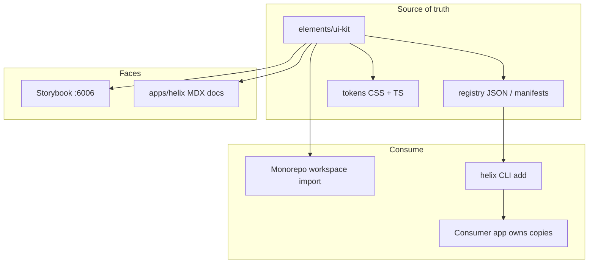

# Helix UI kit — intent

> Who: anyone planning or building the design system. This is **intent**, not as-built. Code truth still wins for what already exists in `elements/ui-kit`.

Promoted from [[../../idea/ui-kit/2026-10-10-helix-portable-ui-kit]].

## Why

Reuse one high-quality UI system across altr.lab apps and outside projects, with:

- **Ownable source** via CLI (shadcn / Smooth UI model)
- **Custom tokens + themes** (light / dark / variants)
- **Motion + charts** in the same kit
- **Docs** that feel as clean as shadcn’s site
- **No Radix / Base UI** — Helix primitives we control

Developers should restyle and compose through tokens, variants, and composition props without touching kit source when consuming as a package; when they `helix add`, the file lives in their app and they own it.

## Product name

**Helix**

| Surface | Location |
|---------|----------|
| Kit source / registry | `elements/ui-kit` · package `@altr/ui-kit` |
| Public docs app | `apps/helix` (Next.js + MDX) |
| Component workshop | Storybook (existing on ui-kit) |
| CLI | `helix` / `@altr/helix` (name final at plan time) |

## Goals

1. Treat `elements/ui-kit` as the **canonical registry** of components, tokens, motion, and charts.
2. Ship a **CLI** that installs a component (and deps) into a target project — copy source, not a black-box npm-only API.
3. Ship **`apps/helix`** — clean docs shell + MDX per component (API, variants, a11y, copy-paste / CLI usage).
4. Keep **Storybook** for isolated workshop + a11y addon.
5. Build **Helix primitives** (focus, overlay, portal, dismissable, listbox patterns as needed) — **no Radix, no Base UI**.
6. **Custom CSS tokens** (Tailwind v4 `@theme` / variables) with light, dark, and named theme variants.
7. First-class **Motion** recipes and **chart** components installable like buttons.
8. APIs aimed at max utility: `cva` variants, token overrides, `asChild`/slot-equivalent we own, composition — customize without forking the registry.

## Out of scope (this intent phase)

- Full component catalog (only the first wave below)
- npm publish / public registry hosting (design for it; ship later)
- Migrating every monorepo app off workspace imports
- Sprint task breakdown → that goes in `Docs/plan/ui-kit/` when we build
- Replacing Storybook with the docs app (both stay)

## Infrastructure we need

| Piece | Purpose |
|-------|---------|
| `elements/ui-kit` | Components, primitives, tokens, motion, charts, Storybook |
| Registry manifests | shadcn-like `registry` entries (file list, deps, docs slug) |
| CLI package | `init` (tokens + config) · `add <name>` · later `diff` / `update` |
| `apps/helix` | Marketing + MDX docs (layout like shadcn: nav, component page, preview, code) |
| Turbo scripts | `dev` docs, Storybook, typecheck kit, optional registry build |
| Theme contract | CSS variables + class/data attribute for light/dark/variant themes |
| A11y helpers | Shared focus-trap / id / keyboard utils **inside** Helix (not Radix) |

### Docs app expectations (`apps/helix`)

- Clean, content-first UI (shadcn docs energy — not a dashboard)
- MDX for each component: overview, anatomy, variants, tokens used, a11y notes, CLI install line
- Live previews (import from `@altr/ui-kit` in monorepo)
- Theme switcher demonstrating light / dark / extra variants
- Later: search, changelog, “blocks” / recipes

### CLI expectations (first useful slice)

- `helix init` — write config, pull base tokens/globals, set paths (e.g. `components/ui`)
- `helix add button` — copy files from registry + ensure peer deps listed
- Works against monorepo registry path first; remote URL later for publish

### Customization without touching kit source

| Mechanism | Use |
|-----------|-----|
| CSS tokens / theme variants | Color, radius, type, motion duration globally |
| CVA / variant props | Per-instance look without fork |
| Composition | Wrap / slot children; prefer props over CSS hacks |
| CLI-owned copies | Edit installed files in the consumer app |
| Optional className + `cn` | Escape hatch on every public component |

## Tech choices (intent)

| Area | Choice | Notes |
|------|--------|-------|
| Framework target | React 19 | Peer dep; Next.js apps first |
| Styling | Tailwind CSS v4 | `@theme` + CSS variables in kit globals |
| Tokens | Custom Helix tokens | Semantic (background, foreground, primary, …) + theme variants; OKLCH preferred for new palette work |
| Variants | `class-variance-authority` + `tailwind-merge` / `clsx` | Keep if useful; no Radix |
| Primitives | **Helix-owned** | Replace `@radix-ui/react-slot` and any future Radix; build Slot/Focus/Portal ourselves |
| Icons | `lucide-react` (or swap later) | Tree-shakeable; not a hard forever choice |
| Motion | `motion` (`motion/react`) | Primitives + recipes; `prefers-reduced-motion` |
| Theming | CSS vars + provider | Extend beyond next-themes if we need multi-variant themes |
| Charts | Helix chart components | SVG-first simple charts in v1; engine decision at plan/tech_space |
| Docs app | Next.js App Router + MDX | `apps/helix` |
| Workshop | Storybook 9 (existing) | Keep stories next to components |
| Package manager / mono | pnpm + Turborepo | Existing |
| Registry format | JSON manifests co-located with kit | Compatible *spirit* with shadcn registry; Helix-branded schema OK |
| A11y | Manual + Storybook a11y | WCAG-minded primitives from day one |
| Explicitly **not** | Radix UI, Base UI, full Material/Ant clones | |

### Migration note from current code

Existing `@altr/ui-kit` uses `@radix-ui/react-slot` on Button. Helix intent: **remove Radix** and ship an internal `Slot` (or drop `asChild` until our Slot exists). Tracked as acceptance for the first primitive wave — implementation detail lands in plan + tech_space later.

## First component wave (simple + foundational)

Ship small, useful, documentable. Order is suggested dependency order.

### Foundations (infra-adjacent)

| Item | Role |
|------|------|
| Tokens + `globals.css` | Light / dark / at least one extra theme variant |
| `cn` + theme provider / toggle | Already started — extend for variants |
| `Slot` (Helix) | Composition without Radix |
| Motion tokens + `FadeIn` / `Stagger` | Motion baseline |

### Primitives / UI (wave 1)

| Component | Notes |
|-----------|-------|
| Button | Variants + sizes; Helix Slot |
| Text / Heading | Type scale tied to tokens |
| Label | Form pairing |
| Input | Text field |
| Textarea | Multi-line |
| Checkbox | Own primitive |
| Switch | Own primitive |
| Card | Surface layout |
| Badge | Status / meta |
| Avatar | Image + fallback |
| Separator | Divider |
| Spinner / Skeleton | Loading |
| Alert | Inline feedback |
| Kbd | Docs / shortcut display |

### Overlay / navigation (wave 1b — after focus helpers)

| Component | Notes |
|-----------|-------|
| Dialog / Modal | Focus trap + dismiss |
| Dropdown Menu | Keyboard nav |
| Tabs | Roving tabindex |
| Tooltip | Delay + portal |
| Toast / Sonner-like | Queue API |

### Motion recipes (wave 1)

| Recipe | Notes |
|--------|-------|
| FadeIn | Exists — tokenize |
| StaggerChildren | Lists / grids |
| Pressable / HoverLift | Micro-interaction helpers |

### Charts (wave 1 — minimal)

| Chart | Notes |
|-------|-------|
| LineChart | Simple SVG, token colors |
| BarChart | Same |
| ChartContainer / tooltip | Shared chrome |

Defer complex viz (candles, maps) until later feature notes.

## Acceptance criteria (definition of “intent ready to plan”)

This feature_list note is enough to open a sprint when we can check:

- [x] Product name + surfaces agreed (Helix / `elements/ui-kit` / `apps/helix` / CLI)
- [x] Infra pieces listed (registry, CLI, docs, Storybook, tokens)
- [x] Tech stack locked at intent level (incl. no Radix/Base UI)
- [x] First component + chart + motion wave listed
- [ ] **Not done here:** sprint task cards → `Docs/plan/ui-kit/` next step after docs review

## Acceptance criteria (later — when Helix v1 infra ships)

Use these when implementing; verify in code + tech_space:

- [ ] Helix `Slot` (or equivalent) — zero Radix / Base UI deps in ui-kit
- [ ] Token file(s) with light, dark, ≥1 named variant; docs demonstrate switching
- [ ] Registry manifest + `helix add` for at least Button (and deps)
- [ ] `apps/helix` serves MDX page for Button (and index of wave-1 components)
- [ ] Storybook still runs for the same components
- [ ] Motion recipe + one chart installable / documented
- [ ] Customization story documented: tokens + variants + CLI-owned edits

## Packages touched (when we build)

- `elements/ui-kit` — source, registry, Storybook, tokens
- `apps/helix` — new docs app
- CLI package location — decide in plan (`elements/ui-kit` bin vs `elements/helix-cli`)
- Consumers later: `apps/hub`, `apps/dashboard`, `apps/trading-ui` (optional migration)

## Open questions

1. Public npm name vs keep `@altr/ui-kit` forever and only brand the docs/CLI as Helix?
2. Chart engine: pure SVG vs wrap a small lib behind Helix API?
3. How many theme variants at v1 beyond light/dark?
4. Do monorepo apps stay on workspace import while external users use CLI only?

## Links

- Idea: [[../../idea/ui-kit/2026-10-10-helix-portable-ui-kit]]
- Index: [[README]]
- Prior foundation: [[../01-hub-ui-kit-base]] · [[../02-ui-kit-storybook]]
- Code today: `elements/ui-kit`
- Plan (not yet): `Docs/plan/ui-kit/` — create when sprint starts
