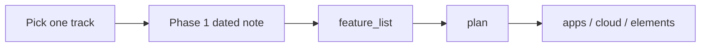

# altr.lab — product and ideas catalog (v2.1)

> Open this to choose which product to grow next. Each track has its own folder. These notes are exploratory until promoted into `feature_list/`.

Map: [[../brain/00-Docs-Brain]] · Inbox: [[README]]

**Pillars:** Artemis financial engine · Apolyx UI kit · AltrBase backend · high-leverage life systems.

Earlier brainstorm prompt (still useful, especially Artemis on Hyperliquid): [[2026-09-27-altr-lab-project-brief]]. This catalog is the current index. It does not retire that brief.

---

## Crown jewels

| # | Track | Folder | Vault stage |
|---|--------|--------|-------------|
| 1 | **Artemis Engine** — wealth terminal, copilot, risk guard | [[artemis/README]] | Captured. Code surfaces exist as scaffolds (`apps/trading-ui`, `cloud/ai-bot-agent`). |
| 2 | **Apolyx (ui-kit)** — architecture showcase and shared visual system | [[Apolyx (ui-kit)/README]] | Promoted 2026-10-11. Sprints S0001–S0003 closed. Residual growth: [[Apolyx (ui-kit)/2026-10-18-catalog-growth]]. |

## Foundation

| # | Track | Folder | Vault stage |
|---|--------|--------|-------------|
| 7 | **AltrBase / PolyBase** — self-hosted multi-engine BaaS (libSQL first, Postgres later) | [[altr-base/README]] | Captured. `@altr/base` db and auth are stubs. Stack decision stays in [[../Altr.lab/stack]] until this track is promoted. |

## Life systems

Tools aimed at fitness, people, cooking, and games, built with the same engineering stack as the crown jewels.

| # | Track | Life pillar | Folder | Vault stage |
|---|--------|-------------|--------|-------------|
| 3 | **HyperFit OS** — body and calorie ledger | Fitness | [[hyperfit/README]] | Captured |
| 4 | **Co-Op Sphere** — proof-of-effort matchmaking | Partner and network | [[co-op-sphere/README]] | Captured |
| 5 | **PantryYield** — fridge inventory and macro cooking | Cooking | [[pantry-yield/README]] | Captured |
| 6 | **ForgeRealm / CardCraft** — merge-and-craft card game | Games and digital economy | [[forge-realm/README]] | Captured |

Adjacent draft, separate from Co-Op Sphere: [[draft/2026-10-17-p2p-social-messenger]] (offline-first encrypted messenger). It stays in `draft/` until you give it a track folder.

---

## Potential and feasibility

Figures below are catalog hypotheses from 2026-10-18, for choosing a track. They are not estimates locked in `plan/`.

| Project | Target priority | Stack synergy | Monetization hypothesis | MVP feel |
| :--- | :--- | :--- | :--- | :--- |
| Artemis | Wealth / trading | Core (`trading-ui`, `ai-bot-agent`, Hono, Turso) | Pro subscription, bot licensing, own trading | Already scaffolded; product still greenfield |
| Apolyx | Developer brand | Core (`elements/ui-kit`, `apps/apolyx`) | Sponsorship, consulting, premium themes | Continuous; kit already shipping |
| HyperFit OS | Fitness and routine | Hono, Turso, Apolyx | B2C subscription, Telegram bot SaaS | Shortest new product |
| Co-Op Sphere | Partner and network | Next.js, auth | Verification badges, deal escrow fees | Needs identity and trust before chat |
| PantryYield | Cooking | Hono, AI, Turso | Micro-SaaS for fitness meal-preppers | Small inventory loop |
| ForgeRealm | Games | React, motion, Hono, Turso | Skins, craft tools, faster merge timers | Phase 1 is inventory and merge only |
| AltrBase / PolyBase | Developer infrastructure | Core (`hono-server`, `@altr/base`, `dashboard`) | Open-core self-host, hosted projects later | First slice is a libSQL client that executes plus one studio table |

---

## How a track grows

Every new product uses the same ladder. Work stays inside the idea folder until phase 2.

| Phase | Name | Where it lives | Exit |
|-------|------|----------------|------|
| 0 | Captured | `idea/<track>/README.md` | Problem, concept, product phases, open questions |
| 1 | Sharpened | Next dated note in the same folder | One user, one job, non-goals, a data sketch, open questions answered |
| 2 | Promoted | `feature_list/<track>/` | Intent brief you can build against |
| 3 | Planned | `plan/<track>/` | Checkbox slices for the first product phase only |
| 4 | Built | code, then `tech_space/`, then `report/` | As-built notes match the repo |

**Next session:** name one folder. We add a phase-1 sharpening note there and stop. We do not open five products at once, and we do not skip into `plan/` from a captured brief.

AltrBase is the shared backend track ([[altr-base/README]]). Other products name which AltrBase slice they need in their own sharpening note. They do not each invent a database client. Apolyx charts and forms stay on the Apolyx track.