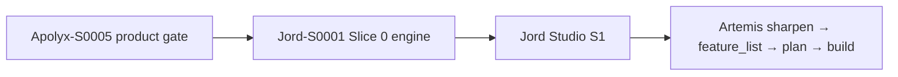

# Roadmap — Apolyx → Jord → Artemis

> Who: anyone picking the next lab track. This is the **current** big-picture sequence (locked 2026-10-21). Living map: [[../brain/00-Docs-Brain]] · Status: [[../report/STATUS]].

## Sequence

| Order | Track | What “done” means | Docs |
|-------|--------|-------------------|------|
| **1** | **Apolyx-S0005** | Select, Combobox, Pagination, Accordion, Scroll Area, Progress, Radio Group shipped | **Closed 2026-10-21** — [[../feature_list/ui-kit/06-apolyx-s0005-product-gate]] · [[../tech_space/ui-kit/10-s0005-product-gate]] |
| **2** | **Jord-S0001** | `data/jord.db`, `@altr/jord`, `@altr/jord-server`, OCC `records`, WAL + snapshot | **← implement now** · Intent [[../feature_list/Jord/00-intent]] · Plan [[Jord/Jord-S0001/README]] |
| **3** | **Jord Studio S1** | `apps/jord-studio` lists / browses `records` via server, Apolyx UI | [[../feature_list/Jord/03-jord-studio]] |
| **4** | **Artemis** | Sharpen idea → promote `feature_list/artemis/` → plan → terminal shell | Idea [[../idea/artemis/README]] (not promoted yet) |

## Why Apolyx before Jord engine?

**Code coupling:** Jord Slice 0 needs **zero** Apolyx. The engine is `elements/jord` + `cloud/jord` only.

**Product coupling:** Jord Studio and Artemis both consume `@altr/apolyx`. Shipping the **product gate** first avoids building Studio / terminal screens on missing Select / Combobox / Pagination / Scroll Area, then ripping them up.

Apolyx gate is closed. **Start Jord-S0001** at [[Jord/Jord-S0001/01-packages]]. Product apps remain Apolyx-first (`.cursor/rules/apolyx-first.mdc`).

## Apolyx after S0005 (not blocking Jord)

Still open in [[../feature_list/ui-kit/01-apolyx-s0001-carryovers]] for later waves (S0006+):

- Command palette, data-grid engine, Slider, date / color pickers
- Dropdown submenus, phone input, RHF / Zod adapter
- Candlestick (Artemis density), remote registry / CLI update / npm publish

## Artemis gate

Do **not** open `feature_list/artemis/` until:

1. Apolyx-S0005 closed (or explicitly waived for a paper shell)
2. Jord-S0001 closed (scratchpad + server for paper / agent notes)
3. Idea sharpening note answers the four open questions in [[../idea/artemis/README]]

## Out of this roadmap

- Tia (promoted intent only — separate track)
- Life systems, API client, Search
- Apolyx Token Studio / premium themes (still idea)

## Links

- Apolyx track: [[ui-kit/README]]
- Jord track: [[Jord/README]]
- Catalog: [[../idea/2026-10-18-product-catalog]]
