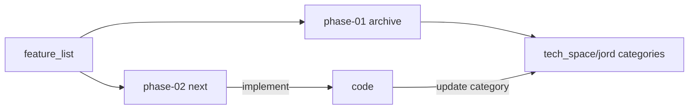

# plan / Jord

> Sprint cards for Jord. **phase-01** is closed archive. **phase-02** holds S0021–S0027 from the gap analysis.

Intent: [[../../feature_list/Jord/README]] · Capabilities: [[../../feature_list/Jord/04-phase-01-capabilities]] · Phase-02 features: [[../../feature_list/Jord/03-phase-02-features]] · As-built: [[../../tech_space/jord/README]] · Review: [[../../report/Jord-implemented-review]] · Status: [[../../report/STATUS]]

## Phases

| Phase | Folder | Status | Entry |
|-------|--------|--------|-------|
| **01** | [[phase-01/README]] | **Closed** — Jord-S0001 … Jord-S0020 | Lab data plane + Studio through hard vectors |
| **02** | [[phase-02/README]] | **Accepted** (file + live Postgres + local CI mirror) · branch protection is a one-shot admin step on S0027 · Functions runtime gated · [[phase-02/00-task-rollup]] | Features: [[../../feature_list/Jord/03-phase-02-features]] |
| **02.5** | [[phase-02.5/README]] | **Code done** (2026-10-25): S0030 locally · S0031 · S0032 · S0033 | Acceptance closeout: [[phase-02.5/README]] |
| **02.75** | [[phase-02.75/README]] | **Closed 2026-10-26** (B/C code + MinIO live + local CI mirror; hosted libSQL live = secret-gated) | Leftovers before phase-03 |
| **03** | _(not created)_ | **Proposed — needs a plan**; planning can start | Candidates: [[../../feature_list/Jord/05-phase-03-candidates]] |

## Conductor rule

1. Do not reopen phase-01 cards for new scope — archive only.
2. New sprints land under the active phase folder (`plan/Jord/phase-03/` once created; never under phase-01 / closed 02.x).
3. Numbered work is [[../../feature_list/Jord/03-phase-02-features]]; soft leftovers stay in [[../../feature_list/Jord/01-phase-02-candidates]] / [[phase-02/00-remaining-backlog]].
4. Implement **session-sized** chunks; stop for review (especially S0021 A→B→C).
5. After ship → update the matching note under `tech_space/jord/<category>/` → docs_man refreshes report + brain.

Roadmap: [[../00-roadmap-apolyx-jord-artemis]] · Agent: [[../../agents/mimir/00-index|mimir]]
