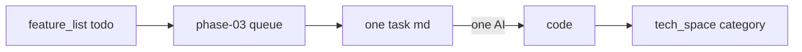

# plan / Jord

> Sprint / task cards for Jord. **phase-01**–**02.75** closed/accepted. **phase-03** uses the new **one file = one AI task** shape ([[../../agents/templates/plan-task]]).

Intent: [[../../feature_list/Jord/README]] ([[../../feature_list/Jord/done/README\|done]] / [[../../feature_list/Jord/todo/README\|todo]]) · As-built: [[../../tech_space/jord/README]] · Status: [[../../report/STATUS]]

## Phases

| Phase | Folder | Status | Entry |
|-------|--------|--------|-------|
| **01** | [[phase-01/README]] | **Closed** — Jord-S0001 … Jord-S0020 | Lab data plane + Studio through hard vectors |
| **02** | [[phase-02/README]] | **Accepted** · [[phase-02/00-task-rollup]] | Features archived under [[../../feature_list/Jord/done/README]] |
| **02.5** | [[phase-02.5/README]] | **Code done** (2026-10-25) | Acceptance closeout |
| **02.75** | [[phase-02.75/README]] | **Closed 2026-10-26** | Leftovers before phase-03 |
| **03** | [[phase-03/README]] | **Active** — single-task queue, **63 cards** · **S0034–S0036 done** | Waves A–P: next [[phase-03/S0037-listen-seq-fanout\|S0037]] → Studio v2 [[phase-03/S0042-control-plane-store-adr\|S0042]]…[[phase-03/S0096-dashboard-ui\|S0096]] · gated Functions [[phase-03/S0090-functions-worker-pool\|S0090]] · parent [[../../feature_list/Jord/INDEX]] |

## Conductor rule

1. Do not reopen closed phases for new scope.
2. **New work** → new `S00xx-slug.md` under the active phase ([[phase-03/README]]). Template: [[../../agents/templates/plan-task]].
3. One AI session per file; split if &gt; ~3 h or two coding hats.
4. After ship → matching `tech_space/jord/<category>/` → docs_man refreshes report + brain.

Roadmap: [[../00-roadmap-apolyx-jord-artemis]] · Agent: [[../../agents/mimir/00-index|mimir]]
