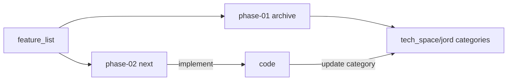

# plan / Jord

> Sprint cards for Jord. **phase-01** is closed archive. **phase-02** holds S0021–S0027 from the gap analysis.

Intent: [[../../feature_list/Jord/README]] · Capabilities: [[../../feature_list/Jord/04-phase-01-capabilities]] · Phase-02 features: [[../../feature_list/Jord/03-phase-02-features]] · As-built: [[../../tech_space/jord/README]] · Review: [[../../report/Jord-implemented-review]] · Prompt: [[../../report/Jord-next-phase2-prompt]] · Status: [[../../report/STATUS]]

## Phases

| Phase | Folder | Status | Entry |
|-------|--------|--------|-------|
| **01** | [[phase-01/README]] | **Closed** — Jord-S0001 … Jord-S0020 | Lab data plane + Studio through hard vectors |
| **02** | [[phase-02/README]] | **Open** — S0021–S0027 planned; next = S0021 Part A | Features: [[../../feature_list/Jord/03-phase-02-features]] |

## Conductor rule

1. Do not reopen phase-01 cards for new scope — archive only.
2. New sprints land under `plan/Jord/phase-02/` (never under phase-01).
3. Numbered work is [[../../feature_list/Jord/03-phase-02-features]]; soft leftovers stay in [[../../feature_list/Jord/01-phase-02-candidates]] / [[phase-02/00-remaining-backlog]].
4. Implement **session-sized** chunks; stop for review (especially S0021 A→B→C).
5. After ship → update the matching note under `tech_space/jord/<category>/` → docs_man refreshes report + brain.

Roadmap: [[../00-roadmap-apolyx-jord-artemis]] · Agent: [[../../agents/mimir/00-index|mimir]]
