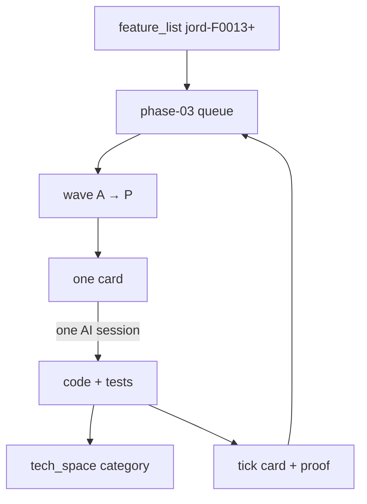
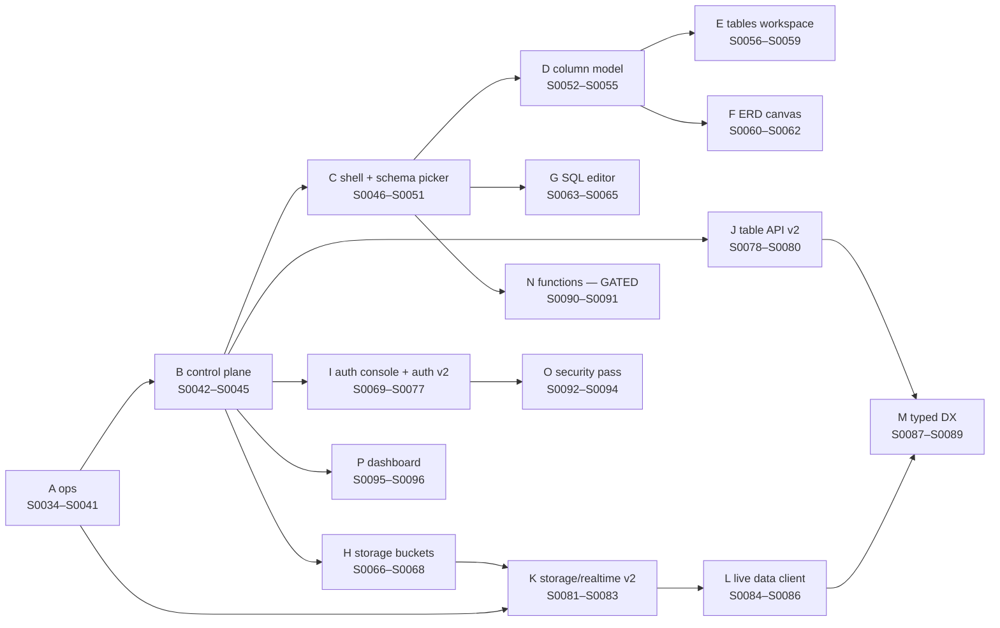

# plan / Jord / phase-03

> **One markdown file = one task for one AI session.** Features: [[../../../feature_list/Jord/INDEX]] (`jord-F####`). Template: [[../../../agents/templates/plan-task]]. Hub: [[../README]]. Completed cards: [[done/README]].

**Queue status (2026-11-02):** **S0034–S0056 done** — wave A (production ops / [[../../../feature_list/Jord/done/jord-F0013-production-ops|jord-F0013]]) closed; wave B ([[done/S0042-control-plane-store-adr|S0042]]–[[done/S0045-project-scoped-routes|S0045]]) closed; wave C closed ([[done/S0046-three-pane-shell|S0046]]–[[done/S0051-workspace-tabs|S0051]]); wave D ([[done/S0052-type-registry|S0052]]–[[done/S0055-fk-relationship-editor|S0055]]) closed; wave E started ([[done/S0056-grid-column-ops|S0056]]). Archived under [[done/README|done/]]. Next open card: [[S0057-row-ops-pagination|S0057]]. **63 cards** cover every open Jord feature — [[../../../feature_list/Jord/todo/jord-F0014-typed-dx|F0014]]…[[../../../feature_list/Jord/todo/jord-F0015-functions-runtime|F0015]] and [[../../../feature_list/Jord/todo/jord-F0016-auth-v2|F0016]]…[[../../../feature_list/Jord/todo/jord-F0030-auth-console|F0030]], plus the Studio v2 wave (F0021–F0028). The only intent **not** carded is the soft backlog [[../../../feature_list/Jord/todo/jord-F0020-soft-leftovers|jord-F0020]] — promote it into a new `jord-F####` first.

## How to run a task

1. Open the next **todo** card in wave order (A → P). Do not skip a card a later one depends on.
2. Follow its **Routing** table (agent · skills · model · estimate).
3. Do **only** that card's in-scope steps. Do not expand into the next feature id.
4. Paste proof into the card. Mark status **done**. Move the file to [[done/README|done/]].
5. Call **docs_man** to update the matching `tech_space/jord/<category>/` (+ feature_list `done/` if the contract changed).

## Delivery waves

Order inside a wave is the recommended sequence; ids are **stable** and never renumbered.

### Wave A — production ops ([[../../../feature_list/Jord/done/jord-F0013-production-ops|jord-F0013]] · **closed**)

| # | Id | Task | Est. |
|--:|----|------|------|
| A1 | [[done/S0034-health-probes\|S0034]] | `/health/live` + `/health/ready` | **done** 2026-10-29 |
| A2 | [[done/S0035-structured-json-logs\|S0035]] | Structured JSON request logs | **done** 2026-10-29 |
| A3 | [[done/S0036-shared-rate-limit-idempotency\|S0036]] | Shared rate limit + idempotency in Postgres | **done** 2026-10-29 |
| A4 | [[done/S0037-listen-seq-fanout\|S0037]] | LISTEN/NOTIFY fan-out + shared watermark | **done** 2026-10-29 |
| A5 | [[done/S0038-pg-write-concurrency\|S0038]] | `JORD_PG_WRITE_CONCURRENCY` | **done** 2026-11-01 |
| A6 | [[done/S0039-otel-traces\|S0039]] | OpenTelemetry traces + metrics | **done** 2026-11-01 |
| A7 | [[done/S0040-backup-restore-drill\|S0040]] | Backup + restore drill | **done** 2026-11-01 |
| A8 | [[done/S0041-dockerfile-deploy\|S0041]] | Dockerfile + deploy recipe | **done** 2026-11-01 |

### Wave B — control plane ([[../../../feature_list/Jord/todo/jord-F0021-projects-provisioning|jord-F0021]])

| # | Id | Task | Est. |
|--:|----|------|------|
| B1 | [[done/S0042-control-plane-store-adr\|S0042]] | Control-plane store + ADR (**decision first**) | **done** 2026-11-01 |
| B2 | [[done/S0043-project-registry-api\|S0043]] | Project registry API + keys + connect test | **done** 2026-11-01 |
| B3 | [[done/S0044-new-project-wizard\|S0044]] | Projects list + New project wizard | **done** 2026-11-01 |
| B4 | [[done/S0045-project-scoped-routes\|S0045]] | `/p/[project]` scoping + switcher | **done** 2026-11-01 |

### Wave C — Studio shell ([[../../../feature_list/Jord/todo/jord-F0023-studio-shell-v2|jord-F0023]])

| # | Id | Task | Est. |
|--:|----|------|------|
| C1 | [[done/S0046-three-pane-shell\|S0046]] | Three-pane shell + nav config | **done** 2026-11-01 |
| C2 | [[done/S0047-contextual-sidebar\|S0047]] | Contextual sidebar per section | **done** 2026-11-01 |
| C3 | [[done/S0048-right-inspector\|S0048]] | Right inspector drawer + deep links | **done** 2026-11-01 |
| C4 | [[done/S0049-schema-scoped-introspection\|S0049]] | Server: schema-scoped introspection/DDL (**unblocks the picker**) | **done** 2026-11-01 |
| C5 | [[done/S0050-schema-picker-ui\|S0050]] | Schema dropdown → add table → search → list | **done** 2026-11-01 |
| C6 | [[done/S0051-workspace-tabs\|S0051]] | Workspace tab bar (one tab per table) | **done** 2026-11-02 |

### Wave D — column model ([[../../../feature_list/Jord/todo/jord-F0024-column-model-v2|jord-F0024]])

| # | Id | Task | Est. |
|--:|----|------|------|
| D1 | [[done/S0052-type-registry\|S0052]] | Dialect type registry + introspection model | **done** 2026-11-02 |
| D2 | [[done/S0053-column-settings\|S0053]] | Column settings + server-side validation | **done** 2026-11-02 |
| D3 | [[done/S0054-id-strategies\|S0054]] | Generated id strategies | **done** 2026-11-02 |
| D4 | [[done/S0055-fk-relationship-editor\|S0055]] | FK / relationship editor (cross-schema) | **done** 2026-11-02 |

### Wave E — tables workspace ([[../../../feature_list/Jord/todo/jord-F0025-tables-workspace-v2|jord-F0025]])

| # | Id | Task | Est. |
|--:|----|------|------|
| E1 | [[done/S0056-grid-column-ops\|S0056]] | DataGrid column ops + filters + saved views | **done** 2026-11-02 |
| E2 | [[S0057-row-ops-pagination\|S0057]] | Row ops, bulk delete, paging, 10k rows | 2–3 h |
| E3 | [[S0058-inline-edit-live-sync\|S0058]] | Double-click edit + optimistic + live merge | 2.5–3 h |
| E4 | [[S0059-policies-apis-drawers\|S0059]] | Per-table Policies + APIs drawers | 2.5–3 h |

### Wave F — relationship canvas ([[../../../feature_list/Jord/todo/jord-F0027-relationship-canvas|jord-F0027]])

| # | Id | Task | Est. |
|--:|----|------|------|
| F1 | [[S0060-table-relationships-view\|S0060]] | Per-table relationships view | 1.5–2 h |
| F2 | [[S0061-erd-canvas\|S0061]] | ERD canvas: pan, zoom, drag, relations | 3 h |
| F3 | [[S0062-canvas-layout\|S0062]] | Layout persistence, auto-layout, FK drag, export | 2.5–3 h |

### Wave G — SQL editor ([[../../../feature_list/Jord/todo/jord-F0028-sql-editor-v2|jord-F0028]])

| # | Id | Task | Est. |
|--:|----|------|------|
| G1 | [[S0063-monaco-sql-editor\|S0063]] | Monaco + schema-aware completion | 2–3 h |
| G2 | [[S0064-query-tabs-history\|S0064]] | Query tabs, saved queries, history | 2–3 h |
| G3 | [[S0065-results-explain-cancel\|S0065]] | Results grid, export, explain, cancel | 2.5–3 h |

### Wave H — storage buckets ([[../../../feature_list/Jord/todo/jord-F0029-storage-buckets|jord-F0029]])

| # | Id | Task | Est. |
|--:|----|------|------|
| H1 | [[S0066-bucket-registry\|S0066]] | `jord_buckets` + per-bucket provider resolution | 2.5–3 h |
| H2 | [[S0067-bucket-config-api\|S0067]] | Bucket config API + encrypted credentials + test | 2.5–3 h |
| H3 | [[S0068-storage-studio-ui\|S0068]] | Bucket wizard, object browser, settings | 3 h |

### Wave I — auth ([[../../../feature_list/Jord/todo/jord-F0030-auth-console|jord-F0030]] + [[../../../feature_list/Jord/todo/jord-F0016-auth-v2|jord-F0016]])

| # | Id | Task | Parent | Est. |
|--:|----|------|--------|------|
| I1 | [[S0069-auth-settings-store\|S0069]] | Auth settings store + config API | F0030 | 2.5–3 h |
| I2 | [[S0070-auth-console-users\|S0070]] | Auth console shell + Users | F0030 | 2.5–3 h |
| I3 | [[S0071-auth-console-sections\|S0071]] | Providers, URL config, JWT, rate limits | F0030 | 3 h |
| I4 | [[S0072-email-templates\|S0072]] | Email templates + test send | F0030 | 2–3 h |
| I5 | [[S0073-mailer-port\|S0073]] | Real `MailerPort` | F0016 | 2–3 h |
| I6 | [[S0074-magic-link\|S0074]] | Magic-link sign-in | F0016 | 2–3 h |
| I7 | [[S0075-oauth-provider\|S0075]] | One OAuth provider (state + PKCE) | F0016 | 3 h |
| I8 | [[S0076-sessions-claims\|S0076]] | Sessions list/revoke + custom claims | F0016 | 2.5–3 h |
| I9 | [[S0077-policy-tester\|S0077]] | "Run as user" policy tester | F0016 | 2–3 h |

### Wave J — table API v2 ([[../../../feature_list/Jord/todo/jord-F0017-table-api-v2|jord-F0017]])

| # | Id | Task | Est. |
|--:|----|------|------|
| J1 | [[S0078-fk-embeds\|S0078]] | FK embeds with per-table policies | 3 h |
| J2 | [[S0079-keyset-pagination\|S0079]] | Keyset pagination | 2–3 h |
| J3 | [[S0080-bulk-upsert-rpc\|S0080]] | Bulk upsert + RPC | 3 h |

### Wave K — storage & realtime v2 ([[../../../feature_list/Jord/todo/jord-F0018-storage-realtime-v2|jord-F0018]])

| # | Id | Task | Est. |
|--:|----|------|------|
| K1 | [[S0081-multipart-uploads\|S0081]] | Multipart + resumable uploads | 3 h |
| K2 | [[S0082-image-transforms\|S0082]] | Image transforms (non-native) | 2–3 h |
| K3 | [[S0083-presence-broadcast\|S0083]] | Presence + broadcast with policy-gated join | 3 h |

### Wave L — live data for apps ([[../../../feature_list/Jord/todo/jord-F0026-live-data-client|jord-F0026]])

| # | Id | Task | Est. |
|--:|----|------|------|
| L1 | [[S0084-realtime-app-endpoint\|S0084]] | App endpoint: publishable key, snapshot + deltas | 3 h |
| L2 | [[S0085-realtime-reconnect\|S0085]] | Reconnect, resume, ordering, resync | 2–3 h |
| L3 | [[S0086-live-toggle-snippet\|S0086]] | Live toggle, counters, client snippet | 2–3 h |

### Wave M — typed DX ([[../../../feature_list/Jord/todo/jord-F0014-typed-dx|jord-F0014]])

| # | Id | Task | Est. |
|--:|----|------|------|
| M1 | [[S0087-gen-types-cli\|S0087]] | `jord gen types` | 2–3 h |
| M2 | [[S0088-typed-client-builder\|S0088]] | Typed table builder in `@altr/jord-client` | 3 h |
| M3 | [[S0089-react-bindings\|S0089]] | React bindings package | 3 h |

### Wave N — Functions runtime (**GATED**)

| # | Id | Task | Est. |
|--:|----|------|------|
| N1 | [[S0090-functions-worker-pool\|S0090]] | Worker pool + timeout/memory caps — **do not start** | 3 h |
| N2 | [[S0091-functions-client-logs\|S0091]] | Principal-bound client + logs — **do not start** | 3 h |

Gate: parent [[../../../feature_list/Jord/todo/jord-F0015-functions-runtime|jord-F0015]] + [[../../../tech_space/jord/apis/ADR-functions-v2|ADR-functions-v2]].

### Wave O — security pass ([[../../../feature_list/Jord/todo/jord-F0019-security-pass|jord-F0019]])

| # | Id | Task | Est. |
|--:|----|------|------|
| O1 | [[S0092-strix-pentest\|S0092]] | Authorized Strix pentest + triage | 2–3 h |
| O2 | [[S0093-key-rotation-runbook\|S0093]] | Key-rotation runbook + drill | 2–3 h |
| O3 | [[S0094-dependency-audit-ci\|S0094]] | Dependency audit in CI | 45–75 min |

### Wave P — project dashboard ([[../../../feature_list/Jord/todo/jord-F0022-project-dashboard|jord-F0022]])

| # | Id | Task | Est. |
|--:|----|------|------|
| P1 | [[S0095-project-stats-endpoint\|S0095]] | `GET /admin/projects/:id/stats` | 2.5–3 h |
| P2 | [[S0096-dashboard-ui\|S0096]] | Dashboard UI: charts, counters, connect card | 3 h |

## Cross-wave dependencies

| Card | Blocked by |
|------|------------|
| [[done/S0043-project-registry-api\|S0043]] | S0042 (store decision) — **done** |
| [[done/S0044-new-project-wizard\|S0044]] | S0043 (registry API) — **done** |
| [[done/S0045-project-scoped-routes\|S0045]] | S0044 (projects UI) — **done** |
| [[done/S0049-schema-scoped-introspection\|S0049]] | — (server only) — **done** |
| [[done/S0050-schema-picker-ui\|S0050]] | S0047, S0049 — **done** |
| [[done/S0056-grid-column-ops\|S0056]] | apolyx-F0008 DataGrid (column-ops slice) — **done** |
| [[S0066-bucket-registry\|S0066]] | — |
| [[S0068-storage-studio-ui\|S0068]] | S0067 |
| [[S0071-auth-console-sections\|S0071]] | S0069 (OAuth/magic-link sections need S0074/S0075) |
| [[S0090-functions-worker-pool\|S0090]] | status gate |

## Rules

1. Do not reopen phase-01 / 02 / 02.5 / 02.75 for new scope.
2. New work = a new `S00xx-slug.md` here; never a multi-part mega-README. Ids stay stable.
3. If a card grows past ~3 hours or needs two hats coding at once → **split** before implementing.
4. A card marked **gated** is not started until `report/STATUS.md` lifts the gate.
5. Every card ends with `docs_man`: `tech_space/jord/<category>/` update + tick + STATUS if the phase status changed.
