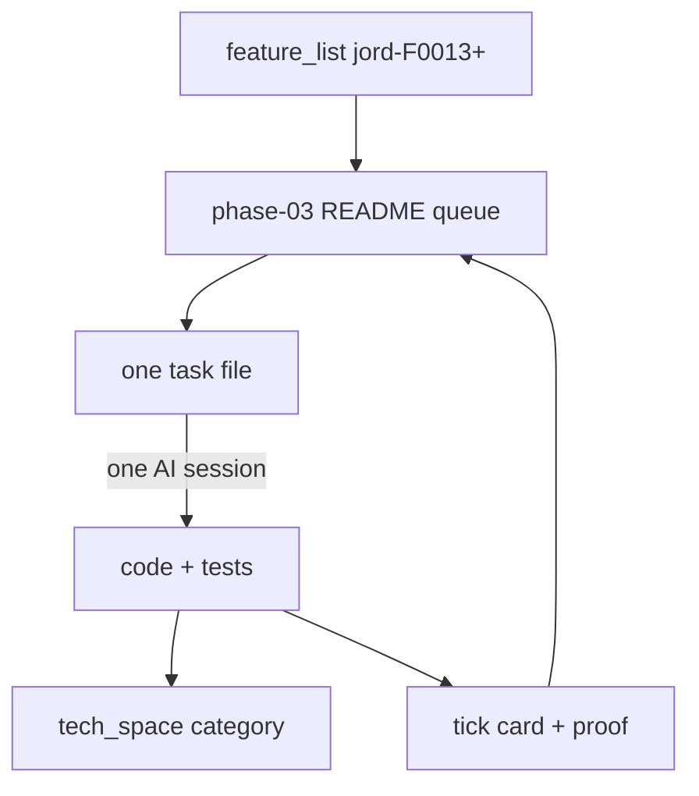

# plan / Jord / phase-03

> **New plan shape (this phase onward):** **one markdown file = one simple task** for **one AI session**. Features: [[../../../feature_list/Jord/INDEX]] (`jord-F####`). Template: [[../../../agents/templates/plan-task]]. Hub: [[../README]].

## How to run a task

1. Open the next **todo** card (not a closed historical phase).
2. Follow its **Routing** table (agent · skills · model · time).
3. Do **only** that card’s in-scope steps. Do not expand into the next feature id.
4. Paste proof into the card. Mark status **done**.
5. Call **docs_man** to update the matching `tech_space/jord/<category>/` (+ feature_list `done/` if the contract changed).

## Queue

| Order | Id | Task | Parent feature | Est. | Status |
|------:|----|------|----------------|------|--------|
| 1 | [[S0034-health-probes\|S0034]] | `/health/live` + `/health/ready` | [[../../../feature_list/Jord/todo/jord-F0013-production-ops\|jord-F0013]] | ~45–75 min | **todo** — example |
| 2 | [[S0035-structured-json-logs\|S0035]] | Structured JSON request logs | [[../../../feature_list/Jord/todo/jord-F0013-production-ops\|jord-F0013]] | ~60–90 min | **todo** — example |

More cards under **jord-F0013** (rate-limit store, LISTEN, PG concurrency, OTel, backup, Dockerfile) and **jord-F0014…F0019** land as separate files when split.

## Still not task cards

Remainder of [[../../../feature_list/Jord/todo/jord-F0013-production-ops\|jord-F0013]] · [[../../../feature_list/Jord/todo/jord-F0014-typed-dx\|F0014]]…[[../../../feature_list/Jord/todo/jord-F0019-security-pass\|F0019]] · [[../../../feature_list/Jord/todo/jord-F0020-soft-leftovers\|F0020]].

## Rules

1. Do not reopen phase-01 / 02 / 02.5 / 02.75 for new scope.
2. New work = new `S00xx-slug.md` here; never a multi-part mega-README.
3. If a card grows past ~3 hours or needs two hats coding at once → **split** before implementing.
4. Ids stay stable (`S0034`…). Order in the table can change.
