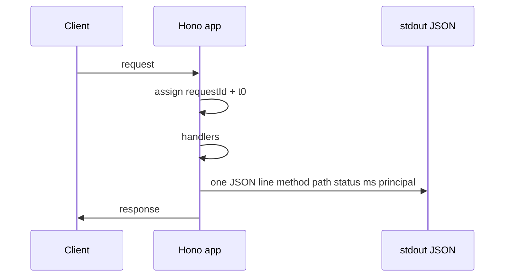

# S0035 — structured JSON request logs

> **Status:** done  
> **Phase:** [[README]] · Parent feature: [[../../../feature_list/Jord/todo/jord-F0013-production-ops|jord-F0013]] · After ship: [[../../../tech_space/jord/overview/README]] (and jobs/logs if ring behavior is mentioned)

## Routing (who / how long / which model)

| | |
|--|--|
| **Suggested agent** | **mimir → sindri** (server). **heimdall** glance: no tokens/PII in fields |
| **Companion skills** | `.agents/skills/graft/` · `.agents/skills/hono-typescript/` · `.agents/skills/security-and-hardening/` (redaction only) |
| **Suggested model** | `gpt-5.6-sol-medium` or `claude-sonnet-5-5-high` — small design surface (field schema + middleware) |
| **Est. time** | **60–90 min** |
| **Parallel?** | **No** — finish [[S0034-health-probes|S0034]] first if both are open (avoids conflicting `app.ts` edits) |

## Goal

Every HTTP request that finishes gets **one JSON object** on process stdout (info) or stderr (5xx), suitable for log shippers. Human `console.log` banners for boot can stay; request noise must be machine-parseable.

## Why now

jord-F0013: without structured request logs you cannot debug multi-instance deploys or correlate with future OTel. Studio’s `LogBatcher` / `jord_logs` ring is a **product feature**, not an ops pipe — do not overload it.

## Context (read before coding)

| Kind | Open |
|------|------|
| Intent | [[../../../feature_list/Jord/INDEX]] P1 |
| As-built | [[../../../tech_space/jord/overview/README]] · [[../../../tech_space/jord/jobs/README]] (existing log ring) |
| Code | `cloud/jord/src/app.ts` (`createJordApp`) · `cloud/jord/src/logs/batch.ts` (`LogBatcher`) · `cloud/jord/src/logs/redact.ts` |
| Hardening | [[../../../feature_list/Jord/done/jord-F0006-apis]] F10 — body limits / CORS already exist |

**Do not break:** LogBatcher flush path; SQL audit redaction; health probes spam — either sample or skip logging `/health*` at info (document the choice).

## In scope

- Hono middleware (early in `createJordApp`) that records `start = Date.now()`, assigns `requestId` (UUID or existing header `x-request-id` if valid/short)
- On response finish, print **one line** JSON:

```json
{
  "level": "info",
  "msg": "http",
  "requestId": "…",
  "method": "GET",
  "path": "/api/v1/records",
  "status": 200,
  "ms": 12,
  "principal": "service"
}
```

- `principal`: kind only (`anon` | `user` | `service` | `operator` | `none`) — **never** raw tokens, Authorization, cookies, or bodies
- 5xx → `level: "error"` on stderr; 4xx stay `info` (or `warn` — pick one and test)
- Env toggle: `JORD_HTTP_LOG=0` disables (default **on** in server entry)
- Reuse `redactSecrets` if any header echo is tempted — prefer **no** header dump in v1
- Unit test: middleware emits parseable JSON with expected keys (mock `console.log` / inject writer)

## Out of scope

- OpenTelemetry traces/metrics (later P1 card)
- Shipping logs into `jord_logs` / Studio UI
- Changing LogBatcher semantics or job log ring
- Access-log files on disk · log rotation daemons

## Diagram



## Steps (do in order)

1. Read existing redact helpers; decide writer injection for tests (`deps.httpLog?: (line: object) => void`).
2. Add `cloud/jord/src/http/request-log.ts` (or similar) with middleware + type for the log shape.
3. Wire into `createJordApp` after CORS / before heavy routes; skip or downgrade `/health` and `/health/*` if volume is an issue.
4. Boot banner in `index.ts` may stay plain text; optional one JSON `msg: "boot"` line with dialect — nice-to-have, not required.
5. Tests with mocked writer; ensure secrets never appear if a fixture sends `Authorization`.
6. typecheck + vitest.
7. **docs_man**: overview category notes the JSON field set + env toggle; tick card.

## Done when (acceptance)

- [x] One JSON object per finished request (when enabled)
- [x] Fields: `level`, `msg`, `requestId`, `method`, `path`, `status`, `ms`, `principal`
- [x] No Authorization / cookie / body content in the line
- [x] `JORD_HTTP_LOG=0` disables
- [x] Test proves shape; proof pasted below

## Proof

| Date | Command | Result |
|------|---------|--------|
| 2026-10-29 | `pnpm --filter @altr/jord-server typecheck` | exit 0 |
| 2026-10-29 | `pnpm --filter @altr/jord-server exec vitest run src/http/request-log.test.ts` | **7 passed** |

**Shipped:** `cloud/jord/src/http/request-log.ts` · wired in `createJordApp` · `/health*` skipped (LB spam) · 4xx=`info`, 5xx=`error` · inject `deps.httpLog`.

## After ship

| Update | Path |
|--------|------|
| tech_space | [[../../../tech_space/jord/overview/README]] |
| Phase queue | [[README]] status → done |
| Next suggested split | [[S0036-shared-rate-limit-idempotency\|S0036]] · OTel later ([[S0039-otel-traces\|S0039]]) |
