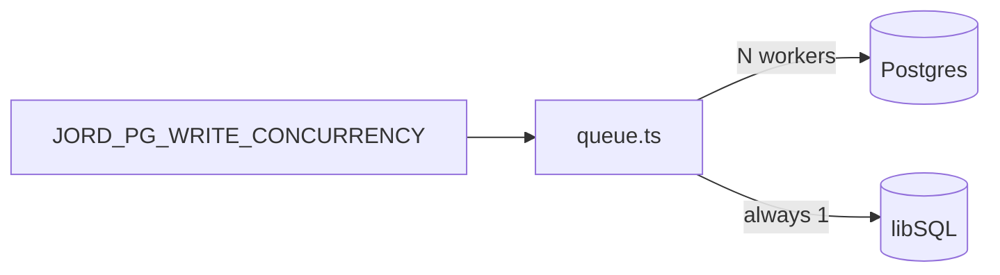

# S0038 — JORD_PG_WRITE_CONCURRENCY

> **Status:** todo · **Phase:** [[README]] · Parent: [[../../../feature_list/Jord/todo/jord-F0013-production-ops|jord-F0013]] · After ship: [[../../../tech_space/jord/writes/README]]

## Routing (who / how long / which model)

| | |
|--|--|
| **Suggested agent** | mimir → **sindri** |
| **Companion skills** | `.agents/skills/graft/` · `.agents/skills/nodejs-backend-patterns/` |
| **Suggested model** | `composer-2.5-fast` — one env knob plus queue plumbing |
| **Est. time** | **45–75 min** |
| **Parallel?** | **No** |

## Goal

`JORD_PG_WRITE_CONCURRENCY` (default `1`) controls how many writes the Postgres queue runs at once, and the queue exposes depth + in-flight count for the readiness probe.

## Why now

Leftover **B6** from phase-02.75: throughput work is blocked on a hardcoded serial drain.

## Context (read before coding)

| Kind | Where |
|------|-------|
| Intent | [[../../../feature_list/Jord/todo/jord-F0013-production-ops|jord-F0013]] |
| As-built | [[../../../tech_space/jord/writes/README]] |
| Code today | `cloud/jord/src/queue.ts` (single serial drain) · `elements/jord` write port |
| Tests | `cloud/jord/src/queue.drain.test.ts` |

**Do not break:** libSQL stays serial (no interleaved transactions); job ordering guarantees.

## In scope

- Parse + clamp the env (`1…8`), document it in `load-env.ts` and the overview.
- Drain N jobs concurrently **only** for Postgres; add `pending()` / `inFlight()` accessors.
- Reject an out-of-range value loudly instead of silently ignoring it.
- Tests: N=2 drains two independent jobs concurrently; N=1 unchanged; libSQL warns once and stays serial.

## Out of scope

Per-table concurrency · retry policy changes · metrics export ([[S0039-otel-traces|S0039]]).

## Diagram

## Steps (do in order)

1. Graft the queue; note where the single drain loop serialises.
2. Add env parse + clamp + worker pool for the PG branch.
3. Expose `pending()` / `inFlight()`; wire into the ready check from [[S0034-health-probes|S0034]].
4. Tests for N=1 / N=2 plus the libSQL warning.
5. Typecheck + test; paste proof.
6. **docs_man**: writes + overview tech_space; tick card.

## Done when

- [ ] Default behavior identical to today
- [ ] `JORD_PG_WRITE_CONCURRENCY=4` runs four PG writes concurrently (test)
- [ ] libSQL unaffected and warns once
- [ ] Ready check reports queue depth
- [ ] Proof pasted

## Proof

| Date | Command | Result |
|------|---------|--------|
| | `pnpm --filter @altr/jord-server test` | |

## After ship

| Update | Path |
|--------|------|
| tech_space | `Docs/tech_space/jord/writes/README.md` |
| Queue | [[README]] |
