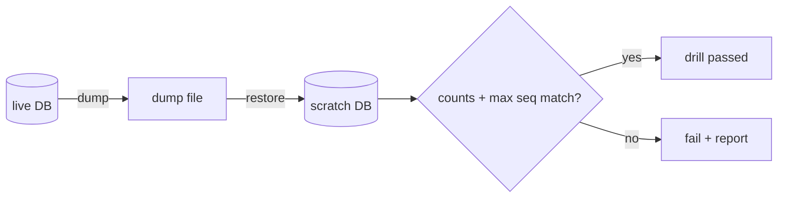

# S0040 — backup + restore drill

> **Status:** todo · **Phase:** [[README]] · Parent: [[../../../feature_list/Jord/todo/jord-F0013-production-ops|jord-F0013]] · After ship: [[../../../tech_space/jord/overview/README]]

## Routing (who / how long / which model)

| | |
|--|--|
| **Suggested agent** | mimir → **sindri** (scripts) · **heimdall** reviews what leaves the box |
| **Companion skills** | `.agents/skills/graft/` · `.agents/skills/supabase-postgres-best-practices/` |
| **Suggested model** | `gpt-5.6-sol-medium` |
| **Est. time** | **60–90 min** |
| **Parallel?** | **No** |

## Goal

`backup` / `restore-drill` scripts plus a documented drill: dump → restore into a scratch database → verify counts and outbox seq → record the transcript. Works for Postgres and the libSQL file.

## Why now

No restore path is stated anywhere; a production feature set without a proven restore is not deployable.

## Context (read before coding)

| Kind | Where |
|------|-------|
| Intent | [[../../../feature_list/Jord/todo/jord-F0013-production-ops|jord-F0013]] |
| As-built | [[../../../tech_space/jord/overview/README]] |
| Code today | `cloud/jord/package.json` scripts · `cloud/jord/src/load-env.ts` |
| Blobs | bytes live outside SQL — the drill must state blob handling explicitly (`data/blobs/` or the S3 bucket) |

**Do not break:** never restore over a live database; the script must refuse a target that matches `JORD_DATABASE_URL`.

## In scope

- `scripts/backup.sh` (`pg_dump --format=custom`, or copy the libSQL file) and `scripts/restore-drill.sh` (restore into `*_drill`, compare per-table row counts and `jord_outbox` max seq).
- Guard rails: target ≠ source; explicit `--yes` for the destructive restore.
- Doc section with exact commands and the pasted output from a real run.
- Blob scope: what a database backup does **not** cover.

## Out of scope

Scheduled backups · off-site upload · PITR.

## Diagram

## Steps (do in order)

1. Confirm env names in `load-env.ts`.
2. Write both scripts; POSIX bash that also runs in Git Bash on Windows.
3. Run the drill against the local compose Postgres; capture output.
4. Write the tech_space section (commands, restore expectations, blob caveat).
5. **docs_man**: overview tech_space (+ STATUS if claims change); tick card.

## Done when

- [ ] Drill passes locally with pasted output
- [ ] Script refuses to restore over the live URL
- [ ] Blob handling stated, not implied
- [ ] Proof pasted

## Proof

| Date | Command | Result |
|------|---------|--------|
| | `bash cloud/jord/scripts/restore-drill.sh …` | |

## After ship

| Update | Path |
|--------|------|
| tech_space | `Docs/tech_space/jord/overview/README.md` |
| Queue | [[README]] |
