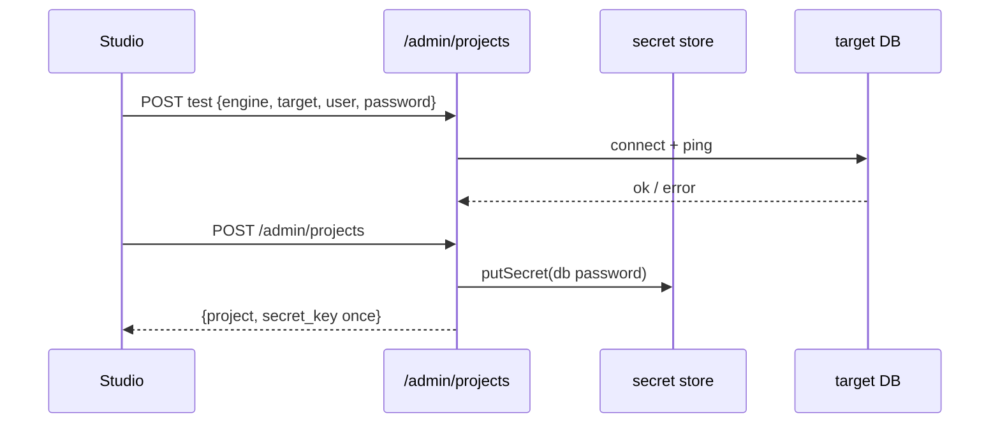

# S0043 — project registry API + keys + connect test

> **Status:** todo · **Depends on** [[S0042-control-plane-store-adr|S0042]] · **Phase:** [[README]] · Parent: [[../../../feature_list/Jord/todo/jord-F0021-projects-provisioning|jord-F0021]] · After ship: [[../../../tech_space/jord/studio/README]]

## Routing (who / how long / which model)

| | |
|--|--|
| **Suggested agent** | mimir → **saga** (schema/keys) + **sindri** (routes) |
| **Companion skills** | `.agents/skills/graft/` · `.agents/skills/hono-typescript/` · `.agents/skills/supabase-postgres-best-practices/` |
| **Suggested model** | `claude-sonnet-5-5-high` |
| **Est. time** | **2.5–3 h** |
| **Parallel?** | **No** |

## Goal

`/admin/projects` route group: list, create (register + test), get, patch notes/status, archive, rotate keys, and `POST /admin/projects/test` (ephemeral connect check). Create returns the secret key **once**; list/detail never return secrets.

## Why now

[[S0044-new-project-wizard|S0044]] and [[S0045-project-scoped-routes|S0045]] both need a real endpoint contract; building the form first would fake it.

## Context (read before coding)

| Kind | Where |
|------|-------|
| Intent | [[../../../feature_list/Jord/todo/jord-F0021-projects-provisioning|jord-F0021]] |
| Depends on | [[S0042-control-plane-store-adr|S0042]] tables + secret port |
| Code today | `cloud/jord/src/auth/admin.ts` (existing admin guard) · `cloud/jord/src/auth/route-inventory.ts` (must list new routes) · `elements/jord/src/adapter/{postgres,libsql}.ts` for the connect test |
| Tests | `cloud/jord/src/auth/principals.test.ts` · `app.test.ts` |

**Do not break:** admin-only guard on every route; archiving revokes keys but never drops a database.

## In scope

- Routes: `GET/POST /admin/projects`, `GET/PATCH/DELETE /admin/projects/:id` (delete = archive), `POST /admin/projects/:id/rotate-keys`, `POST /admin/projects/test`.
- Key generation: `jord_pub_…` (client-safe), `jord_sec_…` (hashed at rest, returned once), `jord_bar_…` (rate-limit/origin barrier).
- Connect test: open a short-lived adapter connection, run a cheap query, close; return engine error verbatim on failure and write no row.
- Archive: `status=archived`, keys revoked, dashboard/API calls return **410** with reason.
- Route inventory + admin tests updated; JSON never contains `password`, `secret_key`, or provider credentials.

## Out of scope

Hosted provider provisioning (Turso/Neon APIs) · team RBAC · billing.

## Diagram

## Steps (do in order)

1. Graft `admin.ts` + route registration; add the route group in `cloud/jord/src/auth/routes.ts`.
2. Implement the ephemeral connect test (per engine, short timeout).
3. Implement create (validate slug, test, encrypt, generate keys, baseline) + list/get/patch/archive/rotate.
4. Update `route-inventory.ts`; extend `principals.test.ts` for admin-only access.
5. Tests: create per engine (mock target), secret returned once, absent from list JSON, archive → 410, failed test → no row.
6. Typecheck + test; paste proof.
7. **docs_man**: studio tech_space route table; tick card.

## Done when

- [ ] Three engines create successfully in tests
- [ ] Secret key appears only in the create response
- [ ] List/detail JSON contains no credential fields (asserted)
- [ ] Failed connect test leaves no project row
- [ ] Archive → 410, keys revoked
- [ ] Proof pasted

## Proof

| Date | Command | Result |
|------|---------|--------|
| | `pnpm --filter @altr/jord-server test` | |

## After ship

| Update | Path |
|--------|------|
| tech_space | `Docs/tech_space/jord/studio/README.md` |
| Queue | [[README]] |
