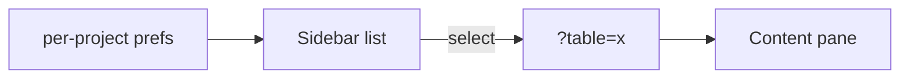

# S0047 — contextual sidebar per section

> **Status:** todo · **Depends on** [[S0046-three-pane-shell|S0046]] · **Phase:** [[README]] · Parent: [[../../../feature_list/Jord/todo/jord-F0023-studio-shell-v2|jord-F0023]] · After ship: [[../../../tech_space/jord/studio/README]]

## Routing (who / how long / which model)

| | |
|--|--|
| **Suggested agent** | mimir → **apollo** |
| **Companion skills** | `.agents/skills/apollo/` · `.agents/skills/vercel-react-best-practices/` |
| **Suggested model** | `gpt-5.6-sol-medium` |
| **Est. time** | **2–3 h** |
| **Parallel?** | **No** |

## Goal

Each section's contextual sidebar is a real, resizable list with search + filters where it helps, remembers width and collapsed state per project, and syncs the selection to the URL.

## Why now

`jord-F0023` pane table defines these lists; the shell from `S0046` only provides the slots. The schema picker, table list and tab bar all build on the Data sidebar.

## Context (read before coding)

| Kind | Where |
|------|-------|
| Intent | [[../../../feature_list/Jord/todo/jord-F0023-studio-shell-v2|jord-F0023]] · [[../../../feature_list/Jord/todo/jord-F0025-tables-workspace-v2|jord-F0025]] |
| Code today | `app/p/[project]/tables/page.tsx` · `records/` · `jobs/` · `apis/` · `database/sql/` · `auth/users/` · `lib/{database-api,schema,jobs}.ts` |
| Tests | typecheck + build; DOM assertions in `playwright-cli` smoke |

**Do not break:** selection drives the content pane only — no full navigation on selection unless the section says so; no N+1 fetch per list item.

## In scope

| Section | Sidebar |
|---------|---------|
| Tables (Data) | schema picker + add table + search/filter + table list (schema work lands in [[S0050-schema-picker-ui|S0050]]) |
| Jobs | job list with status filter + last-run badge |
| APIs | endpoint list grouped by table/custom with method chips |
| SQL | saved queries + history entries (full feature in [[S0064-query-tabs-history|S0064]]) |
| Auth | users list with search (owned by [[S0070-auth-console-users|S0070]]) |
| Storage | buckets list (owned by [[S0068-storage-studio-ui|S0068]]) |

- Shared sidebar list component: item, badge, search, filter menu, sticky header, loading skeleton, empty state.
- Width drag handle with min/max + double-click reset; persist per project in the project UI prefs store.
- Selection in the URL (`?table=…`, `?job=…`) and restored on reload.
- Debounced search (≥150 ms), no request per keystroke.

## Out of scope

The table create inspector ([[S0048-right-inspector|S0048]]) · bulk actions in sidebars · pinning sidebars across sections.

## Diagram

## Steps (do in order)

1. Load apollo; build the shared sidebar list primitive in Studio components (composition only, no new base control).
2. Wire Tables + Jobs + APIs sidebars to existing APIs.
3. Add resize + persistence (project prefs) and URL selection.
4. Stub SQL/Auth/Storage via the section config, filled by their own cards.
5. Keyboard: Up/Down moves selection, Enter opens, `/` focuses search.
6. Typecheck + build; smoke two sections; paste proof.
7. **docs_man**: studio tech_space sidebar table; tick card.

## Done when

- [ ] Three sections have working, searchable sidebars
- [ ] Width + collapse persist per project
- [ ] Selection survives reload via URL
- [ ] Keyboard selection works
- [ ] Typecheck + build pass; proof pasted

## Proof

| Date | Command | Result |
|------|---------|--------|
| | `pnpm --filter @altr/jord-studio typecheck` | |

## After ship

| Update | Path |
|--------|------|
| tech_space | `Docs/tech_space/jord/studio/README.md` |
| Queue | [[README]] |
