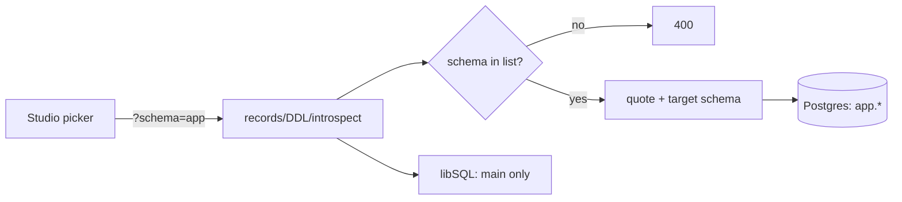

# S0049 — schema-scoped introspection, records and DDL

> **Status:** todo · **Phase:** [[README]] · Parent: [[../../../feature_list/Jord/todo/jord-F0023-studio-shell-v2|jord-F0023]] (schema picker) · After ship: [[../../../tech_space/jord/schema/README]]

## Routing (who / how long / which model)

| | |
|--|--|
| **Suggested agent** | mimir → **saga** (schema/DDL) + **sindri** (routes) |
| **Companion skills** | `.agents/skills/supabase-postgres-best-practices/` · `.agents/skills/graft/` · `.agents/skills/hono-typescript/` |
| **Suggested model** | `claude-sonnet-5-5-high` — quoting, grants and RLS per schema |
| **Est. time** | **2.5–3 h** |
| **Parallel?** | **No** — the UI picker ([[S0050-schema-picker-ui|S0050]]) is blocked on this contract |

## Goal

Add a `schema` scope to the server: `GET /schema/schemas` lists schemas, and introspection, records, DDL and table-API routes accept `?schema=` (default `public`), with every identifier quoted and grants/policies created in the right schema.

## Why now

The Studio sidebar schema dropdown was requested as a UI feature, but the Postgres adapter filters metadata to `public` (`elements/jord/src/adapter/postgres.ts`), so a picker with no server support would be a fake control.

## Context (read before coding)

| Kind | Where |
|------|-------|
| Intent | [[../../../feature_list/Jord/todo/jord-F0023-studio-shell-v2|jord-F0023]] · [[../../../feature_list/Jord/todo/jord-F0025-tables-workspace-v2|jord-F0025]] |
| As-built | [[../../../tech_space/jord/schema/README]] |
| Code today | `elements/jord/src/adapter/postgres.ts` (`WHERE table_schema = 'public'` at introspection, RLS and grant blocks) · `elements/jord/src/schema/{ddl,introspect,table-names,policies}.ts` · `cloud/jord/src/table-api/routes.ts` |
| Tests | `elements/jord/src/schema/{introspect,ddl,ddl-rls}.test.ts` · `cloud/jord/src/table-api/__tests__/` |

**Do not break:** default stays `public` with identical behavior; libSQL reports a single `main` schema; no SQL string interpolation of an unvalidated schema name.

## In scope

- Schema list endpoint: Postgres `information_schema.schemata` minus `pg_*` / `information_schema`; libSQL → `[{ name: 'main', readOnly: true }]`.
- `?schema=` validation against the real list (reject unknown → 400), then quote-all identifiers everywhere.
- Introspection: tables, columns, FKs and indexes scoped to the schema; system schema stays readable but flagged read-only.
- Records/table-API/DDL: create/alter/drop and row reads target the requested schema; `jord_tracked_tables` rows carry the schema.
- Grants + RLS policies created in the target schema, not always `public`.
- Tests: create a table in `app`, introspect it there, `public` unchanged; unknown schema → 400; RLS created in `app`.

## Out of scope

Cross-schema joins in the table API ([[S0078-fk-embeds|S0078]] handles embeds) · schema create/drop UI · search_path tricks · per-schema permissions UI.

## Diagram

## Steps (do in order)

1. Read the introspection + DDL paths; list every hardcoded `'public'`.
2. Add a schema resolver (`resolveSchema(input)`) + list endpoint, with dialect split.
3. Thread the scope through introspection, records, DDL, policies/RLS and grants; keep `public` the default.
4. Persist schema in `jord_tracked_tables` (+ migration if needed).
5. Tests for scoped CRUD, introspection, RLS and the libSQL single-schema behavior.
6. Typecheck both `@altr/jord` and `@altr/jord-server`; paste proof.
7. **docs_man**: schema tech_space + HTTP table; tick card.

## Done when

- [ ] `GET /schema/schemas` lists Postgres schemas and `main` on libSQL
- [ ] Table created in `app` is visible there and not in `public`
- [ ] Unknown schema → 400 (no 500)
- [ ] RLS/grant statements land in the target schema
- [ ] Default `public` behavior byte-identical (existing tests green)
- [ ] Proof pasted

## Proof

| Date | Command | Result |
|------|---------|--------|
| | `pnpm --filter @altr/jord test` | |
| | `pnpm --filter @altr/jord-server test` | |

## After ship

| Update | Path |
|--------|------|
| tech_space | `Docs/tech_space/jord/schema/README.md` |
| Queue | [[README]] |
