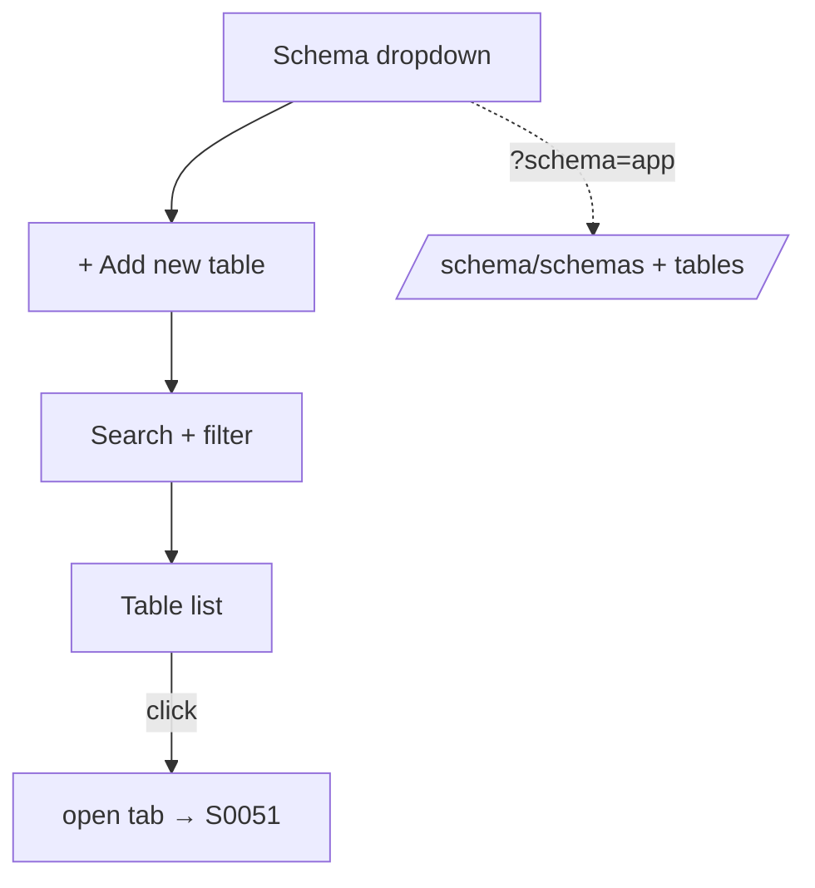

# S0050 — schema picker + scoped table list

> **Status:** todo · **Depends on** [[S0049-schema-scoped-introspection|S0049]] + [[done/S0047-contextual-sidebar|S0047]] · **Phase:** [[README]] · Parent: [[../../../feature_list/Jord/todo/jord-F0023-studio-shell-v2|jord-F0023]] · After ship: [[../../../tech_space/jord/studio/README]]

## Routing (who / how long / which model)

| | |
|--|--|
| **Suggested agent** | mimir → **apollo** |
| **Companion skills** | `.agents/skills/apollo/` · `.agents/skills/vercel-react-best-practices/` · `.agents/skills/fixing-accessibility/` |
| **Suggested model** | `claude-sonnet-5-5-high` |
| **Est. time** | **2–3 h** |
| **Parallel?** | **No** |

## Goal

The Data sidebar reads top to bottom as: **schema dropdown → + Add new table → table search + filter → table list**. Choosing a schema rescopes the list, the add action and the filter to that schema, and the choice persists per project and in the URL.

## Why now

The schema server contract landed in [[S0049-schema-scoped-introspection|S0049]]; this is the control that makes it usable. It is also the anchor for [[S0051-workspace-tabs|S0051]], because tabs are keyed `schema.table`.

## Context (read before coding)

| Kind | Where |
|------|-------|
| Intent | [[../../../feature_list/Jord/todo/jord-F0023-studio-shell-v2|jord-F0023]] (schema picker section) |
| Depends on | [[S0049-schema-scoped-introspection|S0049]] (`GET /schema/schemas`, `?schema=`) · [[done/S0047-contextual-sidebar|S0047]] (list primitive) |
| Code today | `apps/jord-studio/src/lib/{schema,database-api}.ts` · `components/schema-explorer.tsx` · `app/p/[project]/tables/page.tsx` |
| UI kit | Apolyx `Select`/combobox, `Input`, `Button`, `Badge` |

**Do not break:** search/filter never hides the picker or the add action; empty schema shows an inline state instead of an empty list; default `public` keeps today's look.

## In scope

- Schema dropdown: options from the server, default `public`, optional **All schemas** with `schema.table` labels; count badge per schema; read-only `main` on libSQL (no fake list).
- Non-default schema shown as a chip on the picker and a qualifier on each table row.
- **+ Add new table** opens the create inspector scoped to the selected schema (uses the column model later — stub with the existing create path until [[S0052-type-registry|S0052]]).
- Search (name, debounced) + filter menu (has rows / empty / tracked / has policies) — server-side filter once available, client-side until then.
- Persistence: project UI prefs + `?schema=` in the URL; restore on reload; switching does not lose the search string within a session.
- Table row: name, row estimate, badges (tracked / RLS / empty), context action to open in a tab.

## Out of scope

Tab bar ([[S0051-workspace-tabs|S0051]]) · rich column editing ([[S0053-column-settings|S0053]]) · schema create/drop.

## Diagram

## Steps (do in order)

1. Load apollo; read the existing `schema-explorer` and tables page.
2. Add the picker above the list; wire it to the scoped fetch.
3. Add the add-new-table entry point (inspector host from [[S0048-right-inspector|S0048]]).
4. Wire search/filter with debounce and empty states; persist selection.
5. Keyboard: picker, then list; `/` focuses search; `n` opens add table if the shell supports hotkeys.
6. Typecheck + build; smoke `public` and a second schema; paste proof.
7. **docs_man**: studio tech_space sidebar order; tick card.

## Done when

- [ ] Dropdown lists real schemas (and `main` on libSQL, read-only)
- [ ] Selecting a schema rescopes list + add action
- [ ] Selection survives reload and is in the URL
- [ ] Search/filter never hides picker or add action
- [ ] Typecheck + build pass; proof pasted

## Proof

| Date | Command | Result |
|------|---------|--------|
| | `pnpm --filter @altr/jord-studio typecheck` | |
| | `pnpm --filter @altr/jord-studio build` | |

## After ship

| Update | Path |
|--------|------|
| tech_space | `Docs/tech_space/jord/studio/README.md` |
| Queue | [[README]] |
