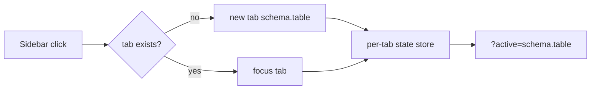

# S0051 — workspace tab bar (one tab per table)

> **Status:** todo · **Depends on** [[S0050-schema-picker-ui|S0050]] · **Phase:** [[README]] · Parent: [[../../../feature_list/Jord/todo/jord-F0023-studio-shell-v2|jord-F0023]] · After ship: [[../../../tech_space/jord/studio/README]]

## Routing (who / how long / which model)

| | |
|--|--|
| **Suggested agent** | mimir → **apollo** |
| **Companion skills** | `.agents/skills/apollo/` · `.agents/skills/vercel-react-best-practices/` · `.agents/skills/animate/` |
| **Suggested model** | `claude-sonnet-5-5-high` |
| **Est. time** | **2.5–3 h** |
| **Parallel?** | **No** |

## Goal

A tab strip above the content pane: clicking a table in the sidebar opens it as a tab (clicking again focuses the existing one), each tab keeps its own scroll/filters/column view, tabs are drag-reorderable and closable, and the active tab is reflected in the URL and restored on reload.

## Why now

Requested together with the schema picker; without tabs, switching tables loses every filter and scroll position, and [[S0056-grid-column-ops|S0056]] saved views have nowhere to live.

## Context (read before coding)

| Kind | Where |
|------|-------|
| Intent | [[../../../feature_list/Jord/todo/jord-F0023-studio-shell-v2|jord-F0023]] (workspace tabs) · [[../../../feature_list/Jord/todo/jord-F0025-tables-workspace-v2|jord-F0025]] |
| Depends on | [[S0050-schema-picker-ui|S0050]] (keying) · [[S0046-three-pane-shell|S0046]] (slot above content) |
| Code today | `app/p/[project]/tables/page.tsx` (single `?table=` view) |
| Tests | typecheck + build; keyboard smoke |

**Do not break:** no cross-project tabs; tab keys are `schema.table` so `public.users` and `auth.users` never collide; closing the last tab returns to the empty state, not a crash.

## In scope

- `<WorkspaceTabs>`: add (from sidebar click), focus-existing, close (× and `Ctrl/Cmd+W`), overflow menu when the strip is full, drag reorder (keyboard reorder with `Alt+←/→`).
- Per-tab state: scroll offset, filters, column order/widths, open inspector; kept in a per-project store, not global.
- URL: `?tabs=public.users,auth.users&active=public.users` (or `?table=` for the active only — pick one and document).
- Persistence across reload; a tab whose table was dropped shows a "table missing" state with a close action.
- Tabs appear for tables only in this card; SQL/function tabs are out of scope.
- Motion: tab add/remove under 150 ms, respects reduced motion.

## Out of scope

Split panes · cross-project tabs · pinning a tab · persisted tab history/back-stack beyond the active tab.

## Diagram

## Steps (do in order)

1. Load apollo; read the tables page and how `?table=` drives it today.
2. Build the tab strip on Apolyx primitives above the content slot.
3. Add the per-tab state store + URL sync + reload restore.
4. Wire sidebar clicks; handle dropped tables.
5. Keyboard close/reorder; reduced-motion check.
6. Typecheck + build; smoke 3 tabs + reload; paste proof.
7. **docs_man**: studio tech_space tab section; tick card.

## Done when

- [ ] Sidebar click opens/focuses a tab; keys use `schema.table`
- [ ] Filters + scroll survive switching tabs and reload
- [ ] Close via ×, `Ctrl/Cmd+W`, and overflow menu
- [ ] Dropped table shows a recoverable state
- [ ] Typecheck + build pass; proof pasted

## Proof

| Date | Command | Result |
|------|---------|--------|
| | `pnpm --filter @altr/jord-studio typecheck` | |

## After ship

| Update | Path |
|--------|------|
| tech_space | `Docs/tech_space/jord/studio/README.md` |
| Queue | [[README]] |
