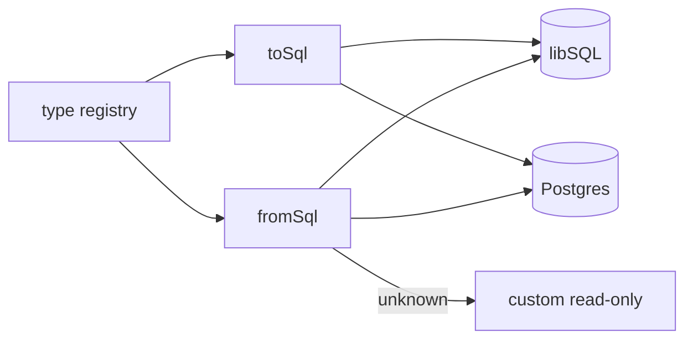

# S0052 — dialect type registry + introspection model

> **Status:** todo · **Phase:** [[README]] · Parent: [[../../../feature_list/Jord/todo/jord-F0024-column-model-v2|jord-F0024]] · After ship: [[../../../tech_space/jord/schema/README]]

## Routing (who / how long / which model)

| | |
|--|--|
| **Suggested agent** | mimir → **saga** |
| **Companion skills** | `.agents/skills/supabase-postgres-best-practices/` · `.agents/skills/graft/` |
| **Suggested model** | `claude-sonnet-5-5-high` — type mapping is where silent corruption hides |
| **Est. time** | **2–3 h** |
| **Parallel?** | **No** — S0053/S0054 depend on the registry |

## Goal

`elements/jord/src/schema/types/` exports a registry: for each logical type family → the DDL fragment per dialect, the read/write codec, the UI metadata (label, params, validation hints), and the reverse mapping used by introspection. Unknown legacy types map to a read-only `{ kind: 'custom', raw }` instead of being coerced.

## Why now

`jord-F0024` needs a real column model; today DDL accepts a thin list and introspection normalises into the same narrow set, so `numeric(10,2)`, `timestamptz` and `jsonb` lose meaning on round-trip.

## Context (read before coding)

| Kind | Where |
|------|-------|
| Intent | [[../../../feature_list/Jord/todo/jord-F0024-column-model-v2|jord-F0024]] (type tables) |
| As-built | [[../../../tech_space/jord/schema/README]] |
| Code today | `elements/jord/src/schema/{ddl,ddl-alter,migrate-type-map,introspect}.ts` · `elements/jord/src/adapter/{postgres,libsql}.ts` |
| Tests | `elements/jord/src/schema/{ddl,ddl-alter,introspect,migrate-type-map}.test.ts` |

**Do not break:** existing `migrate-type-map` behavior for phase-01 tables; snapshots (`elements/jord/src/snapshot.ts`).

## In scope

- Registry entry shape: `{ id, family, label, dialects: { libsql?, postgres? }, params?, codec, ui }`, with a `toSql(id, params)` and `fromSql(columnRow)` function.
- Coverage: strings, numbers (with precision/scale), boolean, date/time (with tz), uuid, json/jsonb, binary, network/array (Postgres only), enumerated (text+check vs native enum).
- Introspection returns the registry id + params; a type not in the registry returns `custom` with the raw SQL type and `readOnly: true`.
- `migrate-type-map` re-expressed on top of the registry (one mapping table, not two).
- Tests: round-trip create → introspect for every registry id on both dialects; unknown type stays custom.

## Out of scope

Column settings/validation ([[S0053-column-settings|S0053]]) · id strategies ([[S0054-id-strategies|S0054]]) · editor UI (uses the `ui` metadata later) · PostGIS.

## Diagram

## Steps (do in order)

1. Read `ddl.ts`, `ddl-alter.ts`, `introspect.ts`, `migrate-type-map.ts`; list every type string currently accepted.
2. Add the registry with dialect entries + params; no behavior change yet.
3. Rewire DDL + introspection + migrate-type-map to the registry.
4. Round-trip tests per id on both dialects; keep old tests green.
5. Typecheck + test; paste proof.
6. **docs_man**: schema tech_space type table; tick card.

## Done when

- [ ] Every type in the F0024 tables round-trips unchanged on its dialect
- [ ] Unsupported Postgres type appears as `custom` read-only, not coerced
- [ ] One mapping source (no duplicate table in migrate-type-map)
- [ ] Proof pasted

## Proof

| Date | Command | Result |
|------|---------|--------|
| | `pnpm --filter @altr/jord test` | |

## After ship

| Update | Path |
|--------|------|
| tech_space | `Docs/tech_space/jord/schema/README.md` |
| Queue | [[README]] |
