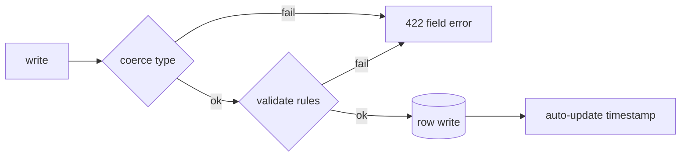

# S0053 — column settings + server-side validation

> **Status:** todo · **Depends on** [[S0052-type-registry|S0052]] · **Phase:** [[README]] · Parent: [[../../../feature_list/Jord/todo/jord-F0024-column-model-v2|jord-F0024]] · After ship: [[../../../tech_space/jord/schema/README]]

## Routing (who / how long / which model)

| | |
|--|--|
| **Suggested agent** | mimir → **saga** (model/DDL) + **sindri** (write path) |
| **Companion skills** | `.agents/skills/supabase-postgres-best-practices/` · `.agents/skills/graft/` |
| **Suggested model** | `claude-sonnet-5-5-high` |
| **Est. time** | **2.5–3 h** |
| **Parallel?** | **No** |

## Goal

Column metadata grows to: nullable/NOT NULL (explicit at create), default (literal / expression / `now()` / `gen_random_uuid()` / none), unique, primary key, auto-update timestamp, check expression, collation, comment — plus validation rules (min/max, length range, regex, enum values, date bounds) enforced **server-side on write** and surfaced as field-level errors.

## Why now

Validation today is form-only or missing, so a direct API write can store what the Studio would have rejected.

## Context (read before coding)

| Kind | Where |
|------|-------|
| Intent | [[../../../feature_list/Jord/todo/jord-F0024-column-model-v2|jord-F0024]] (per-column settings) |
| Depends on | [[S0052-type-registry|S0052]] |
| Code today | `elements/jord/src/schema/{ddl,ddl-alter}.ts` · `elements/jord/src/adapter/row-write.ts` · `cloud/jord/src/table-api/routes.ts` |
| Tests | `elements/jord/src/schema/ddl-alter.test.ts` · `row-write.test.ts` |

**Do not break:** existing tables without rules keep accepting writes; validation errors return **422** with `{ field, reason }`, not a 500.

## In scope

- Column definition schema + migration (store rules in the tracked-column metadata, not as opaque SQL only).
- `toSql` for `NOT NULL`, `DEFAULT`, `UNIQUE`, `PRIMARY KEY`, `CHECK`, `COLLATE`, `COMMENT`.
- Validator in the write path: type coercion first, then min/max/length/regex/enum/date bounds; runs for table API, records route and Studio writes (one function, three callers).
- Auto-update timestamp on the write path (not a trigger-only trick on one dialect).
- Studio: column editor form for every setting; invalid input shows the server message.
- Tests: each rule type accepted/rejected; unsafe DDL (type change, drop, NOT NULL without default) requires the confirm flag.

## Out of scope

Migration generation from diffs · database-level enum management screens · custom extension types.

## Diagram

## Steps (do in order)

1. Read DDL + row-write; note where type coercion already happens.
2. Add the rule model + column metadata storage.
3. Extend DDL + alter for the settings.
4. Add one validator used by all three write callers; map errors to 422.
5. Studio column editor fields + error display.
6. Typecheck (element + server + studio), tests; paste proof.
7. **docs_man**: schema tech_space + HTTP error table; tick card.

## Done when

- [ ] Every setting persists and round-trips through introspection
- [ ] A direct API write that violates a rule gets 422 with the field name
- [ ] Studio form shows the same message
- [ ] Unsafe DDL needs an explicit confirm
- [ ] Proof pasted

## Proof

| Date | Command | Result |
|------|---------|--------|
| | `pnpm --filter @altr/jord test` | |
| | `pnpm --filter @altr/jord-server test` | |

## After ship

| Update | Path |
|--------|------|
| tech_space | `Docs/tech_space/jord/schema/README.md` |
| Queue | [[README]] |
