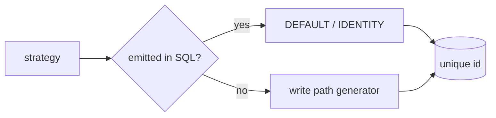

# S0054 — generated id strategies

> **Status:** todo · **Depends on** [[S0052-type-registry|S0052]] · **Phase:** [[README]] · Parent: [[../../../feature_list/Jord/todo/jord-F0024-column-model-v2|jord-F0024]] · After ship: [[../../../tech_space/jord/schema/README]]

## Routing (who / how long / which model)

| | |
|--|--|
| **Suggested agent** | mimir → **saga** |
| **Companion skills** | `.agents/skills/supabase-postgres-best-practices/` · `.agents/skills/graft/` |
| **Suggested model** | `gpt-5.6-sol-medium` |
| **Est. time** | **1.5–2 h** |
| **Parallel?** | **No** |

## Goal

A column can declare how its id is generated: identity always / by default, serial, sequence, uuid v4, uuid v7, ULID, nanoid, cuid2, or a custom default. Generation happens where the value is created (DDL default or write path) and is unique under concurrent inserts.

## Why now

The column model promises generated ids; nothing in the DDL path emits `gen_random_uuid()`, identity, or app-side ULID today.

## Context (read before coding)

| Kind | Where |
|------|-------|
| Intent | [[../../../feature_list/Jord/todo/jord-F0024-column-model-v2|jord-F0024]] (generated id) |
| Depends on | [[S0052-type-registry|S0052]] · [[S0053-column-settings|S0053]] (defaults) |
| Code today | `elements/jord/src/schema/ddl.ts` · `adapter/row-write.ts` |
| Tests | `elements/jord/src/schema/records.test.ts` · `row-write.test.ts` |

**Do not break:** existing tables whose ids are supplied by callers; no requirement for a Postgres extension that is not already enabled.

## In scope

- Strategy → DDL + write-path table: `identity`, `serial`, `sequence(name)`, `uuid_v4`, `uuid_v7`, `ulid`, `nanoid(size)`, `cuid2`, `custom(expression)`.
- Postgres: `GENERATED … AS IDENTITY` / `DEFAULT gen_random_uuid()` / `nextval('seq')`; libSQL: `INTEGER PRIMARY KEY AUTOINCREMENT` / text defaults, with app-side generation where SQL cannot.
- App-side generators as a small tested module (`ulid`, `nanoid`, `cuid2`, `uuidv7`) — no new dependency unless already used.
- Concurrency test: 50 parallel inserts produce 50 unique ids on each strategy/dialect.
- Studio: strategy picker tied to the column type (uuid type → uuid strategies only).

## Out of scope

Client-generated ids from a mobile app · snowflake node ids · id migration for existing rows.

## Diagram

## Steps (do in order)

1. Read DDL defaults + row-write; decide SQL vs app generation per dialect.
2. Implement generators + strategy mapping.
3. Wire into DDL and the write path (only when the column has no supplied value).
4. Concurrency tests per strategy.
5. Studio picker + validation.
6. Typecheck + test; paste proof.
7. **docs_man**: schema tech_space strategy table; tick card.

## Done when

- [ ] Every strategy works on its supported dialect and is documented as unsupported where it is
- [ ] 50 parallel inserts → 50 unique ids (test)
- [ ] No implicit change for tables without a strategy
- [ ] Proof pasted

## Proof

| Date | Command | Result |
|------|---------|--------|
| | `pnpm --filter @altr/jord test` | |

## After ship

| Update | Path |
|--------|------|
| tech_space | `Docs/tech_space/jord/schema/README.md` |
| Queue | [[README]] |
