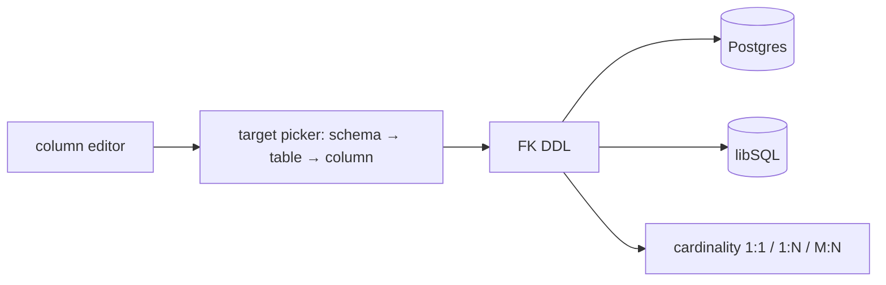

# S0055 — FK / relationship editor

> **Status:** todo · **Depends on** [[S0053-column-settings|S0053]] + [[S0050-schema-picker-ui|S0050]] · **Phase:** [[README]] · Parent: [[../../../feature_list/Jord/todo/jord-F0024-column-model-v2|jord-F0024]] · After ship: [[../../../tech_space/jord/schema/README]]

## Routing (who / how long / which model)

| | |
|--|--|
| **Suggested agent** | mimir → **saga** (DDL) + **apollo** (picker UI) |
| **Companion skills** | `.agents/skills/supabase-postgres-best-practices/` · `.agents/skills/apollo/` |
| **Suggested model** | `claude-sonnet-5-5-high` |
| **Est. time** | **2.5–3 h** |
| **Parallel?** | **No** |

## Goal

A foreign key is declared as **schema + table + column**, with composite keys, `ON DELETE` / `ON UPDATE` (`cascade`, `set null`, `restrict`, `no action`), a searchable target picker that defaults to the active sidebar schema but can reach another one, and cardinality (1:1 · 1:N · M:N) derived from uniqueness.

## Why now

`jord-F0024` moves relations into the column model, and [[S0061-erd-canvas|S0061]] / [[S0078-fk-embeds|S0078]] both need relations to be first-class (schema-qualified) rather than single-schema assumptions.

## Context (read before coding)

| Kind | Where |
|------|-------|
| Intent | [[../../../feature_list/Jord/todo/jord-F0024-column-model-v2|jord-F0024]] (Relationships) |
| Depends on | [[S0049-schema-scoped-introspection|S0049]] · [[S0053-column-settings|S0053]] |
| Code today | `elements/jord/src/schema/{ddl,ddl-alter,introspect}.ts` (FK introspection) · `components/schema-explorer.tsx` |
| Tests | `elements/jord/src/schema/introspect.test.ts` · `ddl-alter.test.ts` |

**Do not break:** existing FKs keep their constraints; dropping a referenced table still errors loudly; libSQL composite FK support matches what SQLite actually allows.

## In scope

- DDL + alter: `FOREIGN KEY (a, b) REFERENCES schema.tbl(x, y) ON DELETE … ON UPDATE …` with correct ordering of create/alter on both dialects (SQLite cannot add an FK by `ALTER` → document the rebuild path or refuse with a clear message).
- Introspection returns referenced `{ schema, table, column }` per FK, including composite ordering.
- Cardinality: unique FK column → 1:1, otherwise 1:N; join table (two FKs + composite PK) → M:N.
- Studio: FK section in the column editor with target picker (schema-first, then table search, then column), behavior selects, and a preview of the SQL to be run.
- Tests: cross-schema FK create + introspect; delete parent → cascade/set null/restrict as declared; invalid target rejected before DDL.

## Out of scope

Canvas drag-to-create ([[S0061-erd-canvas|S0061]]) · auto-index suggestions · polymorphic relations.

## Diagram

## Steps (do in order)

1. Read FK introspection + alter paths; check what SQLite allows today.
2. Extend the column model + DDL for schema-qualified and composite FKs.
3. Return referenced keys from introspection.
4. Build the picker (Apolyx combobox) with active-schema default and cross-schema override.
5. Tests for behavior on delete/update per dialect; reject impossible alters clearly.
6. Typecheck element + server + studio; paste proof.
7. **docs_man**: schema tech_space relations section; tick card.

## Done when

- [ ] Cross-schema FK created and introspected correctly
- [ ] Composite FK works on Postgres; libSQL limitation is a clear error, not a silent no-op
- [ ] ON DELETE behavior verified by test
- [ ] Picker defaults to the active schema and can reach another
- [ ] Proof pasted

## Proof

| Date | Command | Result |
|------|---------|--------|
| | `pnpm --filter @altr/jord test` | |

## After ship

| Update | Path |
|--------|------|
| tech_space | `Docs/tech_space/jord/schema/README.md` |
| Queue | [[README]] |
