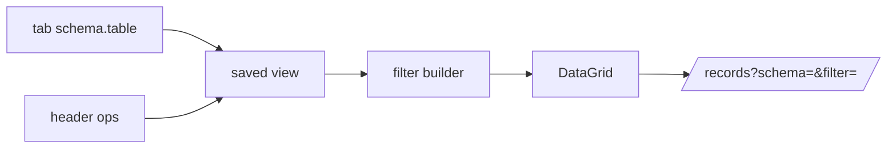

# S0056 — grid column ops, filter builder and saved views

> **Status:** todo · **Blocked until the grid exists** ([[../../../feature_list/ui-kit/apolyx-F0008-datagrid|apolyx-F0008]]) · **Phase:** [[README]] · Parent: [[../../../feature_list/Jord/todo/jord-F0025-tables-workspace-v2|jord-F0025]] · After ship: [[../../../tech_space/jord/studio/README]]

## Routing (who / how long / which model)

| | |
|--|--|
| **Suggested agent** | mimir → **apollo** (Studio consumes the kit; build any missing grid capability in `elements/ui-kit`, never locally) |
| **Companion skills** | `.agents/skills/apollo/` · `.agents/skills/vercel-react-best-practices/` |
| **Suggested model** | `claude-sonnet-5-5-high` |
| **Est. time** | **2.5–3 h** |
| **Parallel?** | **No** — do not fork a second table implementation in the app |

## Goal

The Tables screen renders through `@altr/apolyx` DataGrid with header actions (sort, filter, hide/show, pin left/right, resize, drag reorder, reset), a typed filter builder usable above the grid, quick search, and named views (filters + order + widths) saved per table per project.

## Why now

`jord-F0025` replaces the current records/table screens; the grid primitive is the gate. If contracting, the grid's missing pieces ship in the kit first (documented with apollo).

## Context (read before coding)

| Kind | Where |
|------|-------|
| Intent | [[../../../feature_list/Jord/todo/jord-F0025-tables-workspace-v2|jord-F0025]] (grid table) · [[../../../feature_list/ui-kit/apolyx-F0008-datagrid|apolyx-F0008]] |
| Depends on | [[S0050-schema-picker-ui|S0050]] (schema scope) · [[S0051-workspace-tabs|S0051]] (per-tab state) |
| Code today | `apps/jord-studio/src/components/{table-browser,records-browser,record-row-fields}.tsx` · `lib/records.ts` |
| Kit | `elements/ui-kit` — check what the DataGrid already exposes before adding anything |

**Do not break:** Apolyx-first rule; no `react-table`/AG-Grid added to the app.

## In scope

- Column model mapping (type registry ids from [[S0052-type-registry|S0052]]) → cell renderers + filter operators (text contains, numeric range, date range, boolean, null/not-null, FK equals).
- Header menu: sort asc/desc, hide, pin, resize, reorder (drag + keyboard), reset view.
- Filter builder chips above the grid, combined with AND; quick search mapping to text columns.
- Saved views: create/rename/apply/delete, stored per project per table (`schema.table` key), default view applied on tab open.
- Reset/loading/error states; column set change (new column) merges into the saved view without breaking it.

## Out of scope

Row insert/delete/bulk ([[S0057-row-ops-pagination|S0057]]) · inline edit ([[S0058-inline-edit-live-sync|S0058]]) · CSV import · spreadsheet formulas.

## Diagram

## Steps (do in order)

1. Load apollo; audit the DataGrid API against the list above; file kit gaps as apolyx-F0008 sub-tasks instead of patching in-app.
2. Wire DataGrid to the records API with the schema scope.
3. Build the header menu + filter builder.
4. Persist views + per-tab state.
5. Verify 10k-row table still scrolls (coordinate with [[S0057-row-ops-pagination|S0057]] for fetching).
6. Typecheck + build; paste proof.
7. **docs_man**: studio tech_space grid section; tick card.

## Done when

- [ ] Every header op works and survives reload via the view
- [ ] Filter operators match column types
- [ ] Saved views are per table per project
- [ ] No second grid implementation in the app
- [ ] Typecheck + build pass; proof pasted

## Proof

| Date | Command | Result |
|------|---------|--------|
| | `pnpm --filter @altr/apolyx test` | |
| | `pnpm --filter @altr/jord-studio typecheck` | |

## After ship

| Update | Path |
|--------|------|
| tech_space | `Docs/tech_space/jord/studio/README.md` + `Docs/tech_space/ui-kit/` |
| Queue | [[README]] |
