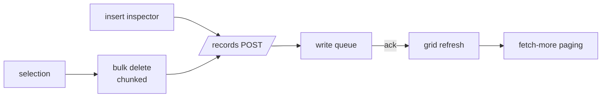

# S0057 — row operations, pagination and 10k-row performance

> **Status:** todo · **Depends on** [[done/S0056-grid-column-ops|S0056]] · **Phase:** [[README]] · Parent: [[../../../feature_list/Jord/todo/jord-F0025-tables-workspace-v2|jord-F0025]] · After ship: [[../../../tech_space/jord/studio/README]]

## Routing (who / how long / which model)

| | |
|--|--|
| **Suggested agent** | mimir → **apollo** (UI) with **sindri** for the fetch contract |
| **Companion skills** | `.agents/skills/apollo/` · `.agents/skills/vercel-react-best-practices/` · `.agents/skills/graft/` |
| **Suggested model** | `gpt-5.6-sol-medium` |
| **Est. time** | **2–3 h** |
| **Parallel?** | **No** |

## Goal

Row-level operations work from the grid and the inspector — insert row (typed form from the column model), duplicate, delete with confirm, multi-select + bulk delete — over a paginated fetch that keeps 10k rows scrolling without jank.

## Why now

The grid without row operations is read-only; `jord-F0025` acceptance requires 10k rows and destructive actions that behave.

## Context (read before coding)

| Kind | Where |
|------|-------|
| Intent | [[../../../feature_list/Jord/todo/jord-F0025-tables-workspace-v2|jord-F0025]] (Rows) |
| Depends on | [[done/S0056-grid-column-ops|S0056]] · [[done/S0048-right-inspector|S0048]] |
| Code today | `components/{create-record-form,record-detail}.tsx` · `lib/records.ts` · `cloud/jord/src/table-api/routes.ts` |
| Later | keyset paging lands in [[S0079-keyset-pagination|S0079]] — use offset paging now and keep the request shape swappable |

**Do not break:** existing delete semantics (`502 storage_delete_failed` is blobs only) · write queue ack before the row disappears · no bulk delete without a confirmation that names the count.

## In scope

- Insert row: inspector form generated from the column model (types, defaults, validation from [[S0053-column-settings|S0053]]).
- Duplicate row (same table, fresh PK), delete single with confirm naming the row, multi-select with checkbox column + select-all-on-page.
- Bulk delete: one request per batch (chunked), progress + per-row failure report; partial failure keeps successes.
- Pagination: page size selector, fetch-more append, count/estimate display, "jump to end" when cheap.
- Performance: virtualized body, 10k-row table scrolls without dropped frames; memoised cell renderers; no full re-render on selection change.
- Empty table state with the primary "insert row" action.

## Out of scope

Inline cell edit ([[S0058-inline-edit-live-sync|S0058]]) · CSV import/export · undo history.

## Diagram

## Steps (do in order)

1. Read the current create/delete flows; keep response shapes.
2. Build the insert form from column metadata and host it in the inspector.
3. Add selection, duplicate, delete, bulk delete with progress + failure report.
4. Add fetch-more paging + page size.
5. Measure 10k rows (insert via SQL seed) and record the frame budget in proof.
6. Typecheck + build; paste proof.
7. **docs_man**: studio tech_space grid rows section; tick card.

## Done when

- [ ] Insert/duplicate/delete/bulk delete all work and reflect in the grid after ack
- [ ] Bulk delete reports per-row failures instead of pretending success
- [ ] 10k rows scroll at the measured target
- [ ] Empty state offers insert
- [ ] Proof pasted

## Proof

| Date | Command | Result |
|------|---------|--------|
| | `pnpm --filter @altr/jord-studio build` | |

## After ship

| Update | Path |
|--------|------|
| tech_space | `Docs/tech_space/jord/studio/README.md` |
| Queue | [[README]] |
