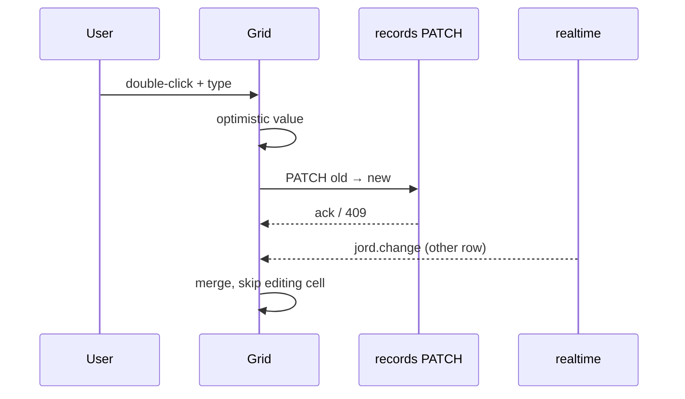

# S0058 — inline double-click edit + optimistic write + live merge

> **Status:** todo · **Depends on** [[S0057-row-ops-pagination|S0057]] · **Phase:** [[README]] · Parent: [[../../../feature_list/Jord/todo/jord-F0025-tables-workspace-v2|jord-F0025]] · After ship: [[../../../tech_space/jord/studio/README]]

## Routing (who / how long / which model)

| | |
|--|--|
| **Suggested agent** | mimir → **apollo** (UI state) + **sindri** (conditional write contract) |
| **Companion skills** | `.agents/skills/apollo/` · `.agents/skills/graft/` · `.agents/skills/vercel-react-best-practices/` |
| **Suggested model** | `claude-sonnet-5-5-high` — optimistic + concurrent edit edge cases |
| **Est. time** | **2.5–3 h** |
| **Parallel?** | **No** |

## Goal

Double-click a cell → typed editor → Enter commits / ESC cancels. The value updates optimistically, reconciles with the write-queue ack, rolls back with a visible error on rejection, and realtime events from other clients merge into the grid without overwriting a cell currently being edited.

## Why now

Editing is the core of the tables workspace and the place where optimistic state, the write queue, and realtime meet — the highest-risk UI in the wave.

## Context (read before coding)

| Kind | Where |
|------|-------|
| Intent | [[../../../feature_list/Jord/todo/jord-F0025-tables-workspace-v2|jord-F0025]] (Cell edit / Hot sync) |
| Depends on | [[S0057-row-ops-pagination|S0057]] · [[S0056-grid-column-ops|S0056]] · realtime from `jord-F0009` |
| Code today | `components/records-browser.tsx` · `lib/realtime-table.ts` · `elements/jord/src/adapter/records.ts` (OCC helpers) |
| Tests | `elements/jord/src/adapter/records.occ.test.ts` (existing optimistic-concurrency contract) |

**Do not break:** the existing OCC contract (`PATCH` with expected `old` value); realtime merge must not resurrect a deleted row; no write on blur without a change.

## In scope

- Grid cell editor by type (text, number, boolean toggle, date, enum select, FK search, JSON textarea with validation).
- Commit path: optimistic value → conditional PATCH with the previous value → ack reconciles or 409 conflict prompts reload/overwrite.
- Pending/error cell states (subtle, non-layout-shifting) + toast on failure with the server reason.
- Realtime merge: apply events by primary key, skip the row/cell under edit, queue and apply on commit; deleted row removes the row unless it has a pending edit.
- Keyboard: Tab/Shift-Tab to neighbouring cell, Enter commit, ESC cancel, arrows move.
- Test: two clients, one edits while the other writes — the edit survives and both converge.

## Out of scope

Multi-cell paste · cell-level audit history · collaborative multi-cursor (explicitly out).

## Diagram

## Steps (do in order)

1. Read the OCC helpers + `realtime-table.ts`; write down the conflict rules.
2. Build typed cell editors + commit/cancel keyboard handling.
3. Wire optimistic update, ack reconcile, rollback on rejection.
4. Implement the merge guard for the editing cell.
5. Two-client test (Playwright or a scripted two-tab run); typecheck + build.
6. **docs_man**: studio tech_space edit section; tick card.

## Done when

- [ ] Double-click edits persist and show the server value
- [ ] Rejected write restores the previous cell with a visible error
- [ ] Concurrent realtime event does not clobber an in-progress edit
- [ ] Deleted-by-other row disappears (or warns if being edited)
- [ ] Proof pasted

## Proof

| Date | Command | Result |
|------|---------|--------|
| | `pnpm --filter @altr/jord-studio typecheck` | |

## After ship

| Update | Path |
|--------|------|
| tech_space | `Docs/tech_space/jord/studio/README.md` |
| Queue | [[README]] |
