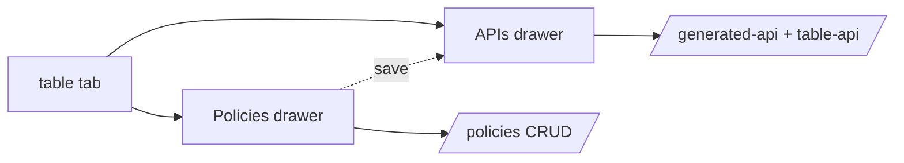

# S0059 — per-table Policies and APIs drawers

> **Status:** todo · **Depends on** [[done/S0048-right-inspector|S0048]] + [[done/S0056-grid-column-ops|S0056]] · **Phase:** [[README]] · Parent: [[../../../feature_list/Jord/todo/jord-F0025-tables-workspace-v2|jord-F0025]] · After ship: [[../../../tech_space/jord/studio/README]]

## Routing (who / how long / which model)

| | |
|--|--|
| **Suggested agent** | mimir → **apollo** |
| **Companion skills** | `.agents/skills/apollo/` · `.agents/skills/graft/` · `.agents/skills/web-design-guidelines/` |
| **Suggested model** | `claude-sonnet-5-5-high` |
| **Est. time** | **2.5–3 h** |
| **Parallel?** | **No** |

## Goal

Two buttons on the table (grid header and row action) open `?inspector=policies` and `?inspector=apis`: the first manages policies for that table with a preview of affected rows, the second documents every way to call the table — routes, auth header, copyable `curl`/`fetch`, a try-it runner, and the realtime channel name.

## Why now

`jord-F0025` pairs the grid with these drawers, and both reuse shipped backends (`jord-F0008` policies, `jord-F0006` APIs), so this is mostly surfacing.

## Context (read before coding)

| Kind | Where |
|------|-------|
| Intent | [[../../../feature_list/Jord/todo/jord-F0025-tables-workspace-v2|jord-F0025]] (Per-table actions) |
| Depends on | [[S0048-right-inspector|S0048]] · [[S0050-schema-picker-ui|S0050]] (schema-qualified table) |
| Code today | `components/{policies-panel,table-api-playground,generated-api-panel,custom-apis-panel}.tsx` · `cloud/jord/src/policies/` · `cloud/jord/src/generated-api/` |
| Policy tester | Full "run as user" lands in [[S0077-policy-tester|S0077]] — this card links to the existing preview only |

**Do not break:** policy save still goes through the existing endpoint; no secret or raw JWT in the examples (use the project publishable key).

## In scope

- **Policies drawer**: list (role, operation, filter summary, enabled), create/edit with row-filter builder (columns of this table), delete with confirm, and **affected rows** preview (count + first N) using the current principal.
- **APIs drawer**: tabs for Generated CRUD · Table API · Custom/functions; per endpoint: method, path (schema-qualified), auth header, copyable `curl` and `fetch`, "try it" with editable body, response viewer, and the realtime channel name for this table.
- Deep links `?inspector=policies` / `?inspector=apis` scoped to the active tab's table.
- Cross-links: a saved policy immediately updates the API drawer's example; policies drawer links to Database → Policies for the full list.
- Empty/loading/error states; no destructive action without confirm.

## Out of scope

Policy decision simulation across many users ([[S0077-policy-tester|S0077]]) · custom API authoring · schema-level policies.

## Diagram

## Steps (do in order)

1. Load apollo; read the four existing panels and the endpoints they call.
2. Build the Policies drawer with the filter builder + affected-rows preview.
3. Build the APIs drawer with per-endpoint examples + try-it.
4. Wire deep links + tab scope; keep examples schema-qualified.
5. Keyboard + copy affordances; typecheck + build.
6. **docs_man**: studio tech_space drawers section; tick card.

## Done when

- [ ] Both drawers deep-link and open for the active table
- [ ] Policy create/edit/delete works with a real affected-row preview
- [ ] API examples are copyable and the try-it runner returns the live response
- [ ] A saved policy is reflected in the API drawer
- [ ] Proof pasted

## Proof

| Date | Command | Result |
|------|---------|--------|
| | `pnpm --filter @altr/jord-studio typecheck` | |

## After ship

| Update | Path |
|--------|------|
| tech_space | `Docs/tech_space/jord/studio/README.md` |
| Queue | [[README]] |
