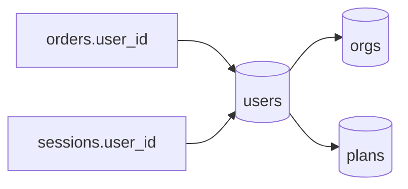

# S0060 — per-table relationships view

> **Status:** todo · **Depends on** [[S0055-fk-relationship-editor|S0055]] · **Phase:** [[README]] · Parent: [[../../../feature_list/Jord/todo/jord-F0027-relationship-canvas|jord-F0027]] · After ship: [[../../../tech_space/jord/schema/README]]

## Routing (who / how long / which model)

| | |
|--|--|
| **Suggested agent** | mimir → **apollo** |
| **Companion skills** | `.agents/skills/apollo/` · `.agents/skills/fixing-motion-performance/` |
| **Suggested model** | `gpt-5.6-sol-medium` |
| **Est. time** | **1.5–2 h** |
| **Parallel?** | **No** |

## Goal

A focused relationship view for one table: the table in the center, outgoing (references) on one side and incoming (referenced by) on the other, each edge labelled with cardinality and the `ON DELETE` / `ON UPDATE` behavior; clicking a neighbour re-centers; clicking an edge opens the constraint details.

## Why now

Cheap, high-value half of `jord-F0027` and the natural companion to the column editor — and it validates the relation data shape that the full canvas needs.

## Context (read before coding)

| Kind | Where |
|------|-------|
| Intent | [[../../../feature_list/Jord/todo/jord-F0027-relationship-canvas|jord-F0027]] (1. Per-table relationships) |
| Depends on | [[S0055-fk-relationship-editor|S0055]] (schema-qualified FKs + cardinality) |
| Code today | `components/schema-explorer.tsx` · `app/p/[project]/schema/` · `lib/schema.ts` |
| Tests | typecheck + build; visual check left to the user |

**Do not break:** no new schema reader — reuse the introspection endpoint from [[S0049-schema-scoped-introspection|S0049]].

## In scope

- Entry points: a "Relationships" action on the table tab/toolbar and from the schema explorer.
- Two columns of neighbour cards (outgoing / incoming) with column pairs (`user_id → users.id`), cardinality badge, and behavior chips (`ON DELETE CASCADE`).
- Click neighbour → re-center (URL `?table=&view=relations` so it is shareable).
- Edge/constraint detail panel: constraint name, columns, target, behaviors, and a link to the column editor.
- Empty state: "no relationships" with a link to add an FK.

## Out of scope

Free pan/zoom canvas ([[S0061-erd-canvas|S0061]]) · editing relations here (link to the column editor instead).

## Diagram

## Steps (do in order)

1. Load apollo; read the schema explorer patterns.
2. Build the focused layout with neighbour cards + edges from the introspection data.
3. Add re-centering, URL state, and the constraint detail.
4. Empty state + link into the column editor.
5. Typecheck + build; paste proof.
6. **docs_man**: schema tech_space relationship section; tick card.

## Done when

- [ ] Incoming and outgoing FKs are separated and labelled with cardinality
- [ ] Clicking a neighbour re-centers and updates the URL
- [ ] Constraint detail shows the behaviors
- [ ] Empty state links to add an FK
- [ ] Typecheck + build pass; proof pasted

## Proof

| Date | Command | Result |
|------|---------|--------|
| | `pnpm --filter @altr/jord-studio typecheck` | |

## After ship

| Update | Path |
|--------|------|
| tech_space | `Docs/tech_space/jord/schema/README.md` |
| Queue | [[README]] |
