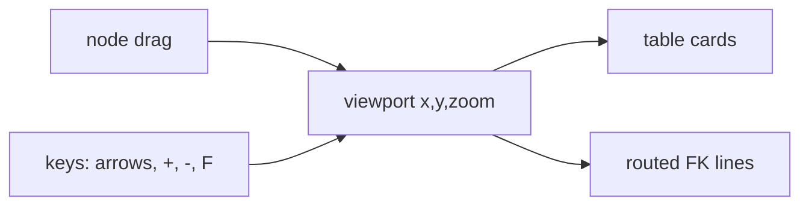

# S0061 — ERD canvas (pan, zoom, drag, relations)

> **Status:** todo · **Depends on** [[done/S0060-table-relationships-view|S0060]] · **Phase:** [[README]] · Parent: [[../../../feature_list/Jord/todo/jord-F0027-relationship-canvas|jord-F0027]] · After ship: [[../../../tech_space/jord/schema/README]]

## Routing (who / how long / which model)

| | |
|--|--|
| **Suggested agent** | mimir → **apollo** |
| **Companion skills** | `.agents/skills/apollo/` · `.agents/skills/fixing-motion-performance/` · `.agents/skills/vercel-react-best-practices/` |
| **Suggested model** | `claude-sonnet-5-5-high` — interaction + render performance |
| **Est. time** | **3 h** |
| **Parallel?** | **No** |

## Goal

A full-bleed canvas page: infinite grid background, two-axis pan (drag + scroll), zoom (wheel + buttons + fit-to-view), one card per table with key columns and type badges, relationship lines with cardinality, node drag with multi-select and optional snap-to-grid.

## Why now

This is the requested ERD view; layout persistence and FK dragging build on top in [[S0062-canvas-layout|S0062]].

## Context (read before coding)

| Kind | Where |
|------|-------|
| Intent | [[../../../feature_list/Jord/todo/jord-F0027-relationship-canvas|jord-F0027]] (2. Full ERD canvas) |
| Depends on | [[S0049-schema-scoped-introspection|S0049]] (schema scope, cross-schema FKs) · [[S0046-three-pane-shell|S0046]] (full-bleed page) |
| Code today | `app/p/[project]/schema/page.tsx` · `lib/schema.ts` |
| Constraints | No new canvas library unless already a dependency; SVG or CSS-transform based rendering, 60 fps target |

**Do not break:** interaction must work with keyboard (arrow-pan, +/- zoom); reduced-motion users get instant transitions; no layout writes to the database.

## In scope

- Viewport state (x, y, zoom) with clamped zoom (10–400 %), fit-to-view, and a minimap or "jump to table" list.
- Table cards: name, PK/FK marked columns, type badge; selected/hover/focused states; multi-select (shift-click, marquee).
- Edges: orthogonal or bezier routing that avoids node bodies, cardinality labels (1—1, 1—N, N—M), highlight when either endpoint is selected.
- Drag: single + multi-select drag, alignment guides, snap-to-grid toggle.
- 100 tables / 500 relations stays interactive (measured with a seeded schema).
- Empty state: "no tables in this schema".

## Out of scope

Saving the layout ([[S0062-canvas-layout|S0062]]) · dragging a column handle to create an FK ([[S0062-canvas-layout|S0062]]) · realtime multi-user cursors.

## Diagram

## Steps (do in order)

1. Load apollo; confirm no canvas dependency is already available; choose SVG + CSS transform.
2. Build the viewport (pan/zoom/fit) with keyboard equivalents.
3. Render cards + edges from introspection; add selection states.
4. Add drag (single/multi) + alignment guides + snap.
5. Seed 100 tables and measure interaction; record numbers.
6. Typecheck + build; paste proof.
7. **docs_man**: schema tech_space canvas section; tick card.

## Done when

- [ ] Pan in both axes, wheel zoom, fit-to-view, keyboard equivalents
- [ ] Node drag + multi-select drag work with guides and snap
- [ ] 100 tables / 500 relations measured interactive
- [ ] Cross-schema FKs render without collisions
- [ ] Proof pasted

## Proof

| Date | Command | Result |
|------|---------|--------|
| | `pnpm --filter @altr/jord-studio build` | |

## After ship

| Update | Path |
|--------|------|
| tech_space | `Docs/tech_space/jord/schema/README.md` |
| Queue | [[README]] |
