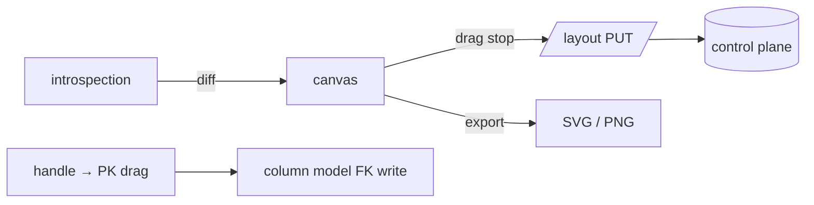

# S0062 — canvas layout persistence, auto-layout and FK drag

> **Status:** todo · **Depends on** [[S0061-erd-canvas|S0061]] + [[done/S0042-control-plane-store-adr|S0042]] · **Phase:** [[README]] · Parent: [[../../../feature_list/Jord/todo/jord-F0027-relationship-canvas|jord-F0027]] · After ship: [[../../../tech_space/jord/schema/README]]

## Routing (who / how long / which model)

| | |
|--|--|
| **Suggested agent** | mimir → **apollo** (canvas) + **saga** (layout storage) |
| **Companion skills** | `.agents/skills/apollo/` · `.agents/skills/graft/` |
| **Suggested model** | `claude-sonnet-5-5-high` |
| **Est. time** | **2.5–3 h** |
| **Parallel?** | **No** |

## Goal

Node positions persist per project (control plane, not the database), autosaving with an unsaved indicator; auto-layout (grid or force) gives a first view; a schema sync adds new tables near the viewport and removes dropped ones without moving the rest; dragging a column handle onto another table's PK proposes an FK through the column model; export SVG/PNG works.

## Why now

A canvas that forgets its positions is a demo. This card makes it a tool, and it completes `jord-F0027`'s acceptance.

## Context (read before coding)

| Kind | Where |
|------|-------|
| Intent | [[../../../feature_list/Jord/todo/jord-F0027-relationship-canvas|jord-F0027]] (Layout, Sync, Edits, Share) |
| Depends on | [[S0061-erd-canvas|S0061]] · [[S0055-fk-relationship-editor|S0055]] (FK write path) · [[done/S0042-control-plane-store-adr|S0042]] (where layout lives) |
| Code today | canvas from S0061 · project record from S0043 |
| Rule | layout is presentation only — never written into the project database |

**Do not break:** dropping a table must not reset other positions; a FK created from the canvas must use the same validation as the column editor.

## In scope

- `GET/PUT /admin/projects/:id/layout` (per schema scope) storing `{ schema, table, x, y, collapsed }`; debounced autosave + "saved/saving" indicator.
- Auto-layout button (grid + simple force) that can be applied to all or only unplaced nodes.
- Sync: diff introspection against stored layout; new tables placed near the viewport center; removed tables pruned after confirm.
- FK drag: handle → target PK, preview line, confirm dialog showing generated SQL and behavior defaults → [[S0055-fk-relationship-editor|S0055]] path; invalid targets rejected with a reason.
- Export: SVG (vector) and PNG (2×) of the current viewport or the whole graph.

## Out of scope

Multi-user cursors · diagram versioning/history · importing an external ERD.

## Diagram

## Steps (do in order)

1. Add the layout endpoint + storage in the control plane with a tests for round-trip.
2. Wire debounced autosave + indicator; restore on open.
3. Add auto-layout + sync diffing.
4. Implement FK drag with preview + confirm.
5. Export SVG/PNG.
6. Typecheck + build; test reload + schema-change behavior; paste proof.
7. **docs_man**: schema tech_space layout section; tick card.

## Done when

- [ ] Positions survive reload per project and per schema
- [ ] Auto-layout works and is reversible (undo to previous positions)
- [ ] New table appears near the viewport; dropped table disappears without moving others
- [ ] Canvas FK creation appears in the column editor; invalid target rejected
- [ ] Export produces a usable SVG/PNG
- [ ] Proof pasted

## Proof

| Date | Command | Result |
|------|---------|--------|
| | `pnpm --filter @altr/jord-studio typecheck` | |

## After ship

| Update | Path |
|--------|------|
| tech_space | `Docs/tech_space/jord/schema/README.md` |
| Queue | [[README]] |
