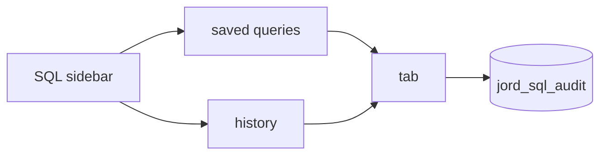

# S0064 — query tabs, saved queries and history

> **Status:** todo · **Depends on** [[S0063-monaco-sql-editor|S0063]] · **Phase:** [[README]] · Parent: [[../../../feature_list/Jord/todo/jord-F0028-sql-editor-v2|jord-F0028]] · After ship: [[../../../tech_space/jord/studio/README]]

## Routing (who / how long / which model)

| | |
|--|--|
| **Suggested agent** | mimir → **apollo** (UI) + **saga** (saved-query storage) |
| **Companion skills** | `.agents/skills/apollo/` · `.agents/skills/graft/` |
| **Suggested model** | `gpt-5.6-sol-medium` |
| **Est. time** | **2–3 h** |
| **Parallel?** | **No** |

## Goal

The SQL workspace gets tabs (create, rename, reorder, close with unsaved guard), saved queries stored per project, and a searchable execution history (timestamp, duration, status) that re-opens a past statement — with the history list living in the SQL contextual sidebar.

## Why now

`jord-F0028` and the sidebar section from [[S0047-contextual-sidebar|S0047]] both point at this; without it every query is lost on navigation.

## Context (read before coding)

| Kind | Where |
|------|-------|
| Intent | [[../../../feature_list/Jord/todo/jord-F0028-sql-editor-v2|jord-F0028]] (Tabs, History) |
| Depends on | [[S0063-monaco-sql-editor|S0063]] · [[S0047-contextual-sidebar|S0047]] |
| Code today | `cloud/jord/src/sql/routes.ts` · `jord_sql_audit` via `elements/jord/src/schema/sql-console.ts` (check the existing audit shape before adding a table) |
| Storage | saved queries in the project DB (they are user data), history from the existing audit table where possible |

**Do not break:** audit rows are the source of truth for history — do not duplicate the audit table; read-only guard untouched.

## In scope

- Tabs: `+`, rename, drag reorder, close; unsaved-changes guard (`dirty` = text differs from saved/executed snapshot); restore tabs after reload (per project + user).
- Saved queries: save/rename/delete, stored per project, listed with search in the sidebar; opening replaces the current tab or a new one (state which).
- History: list from the audit source with time, duration, status, row count; click re-opens the statement in a tab; search + filter (failed only, mine only if multi-user later).
- Keyboard: `Ctrl/Cmd+Enter` run, `Ctrl/Cmd+T` new tab, `Ctrl/Cmd+W` close tab, `Ctrl/Cmd+S` save.

## Out of scope

Sharing queries between users · folders · query parameters/bind variables.

## Diagram

## Steps (do in order)

1. Inspect the audit schema; decide history read model (view/query, no new table unless justified).
2. Add saved-query storage + endpoints (project scoped, admin/editor roles as existing).
3. Build tabs + dirty guard + persistence.
4. Wire the sidebar lists with search.
5. Keyboard shortcuts; typecheck + build; paste proof.
6. **docs_man**: studio tech_space SQL tabs/history; tick card.

## Done when

- [ ] Tabs survive reload and guard unsaved changes on close
- [ ] Saved queries are per project and searchable
- [ ] History comes from the audit source and re-opens a statement
- [ ] Shortcuts work
- [ ] Proof pasted

## Proof

| Date | Command | Result |
|------|---------|--------|
| | `pnpm --filter @altr/jord-studio typecheck` | |

## After ship

| Update | Path |
|--------|------|
| tech_space | `Docs/tech_space/jord/studio/README.md` |
| Queue | [[README]] |
