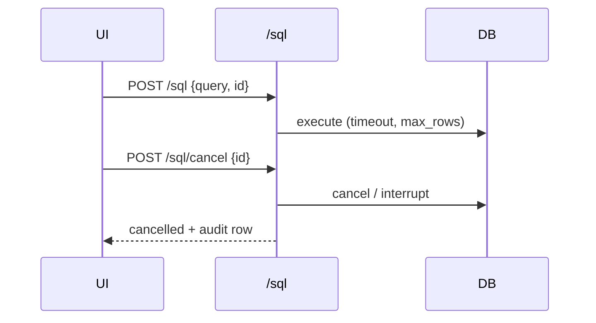

# S0065 — query results grid, export, explain and cancel

> **Status:** todo · **Depends on** [[S0063-monaco-sql-editor|S0063]] · **Phase:** [[README]] · Parent: [[../../../feature_list/Jord/todo/jord-F0028-sql-editor-v2|jord-F0028]] · After ship: [[../../../tech_space/jord/studio/README]]

## Routing (who / how long / which model)

| | |
|--|--|
| **Suggested agent** | mimir → **apollo** (results UI) + **sindri** (cancel, explain, timeouts) |
| **Companion skills** | `.agents/skills/apollo/` · `.agents/skills/supabase-postgres-best-practices/` · `.agents/skills/graft/` |
| **Suggested model** | `claude-sonnet-5-5-high` — server-side cancel and timeout paths |
| **Est. time** | **2.5–3 h** |
| **Parallel?** | **No** |

## Goal

Query results render in the Apolyx DataGrid (sort, filter, copy cell/row, CSV/JSON export, affected-row count, timing, fetch-more, JSON/blob cell detail), `EXPLAIN` renders as a readable plan tree, and a running query can be cancelled in under two seconds with a statement timeout and row-limit guard.

## Why now

`jord-F0028` is not usable for real work without results, plans and a stop button; the read-only/audit invariants are already in place and must survive.

## Context (read before coding)

| Kind | Where |
|------|-------|
| Intent | [[../../../feature_list/Jord/todo/jord-F0028-sql-editor-v2|jord-F0028]] (Results, Explain, Control) |
| Depends on | [[S0063-monaco-sql-editor|S0063]] · [[S0056-grid-column-ops|S0056]] (DataGrid) |
| Code today | `cloud/jord/src/sql/routes.ts` · `sql/routes.ts` guards tests · `cloud/jord/src/http/body-limit.ts` |
| Dialect | Postgres `pg_cancel_backend` / `statement_timeout`; libSQL interrupt via the adapter's execute handle |

**Do not break:** read-only default and `jord_sql_audit` writes; a cancelled query must be audited as cancelled, not as success; result shape stays JSON.

## In scope

- Server: `POST /sql/cancel` with a query id; per-statement timeout (configurable); row-limit guard (`max_rows`) that truncates with a marker instead of OOM.
- Explain: `EXPLAIN` / `EXPLAIN ANALYZE` (Postgres) and `EXPLAIN QUERY PLAN` (libSQL), normalised into `{ node, detail, rows, cost, children[] }`.
- Results: DataGrid with sort/filter (client), copy cell/row, export visible set as CSV/JSON, fetch-more, affected rows + duration, error mapped to line/column when the engine reports a position.
- Cancel button with optimistic "cancelling…" state and under-2 s confirmation; session survives.
- Transaction controls visible while a transaction is open (BEGIN / COMMIT / ROLLBACK) with a clear warning if the session ends dirty.

## Out of scope

Schema diff authoring from SQL · stored procedure UI · query plan history.

## Diagram

## Steps (do in order)

1. Read `sql/routes.ts` + guards; note the audit fields.
2. Add query ids, cancel, timeout, row limit; map cancellation errors.
3. Add explain normalisation for both dialects.
4. Build the DataGrid results view + export + cell detail.
5. Transaction controls + dirty-session warning.
6. Tests: cancel long query, timeout, row-limit truncation, explain shape; typecheck + build.
7. **docs_man**: studio + SQL tech_space; tick card.

## Done when

- [ ] Long query cancels in under 2 s and the session survives
- [ ] Timeout + row-limit guards tested
- [ ] Explain renders a plan tree on both dialects
- [ ] CSV export matches the visible set
- [ ] Cancelled queries are audited as cancelled
- [ ] Proof pasted

## Proof

| Date | Command | Result |
|------|---------|--------|
| | `pnpm --filter @altr/jord-server test` | |

## After ship

| Update | Path |
|--------|------|
| tech_space | `Docs/tech_space/jord/studio/README.md` |
| Queue | [[README]] |
