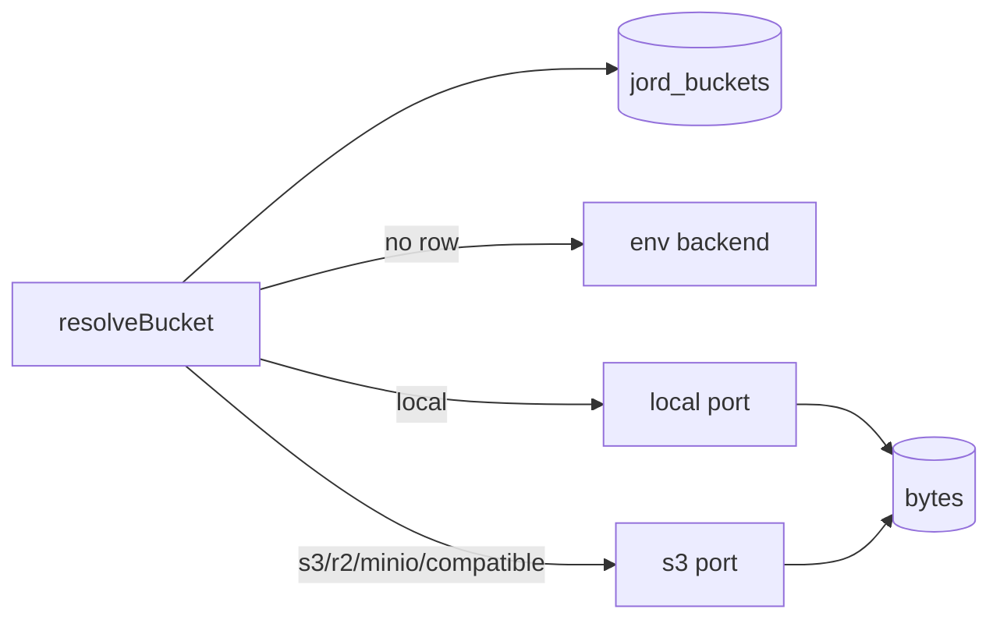

# S0066 — jord_buckets registry + per-bucket provider resolution

> **Status:** todo · **Phase:** [[README]] · Parent: [[../../../feature_list/Jord/todo/jord-F0029-storage-buckets|jord-F0029]] · After ship: [[../../../tech_space/jord/blobs/README]]

## Routing (who / how long / which model)

| | |
|--|--|
| **Suggested agent** | mimir → **saga** (table + migration) + **sindri** (resolution wiring) |
| **Companion skills** | `.agents/skills/supabase-postgres-best-practices/` · `.agents/skills/graft/` |
| **Suggested model** | `claude-sonnet-5-5-high` |
| **Est. time** | **2.5–3 h** |
| **Parallel?** | **No** — S0067/S0068 depend on this shape |

## Goal

A `jord_buckets` table holds name/slug, provider (`local` · `s3` · `r2` · `minio` · `s3-compatible`), connection fields, limits (max size, MIME allowlist, TTL), access defaults, status and optional linked table. The storage layer resolves a **port per bucket**, falling back to the env backend for buckets with no explicit provider.

## Why now

`JORD_STORAGE_BACKEND` is one global choice (`cloud/jord/src/storage/`), so a project cannot mix a local bucket with an S3 bucket — the exact configuration the storage feature asks for.

## Context (read before coding)

| Kind | Where |
|------|-------|
| Intent | [[../../../feature_list/Jord/todo/jord-F0029-storage-buckets|jord-F0029]] (registry table) |
| As-built | [[../../../tech_space/jord/blobs/README]] · shipped in [[../../../feature_list/Jord/done/jord-F0010-blobs|jord-F0010]] |
| Code today | `cloud/jord/src/storage/{port,local,s3,lifecycle,sign-policy,copy-plan}.ts` · `cloud/jord/src/blobs/routes.ts` · migration `0006_storage_v2` |
| Tests | `cloud/jord/src/blobs/delete-failure.test.ts` · `storage/s3-live.test.ts` (gated on `JORD_TEST_S3_ENDPOINT`) |

**Do not break:** `JordStoragePort`, pending → finalize → GC lifecycle, signed-URL shape (`{ url, method, headers, expires_at, object, storage }`), the 1 h TTL clamp, and the `502 storage_delete_failed` contract.

## In scope

- Migration `jord_buckets` (+ `jord_blobs.bucket` stays the join), dialect-safe.
- Resolution: `resolveBucket(name)` → config → cached port instance (per bucket, keyed by provider + endpoint + physical bucket so ports are reused, not rebuilt per request).
- Env-backed buckets keep working: no row ⇒ env backend; first explicit save materializes a row with `provider = env default`.
- Limits enforced at sign/upload time (max size, MIME allowlist, TTL clamp) using the bucket row, not globals.
- Tests: two buckets with different providers in one project; env-only bucket still serves; limits enforced server-side.

## Out of scope

The HTTP config API + credential encryption ([[S0067-bucket-config-api|S0067]]) · Studio UI ([[S0068-storage-studio-ui|S0068]]) · multipart/resumable ([[S0081-multipart-uploads|S0081]]).

## Diagram

## Steps (do in order)

1. Read the port + both adapters; list what differs per provider (path style, region, endpoint).
2. Add the migration + schema types; seed rows lazily from env on first access.
3. Implement `resolveBucket` with a port cache.
4. Move limit checks from globals to bucket config.
5. Tests: mixed providers, env fallback, limit rejection.
6. Typecheck + test (skip S3 live unless env is set); paste proof.
7. **docs_man**: blobs tech_space provider table; tick card.

## Done when

- [ ] Two buckets with different providers serve upload/download/delete in one test
- [ ] A bucket with no row still uses the env backend unchanged
- [ ] Size/MIME/TTL limits come from the bucket row
- [ ] Port cache does not leak or re-authenticate per request
- [ ] Proof pasted

## Proof

| Date | Command | Result |
|------|---------|--------|
| | `pnpm --filter @altr/jord-server test` | |

## After ship

| Update | Path |
|--------|------|
| tech_space | `Docs/tech_space/jord/blobs/README.md` |
| Queue | [[README]] |
