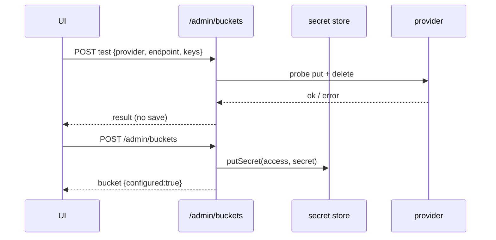

# S0067 — bucket config API, encrypted credentials, test connection

> **Status:** todo · **Depends on** [[S0066-bucket-registry|S0066]] + [[S0042-control-plane-store-adr|S0042]] · **Phase:** [[README]] · Parent: [[../../../feature_list/Jord/todo/jord-F0029-storage-buckets|jord-F0029]] · After ship: [[../../../tech_space/jord/blobs/README]]

## Routing (who / how long / which model)

| | |
|--|--|
| **Suggested agent** | mimir → **sindri** (routes) + **saga** (credential storage) · **heimdall** reviews the secret surface |
| **Companion skills** | `.agents/skills/graft/` · `.agents/skills/hono-typescript/` · `.agents/skills/security-and-hardening/` |
| **Suggested model** | `claude-sonnet-5-5-high` |
| **Est. time** | **2.5–3 h** |
| **Parallel?** | **No** |

## Goal

`/admin/buckets` CRUD: create/update bucket config per provider (endpoint, region, physical bucket, prefix, path-style), write-only credentials via the control-plane secret store, a **test connection** that saves nothing on failure, credential rotation, and pause/resume. No secret ever appears in a response.

## Why now

`S0066` gives the registry shape; without this API the Studio wizard has nothing real to talk to, and credentials would otherwise have to live in env per deployment.

## Context (read before coding)

| Kind | Where |
|------|-------|
| Intent | [[../../../feature_list/Jord/todo/jord-F0029-storage-buckets|jord-F0029]] (Studio surfaces, acceptance 2–3) |
| Depends on | [[S0066-bucket-registry|S0066]] · [[S0042-control-plane-store-adr|S0042]] secret port |
| Code today | `cloud/jord/src/blobs/routes.ts` (`GET/POST /blobs/buckets` today) · `storage/s3.ts` (client factory) · `auth/admin.ts` |
| Tests | `cloud/jord/src/blobs/delete-failure.test.ts` patterns for stub storage |

**Do not break:** `GET /blobs/buckets` keeps returning names for existing clients; signed-URL and delete contracts unchanged; **no** `access_key`/`secret` in any JSON.

## In scope

- `GET /admin/buckets`, `POST /admin/buckets`, `PATCH /admin/buckets/:name`, `POST /admin/buckets/:name/test`, `POST /admin/buckets/:name/rotate`, `POST /admin/buckets/:name/pause|resume`.
- Provider validation matrix (endpoint required for minio/compatible; region + physical bucket for s3/r2; path-style default true for minio).
- Credentials: write-only input, encrypted at rest, `configured: true` + prefix/last4 in responses.
- Test connection: HEAD/list/put-delete a tiny probe object in the configured prefix, then clean up; failure returns the provider error and writes **no** row.
- Rotation: new credentials tested before swap; old credentials rejected afterwards.
- Tests: failed test → no row; secrets absent from JSON (assert on serialized body); rotation invalidates old keys (stub or MinIO).

## Out of scope

Provider account provisioning · GCS/Azure adapters · CDN config · per-bucket billing.

## Diagram

## Steps (do in order)

1. Read `blobs/routes.ts` + `storage/s3.ts`; note how the client is constructed today.
2. Add the admin route group + validation matrix.
3. Store credentials via the control-plane port; never echo them.
4. Implement the probe (put → head → delete) with a short timeout and cleanup.
5. Tests incl. serialized-body secret assertion and rotation.
6. Typecheck + test; paste proof.
7. **docs_man**: blobs tech_space HTTP table + "not yet"; tick card.

## Done when

- [ ] CRUD + test + rotate + pause work for all five providers
- [ ] Failed test saves nothing
- [ ] Serialized responses contain no credential material (asserted)
- [ ] Old credentials fail immediately after rotation
- [ ] Proof pasted

## Proof

| Date | Command | Result |
|------|---------|--------|
| | `pnpm --filter @altr/jord-server test` | |

## After ship

| Update | Path |
|--------|------|
| tech_space | `Docs/tech_space/jord/blobs/README.md` |
| Queue | [[README]] |
