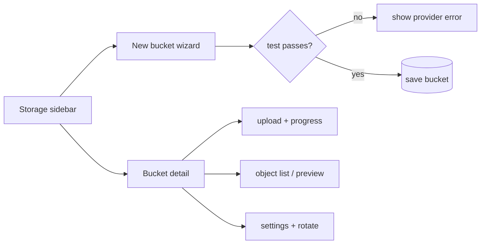

# S0068 — Studio bucket wizard, object browser and settings

> **Status:** todo · **Depends on** [[S0067-bucket-config-api|S0067]] · **Phase:** [[README]] · Parent: [[../../../feature_list/Jord/todo/jord-F0029-storage-buckets|jord-F0029]] · After ship: [[../../../tech_space/jord/studio/README]]

## Routing (who / how long / which model)

| | |
|--|--|
| **Suggested agent** | mimir → **apollo** |
| **Companion skills** | `.agents/skills/apollo/` · `.agents/skills/vercel-react-best-practices/` · `.agents/skills/web-design-guidelines/` |
| **Suggested model** | `claude-sonnet-5-5-high` |
| **Est. time** | **3 h** |
| **Parallel?** | **No** — split only if it exceeds the estimate |

## Goal

The **Storage** section becomes bucket-centric: sidebar list with provider badge + object count, a New-bucket wizard in the inspector (provider → connection → test → save), and a bucket detail view with drag-and-drop upload (progress), object list (type/size/updated), preview, download, copy signed URL, delete, plus a settings tab for config, limits and credential rotation.

## Why now

`jord-F0029` is explicitly "configure buckets in Studio"; the API landed in S0067, this is the operator surface.

## Context (read before coding)

| Kind | Where |
|------|-------|
| Intent | [[../../../feature_list/Jord/todo/jord-F0029-storage-buckets|jord-F0029]] (Studio surfaces) |
| Depends on | [[S0067-bucket-config-api|S0067]] · [[done/S0047-contextual-sidebar|S0047]] · [[S0048-right-inspector|S0048]] |
| Code today | `components/storage-panel.tsx` · `app/p/[project]/storage/` · `lib/blobs.ts` · BFF `app/api/blobs/` |
| UI kit | Apolyx `Field`, `Select`, `Tabs`, `Progress`, `Sheet`, `Table` |

**Do not break:** Apolyx-first; no secret value rendered or put in a URL; existing bucket list still works for env-backed buckets.

## In scope

- Sidebar: bucket rows (name, provider badge, object count, paused state) + "New bucket".
- Wizard (inspector): provider picker → connection form (fields per provider) → **Test connection** with inline result → Save (disabled until the test passes); cannot create without a passing test.
- Detail: drag-and-drop + file picker upload with per-file progress and failure reason (size/MIME rejected server-side); object list with search; preview for images/PDF/text; download; copy signed URL with expiry shown; delete with confirm.
- Settings tab: connection (secrets as masked write-only fields), limits, access, pause/resume, rotate credentials, linked table selector.
- Uploads above the limit or with a disallowed type show the server error, not a generic toast.

## Out of scope

Move local → S3 wizard UI (keep the documented CLI/copy-plan flow) · image transforms · CDN settings · file versioning.

## Diagram

## Steps (do in order)

1. Load apollo; read the storage panel + BFF routes.
2. Build the sidebar list + provider badge.
3. Build the wizard with the live test gate.
4. Build the detail view: upload, list, preview, delete, signed URL.
5. Build the settings tab incl. rotation and pause.
6. Typecheck + build; test with a local bucket and one MinIO/S3 bucket; paste proof.
7. **docs_man**: studio tech_space storage section; tick card.

## Done when

- [ ] Two buckets with different providers are visible with badges
- [ ] Wizard cannot save without a passing connection test
- [ ] Upload/download/preview/delete work from the browser
- [ ] Size/MIME rejections show the server reason
- [ ] Settings persist; rotation invalidates old credentials
- [ ] Proof pasted

## Proof

| Date | Command | Result |
|------|---------|--------|
| | `pnpm --filter @altr/jord-studio typecheck` | |
| | `pnpm --filter @altr/jord-studio build` | |

## After ship

| Update | Path |
|--------|------|
| tech_space | `Docs/tech_space/jord/studio/README.md` |
| Queue | [[README]] |
