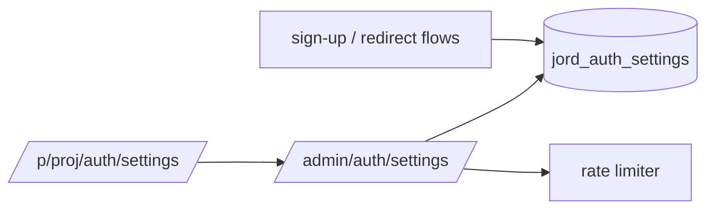

# S0069 — auth settings store + config API

> **Status:** todo · **Phase:** [[README]] · Parent: [[../../../feature_list/Jord/todo/jord-F0030-auth-console|jord-F0030]] · After ship: [[../../../tech_space/jord/auth/README]]

## Routing (who / how long / which model)

| | |
|--|--|
| **Suggested agent** | mimir → **heimdall** (auth surface) + **sindri** (routes) |
| **Companion skills** | `.agents/skills/graft/` · `.agents/skills/security-and-hardening/` · `.agents/skills/hono-typescript/` |
| **Suggested model** | `claude-sonnet-5-5-high` |
| **Est. time** | **2.5–3 h** |
| **Parallel?** | **No** — the console sections read this document |

## Goal

One `jord_auth_settings` document per project with `GET/PATCH /admin/auth/settings`: sign-ups enabled, autoconfirm, password policy, site URL, redirect allowlist, per-endpoint rate limits, session lifetime. Server behavior reads the settings — a disabled sign-up actually fails, not just hides a form.

## Why now

`jord-F0030` is a console over server capability; without a settings store the Supabase-style sections would be decorative toggles.

## Context (read before coding)

| Kind | Where |
|------|-------|
| Intent | [[../../../feature_list/Jord/todo/jord-F0030-auth-console|jord-F0030]] (Settings, URL configuration, Rate limits) |
| As-built | [[../../../tech_space/jord/auth/README]] · shipped [[../../../feature_list/Jord/done/jord-F0005-auth|jord-F0005]] |
| Code today | `cloud/jord/src/auth/{config,routes,admin,password,jwt}.ts` · `route-inventory.ts` |
| Tests | `cloud/jord/src/auth/principals.test.ts` · `token.test.ts` |

**Do not break:** existing env-driven auth config keeps working as defaults; enumeration-safe responses; admin-only access.

## In scope

- Schema + migration `jord_auth_settings` (one row per project, JSON or columns with a typed validator).
- `GET/PATCH /admin/auth/settings` with validation (URL format, wildcard rules, limit ranges) and audit of changes.
- Enforcement: sign-up toggle, autoconfirm, password rules, redirect allowlist (server-side check on every redirect parameter), rate limits wired to the limiter from [[S0036-shared-rate-limit-idempotency|S0036]] where available.
- Defaults documented; missing row ⇒ today's behavior.
- Tests: disabling sign-up → sign-up 403; redirect not in allowlist → rejected (open-redirect test); limit change takes effect.

## Out of scope

Provider credentials and JWT key management → [[S0071-auth-console-sections|S0071]] · email templates → [[S0072-email-templates|S0072]] · OAuth/magic link capability → [[S0073-mailer-port|S0073]]–[[S0075-oauth-provider|S0075]].

## Diagram

## Steps (do in order)

1. Read `auth/config.ts` + routes; list every currently hardcoded behavior.
2. Add the table + typed settings loader with defaults.
3. Implement GET/PATCH with validation + audit; update `route-inventory.ts`.
4. Enforce the flags in sign-up, redirect validation and rate limiting.
5. Tests for each enforcement path.
6. Typecheck + test; paste proof.
7. **docs_man**: auth tech_space settings table; tick card.

## Done when

- [ ] Settings persist per project and reload
- [ ] Disabled sign-up returns an error from the server (tested)
- [ ] Off-allowlist redirect rejected (tested)
- [ ] Rate-limit changes take effect
- [ ] Proof pasted

## Proof

| Date | Command | Result |
|------|---------|--------|
| | `pnpm --filter @altr/jord-server test` | |

## After ship

| Update | Path |
|--------|------|
| tech_space | `Docs/tech_space/jord/auth/README.md` |
| Queue | [[README]] |
