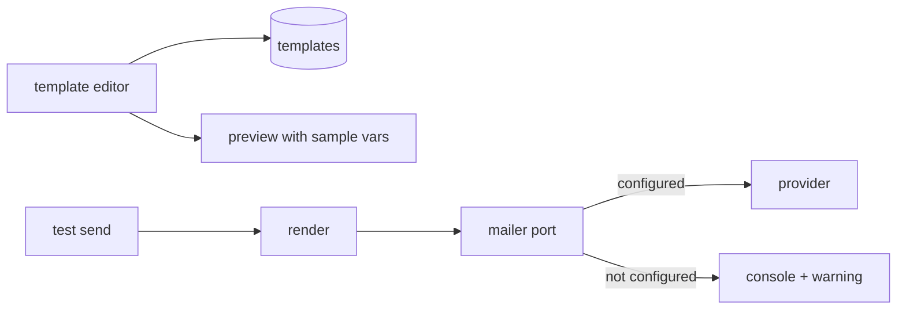

# S0072 — email templates + test send

> **Status:** todo · **Blocked on** [[S0073-mailer-port|S0073]] for real delivery · **Phase:** [[README]] · Parent: [[../../../feature_list/Jord/todo/jord-F0030-auth-console|jord-F0030]] · After ship: [[../../../tech_space/jord/auth/README]]

## Routing (who / how long / which model)

| | |
|--|--|
| **Suggested agent** | mimir → **apollo** (UI) + **sindri** (render + send path) |
| **Companion skills** | `.agents/skills/apollo/` · `.agents/skills/security-and-hardening/` |
| **Suggested model** | `gpt-5.6-sol-medium` |
| **Est. time** | **2–3 h** |
| **Parallel?** | **No** |

## Goal

An **Email** section: subject + body per template (confirm sign-up, magic link, password reset, invite), variable list with insert affordance, sender name/address, and **Send test** that delivers through the configured mailer with the real template rendering.

## Why now

Templates are part of the requested auth menu; once `S0073` ships a real mailer, this is the operator control for it. Until then it works against the console mailer and says so.

## Context (read before coding)

| Kind | Where |
|------|-------|
| Intent | [[../../../feature_list/Jord/todo/jord-F0030-auth-console|jord-F0030]] (Email) |
| Depends on | [[S0073-mailer-port|S0073]] (delivery) · [[S0069-auth-settings-store|S0069]] (settings doc) |
| Code today | `cloud/jord/src/auth/mailer.ts` (console mailer today) |
| Gate | Without a configured provider the section shows "console mailer — no real delivery" instead of pretending to send |

**Do not break:** template rendering escapes variables; no HTML injection through a user-supplied email; SMTP/API key is write-only.

## In scope

- Templates stored per project with `{{variable}}` substitution for `email`, `link`, `token`, `expires_in`, `project`, `app_name`.
- Editor: subject + body (plain text + simple HTML), variable chips, live preview with sample values, reset to default.
- Sender identity (name + from address) validated; reply-to optional.
- **Send test**: pick recipient, render with sample data, send through the configured mailer, show the provider response and message id; failure surfaces the provider error.
- Server: template render endpoint + test-send endpoint (rate-limited, admin only, audited).
- Tests: render with escaping; test send against a stub mailer; unroutable provider → clear error.

## Out of scope

Drag-and-drop template builder · per-locale templates · marketing email.

## Diagram

## Steps (do in order)

1. Read `mailer.ts`; note the port shape and what a "send test" needs.
2. Add template storage + render with escaping + tests.
3. Build the editor, variable chips, preview, reset.
4. Add the test-send endpoint (stub in tests) + UI feedback.
5. Typecheck + build; paste proof.
6. **docs_man**: auth tech_space email section; tick card.

## Done when

- [ ] Four templates editable, previewable and resettable
- [ ] Test send delivers via the configured mailer and reports the message id
- [ ] Without a provider, the section says so plainly
- [ ] Variables are escaped (tested)
- [ ] Proof pasted

## Proof

| Date | Command | Result |
|------|---------|--------|
| | `pnpm --filter @altr/jord-server test` | |

## After ship

| Update | Path |
|--------|------|
| tech_space | `Docs/tech_space/jord/auth/README.md` |
| Queue | [[README]] |
