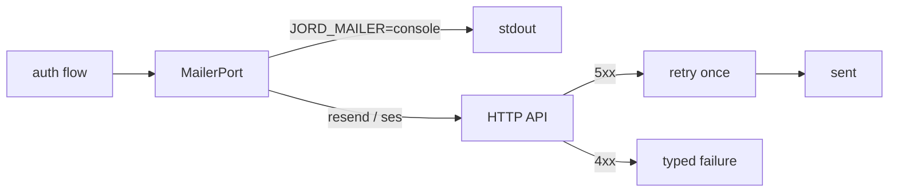

# S0073 — real MailerPort

> **Status:** todo · **Phase:** [[README]] · Parent: [[../../../feature_list/Jord/todo/jord-F0016-auth-v2|jord-F0016]] · After ship: [[../../../tech_space/jord/auth/README]]

## Routing (who / how long / which model)

| | |
|--|--|
| **Suggested agent** | mimir → **sindri** · **heimdall** reviews what leaves the process |
| **Companion skills** | `.agents/skills/graft/` · `.agents/skills/hono-typescript/` · `.agents/skills/security-and-hardening/` |
| **Suggested model** | `claude-sonnet-5-5-high` |
| **Est. time** | **2–3 h** |
| **Parallel?** | **No** — S0074/S0072 build on real delivery |

## Goal

`MailerPort` gets a real adapter (HTTP transactional email API, provider chosen at implementation between the two the feature names: Resend or SES) configured by env, with timeouts, one retry on 5xx, and a typed failure the caller can react to. The console adapter stays for local dev and is selected explicitly.

## Why now

Sign-up confirmation, reset and magic link are untestable end-to-end while mail only prints to the console.

## Context (read before coding)

| Kind | Where |
|------|-------|
| Intent | [[../../../feature_list/Jord/todo/jord-F0016-auth-v2|jord-F0016]] (real MailerPort) |
| As-built | [[../../../tech_space/jord/auth/README]] |
| Code today | `cloud/jord/src/auth/mailer.ts` (port + console implementation) · callers in `auth/routes.ts` |
| Config | `load-env.ts`; keys stay env/secret-store — never in the database or the UI |
| Tests | `cloud/jord/src/auth/token.test.ts` patterns; stub the HTTP layer, no live sends in CI |

**Do not break:** local dev must still work with zero email config (explicit console mode); no PII in logs beyond the recipient address already logged today.

## In scope

- Adapter with: API key auth, from address, timeout (5 s), one retry on 5xx/network, typed error `{ code, provider_status, message }`.
- Provider selection: `JORD_MAILER=console|resend|ses` (only implemented values), validated at boot with a clear error.
- Template payload → subject/html/text; plain-text fallback always included.
- Test: stub server returns 200/401/500 → caller sees success / invalid credentials / retry-then-fail.
- Doc: env vars, provider setup steps, and what to do when email is disabled.

## Out of scope

Templates UI ([[S0072-email-templates|S0072]]) · inbound email · bounce/complaint webhooks · per-project provider credentials (project-level mail settings are not in scope here).

## Diagram

## Steps (do in order)

1. Read the port + callers; keep the interface identical.
2. Implement the adapter with timeout/retry and typed errors.
3. Boot-time validation of `JORD_MAILER` + required env.
4. Stubbed tests for success, bad key, retry path.
5. Update `.env.example` + docs.
6. Typecheck + test; paste proof.
7. **docs_man**: auth tech_space mailer section; tick card.

## Done when

- [ ] Console mode still the default with no config
- [ ] Real provider sends a template email in a manual smoke (paste message id)
- [ ] 401 from the provider surfaces as invalid credentials, not a crash
- [ ] 5xx retried once, then reported
- [ ] Proof pasted

## Proof

| Date | Command | Result |
|------|---------|--------|
| | `pnpm --filter @altr/jord-server test` | |

## After ship

| Update | Path |
|--------|------|
| tech_space | `Docs/tech_space/jord/auth/README.md` |
| Queue | [[README]] |
