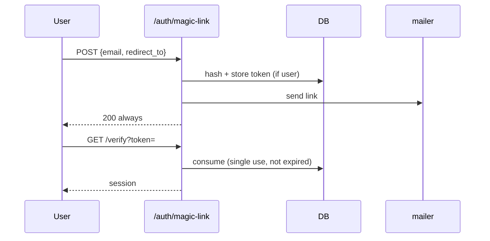

# S0074 — magic link sign-in

> **Status:** todo · **Depends on** [[done/S0073-mailer-port|S0073]] · **Phase:** [[README]] · Parent: [[../../../feature_list/Jord/todo/jord-F0016-auth-v2|jord-F0016]] · After ship: [[../../../tech_space/jord/auth/README]]

## Routing (who / how long / which model)

| | |
|--|--|
| **Suggested agent** | mimir → **heimdall** |
| **Companion skills** | `.agents/skills/security-and-hardening/` · `.agents/skills/graft/` |
| **Suggested model** | `claude-sonnet-5-5-high` |
| **Est. time** | **2–3 h** |
| **Parallel?** | **No** |

## Goal

`POST /auth/magic-link` issues a single-use token and emails a link; `GET /auth/magic-link/verify?token=…` exchanges it for a session. Tokens expire (15 min default), are hashed at rest, invalidated on use, rate-limited per email and IP, and the post-login redirect must be in the allowlist.

## Why now

Passwordless is one of the four `jord-F0016` capabilities and the first real consumer of the mailer.

## Context (read before coding)

| Kind | Where |
|------|-------|
| Intent | [[../../../feature_list/Jord/todo/jord-F0016-auth-v2|jord-F0016]] |
| Depends on | [[done/S0073-mailer-port|S0073]] · [[done/S0069-auth-settings-store|S0069]] (sign-up toggle, allowlist, limits) |
| Code today | `cloud/jord/src/auth/{routes,jwt,identity,password}.ts` + token helpers |
| Tests | `cloud/jord/src/auth/token.test.ts` · `principals.test.ts` |

**Do not break:** enumeration safety — the request endpoint always returns the same response whether or not the email exists; existing password login unchanged.

## In scope

- Token table/columns: hash, principal, purpose, expires_at, used_at, created_ip.
- Request: normalize email, create token (only if the user exists and sign-ups/magic link are enabled), send via mailer, always 200.
- Verify: constant-time hash compare, single use, expiry, disabled/banned user refused, allowlist check on `redirect_to`.
- Rate limits: per email (e.g. 3/15 min) and per IP, using the shared limiter when available.
- Tests: happy path, reuse rejected, expired rejected, unknown email → same 200 and no token, off-allowlist redirect rejected.

## Out of scope

Email OTP codes · link auto-login with a one-click GET in email clients (state the trade-off and pick POST-confirm if needed) · provider-side click tracking.

## Diagram

## Steps (do in order)

1. Read token helpers + auth routes; reuse the same hashing/compare utilities.
2. Add storage columns + migration.
3. Implement request (constant response) and verify with all guards.
4. Wire mailer template + allowlist + rate limits.
5. Tests for each rejection path.
6. Typecheck + test; paste proof.
7. **docs_man**: auth tech_space magic link; tick card.

## Done when

- [ ] Request is enumeration-safe (tested)
- [ ] Token single-use and expiring (tested)
- [ ] Banned/disabled user cannot sign in
- [ ] Off-allowlist redirect rejected
- [ ] Rate limit enforced per email/IP
- [ ] Proof pasted

## Proof

| Date | Command | Result |
|------|---------|--------|
| | `pnpm --filter @altr/jord-server test` | |

## After ship

| Update | Path |
|--------|------|
| tech_space | `Docs/tech_space/jord/auth/README.md` |
| Queue | [[README]] |
