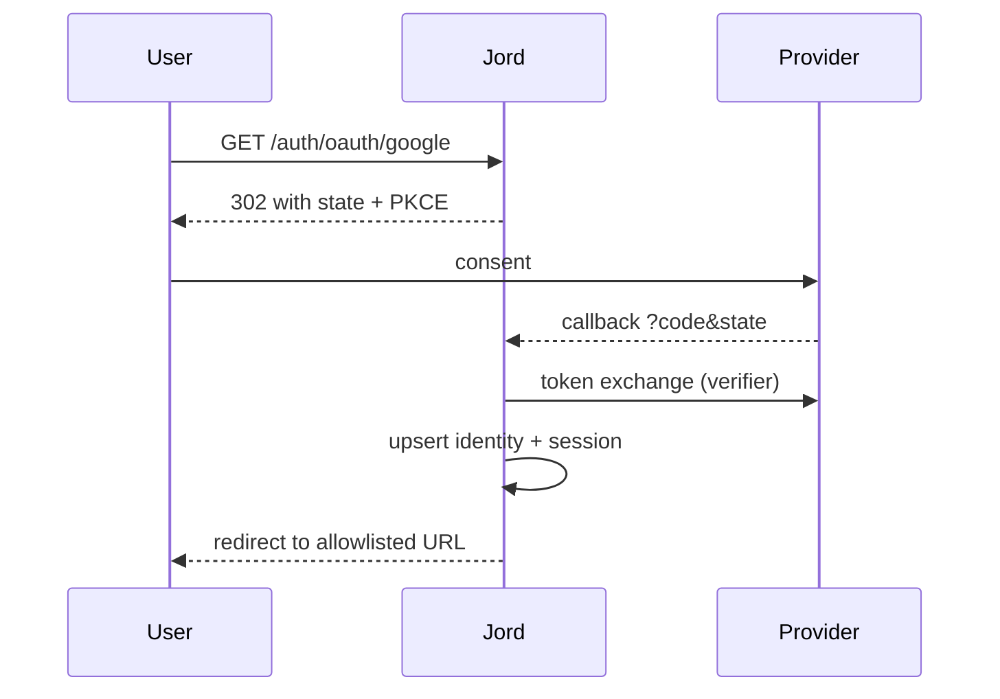

# S0075 — one OAuth provider (state + PKCE)

> **Status:** todo · **Phase:** [[README]] · Parent: [[../../../feature_list/Jord/todo/jord-F0016-auth-v2|jord-F0016]] · After ship: [[../../../tech_space/jord/auth/README]]

## Routing (who / how long / which model)

| | |
|--|--|
| **Suggested agent** | mimir → **heimdall** |
| **Companion skills** | `.agents/skills/security-and-hardening/` · `.agents/skills/graft/` · `.agents/skills/hono-typescript/` |
| **Suggested model** | `claude-sonnet-5-5-high` |
| **Est. time** | **3 h** |
| **Parallel?** | **No** |

## Goal

One OAuth 2.0 provider (Google first, generic OIDC if cheap) end to end: `GET /auth/oauth/:provider` redirects with `state` + PKCE challenge, `/auth/oauth/:provider/callback` validates state, exchanges the code, upserts the identity, and issues a session. Client id/secret come from project settings (write-only), callback URL is fixed and documented.

## Why now

`jord-F0016` scopes OAuth to **one** provider on purpose; the console's OAuth card (`S0071`) is gated until this exists.

## Context (read before coding)

| Kind | Where |
|------|-------|
| Intent | [[../../../feature_list/Jord/todo/jord-F0016-auth-v2|jord-F0016]] · [[../../../feature_list/Jord/todo/jord-F0030-auth-console|jord-F0030]] (Providers) |
| Depends on | [[S0069-auth-settings-store|S0069]] (provider settings + allowlist) · [[S0071-auth-console-sections|S0071]] (secret storage) |
| Code today | `cloud/jord/src/auth/{identity,routes,jwt,admin}.ts` |
| Tests | `cloud/jord/src/auth/principals.test.ts` (add oauth cases) |

**Do not break:** local password login; enumeration safety on link conflicts; no client secret in any response.

## In scope

- Authorize: random `state` (stored, single-use, 10 min) + PKCE `code_verifier`/`challenge` (S256); redirect URI derived from the configured site URL.
- Callback: state check, code exchange with timeout, id_token/userinfo validation (issuer, audience, `email_verified`), identity upsert by provider + subject.
- Linking: existing email + new provider → link only after a verified email and an explicit policy (state which; default link when `email_verified`).
- Errors: single generic failure page/code; no "account exists" leakage.
- Settings: provider enable toggle + client id/secret via the secret store; disable immediately rejects authorize.
- Tests: state mismatch rejected, replay rejected, PKCE verifier mismatch rejected, disabled provider rejected, happy path with a stubbed provider.

## Out of scope

More than one provider · OIDC discovery for arbitrary issuers · refresh tokens from the provider · SAML.

## Diagram

## Steps (do in order)

1. Read identity/upsert + settings; decide the linking policy and write it down in the card before coding.
2. Implement state + PKCE storage.
3. Implement authorize + callback + identity upsert.
4. Add provider settings enable/disable + secret read.
5. Stubbed-provider tests for each guard.
6. Typecheck + test; paste proof.
7. **docs_man**: auth tech_space OAuth section; tick card.

## Done when

- [ ] Happy path signs in with a stubbed provider
- [ ] State mismatch/replay and PKCE mismatch rejected (tested)
- [ ] Disabled provider refuses immediately
- [ ] No account-existence leakage on errors
- [ ] Proof pasted

## Proof

| Date | Command | Result |
|------|---------|--------|
| | `pnpm --filter @altr/jord-server test` | |

## After ship

| Update | Path |
|--------|------|
| tech_space | `Docs/tech_space/jord/auth/README.md` |
| Queue | [[README]] |
