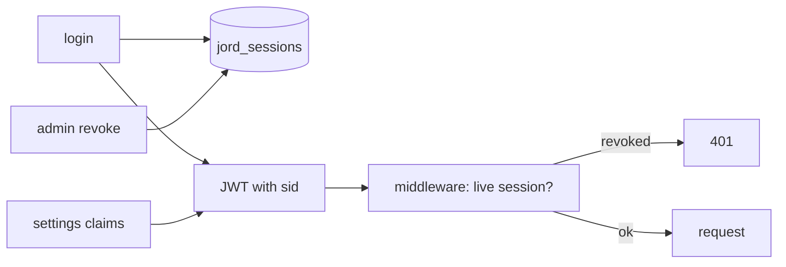

# S0076 — sessions list/revoke + custom JWT claims

> **Status:** todo · **Phase:** [[README]] · Parent: [[../../../feature_list/Jord/todo/jord-F0016-auth-v2|jord-F0016]] · After ship: [[../../../tech_space/jord/auth/README]]

## Routing (who / how long / which model)

| | |
|--|--|
| **Suggested agent** | mimir → **heimdall** |
| **Companion skills** | `.agents/skills/security-and-hardening/` · `.agents/skills/supabase-postgres-best-practices/` |
| **Suggested model** | `claude-sonnet-5-5-high` |
| **Est. time** | **2.5–3 h** |
| **Parallel?** | **No** |

## Goal

Tokens carry a session id; sessions are rows (device label, IP, last seen, created, revoked). `/auth/sessions` lists mine, admin can list per user, revoke one or all, and revocation takes effect on the next request. Custom claims configured in project settings appear in newly issued tokens.

## Why now

Leftover **B7** from phase-02.75, and the Auth console's Sessions section (`S0070`) is gated on it.

## Context (read before coding)

| Kind | Where |
|------|-------|
| Intent | [[../../../feature_list/Jord/todo/jord-F0016-auth-v2|jord-F0016]] · [[../../../feature_list/Jord/todo/jord-F0030-auth-console|jord-F0030]] (Sessions, JWT) |
| Code today | `cloud/jord/src/auth/{jwt,token,identity,middleware,admin}.ts` |
| Settings | custom claims come from [[S0069-auth-settings-store|S0069]] |
| Tests | `cloud/jord/src/auth/token.test.ts` |

**Do not break:** existing tokens without a session id keep working until expiry (or are force-refreshed — state the choice); JWT verification path unchanged.

## In scope

- `jord_sessions` table: id, principal, user_agent (parsed label), ip, created_at, last_seen_at, revoked_at, expires_at.
- Issue: token carries `sid`; middleware validates the session is live and updates `last_seen_at` (throttled to once a minute).
- Revoke one / revoke all (self) and admin revoke per user; immediate effect test.
- Custom claims: allowlisted keys merged into the JWT payload; reserved claims (`sub`, `sid`, `role`, `exp`) cannot be overridden.
- Cleanup of expired sessions on the job runner.
- Tests: revoke → next request 401; last_seen throttle; claims appear and reserved keys rejected.

## Out of scope

Device fingerprinting · refresh-token rotation · session UI (console card `S0070` consumes this).

## Diagram

## Steps (do in order)

1. Read jwt/token/middleware; decide the legacy-token policy.
2. Add the table + issue/validate/revoke logic.
3. Add claim merging with a reserved-key guard.
4. Add endpoints for list/revoke (self + admin).
5. Cleanup job + tests.
6. Typecheck + test; paste proof.
7. **docs_man**: auth tech_space sessions/claims; tick card.

## Done when

- [ ] Session rows created on login with device/IP/last-seen
- [ ] Revoked session fails on the next request (tested)
- [ ] Custom claims present in new tokens; reserved keys rejected
- [ ] Expired sessions cleaned up
- [ ] Proof pasted

## Proof

| Date | Command | Result |
|------|---------|--------|
| | `pnpm --filter @altr/jord-server test` | |

## After ship

| Update | Path |
|--------|------|
| tech_space | `Docs/tech_space/jord/auth/README.md` |
| Queue | [[README]] |
