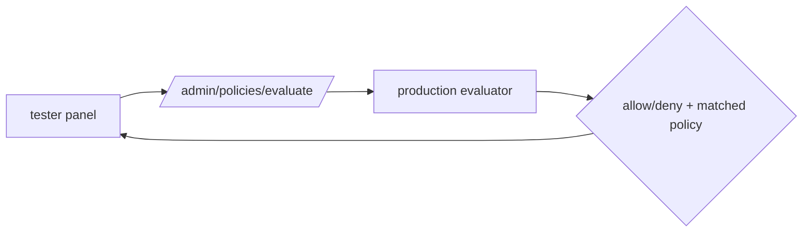

# S0077 — Studio policy tester

> **Status:** todo · **Depends on** [[S0059-policies-apis-drawers|S0059]] + [[S0076-sessions-claims|S0076]] · **Phase:** [[README]] · Parent: [[../../../feature_list/Jord/todo/jord-F0016-auth-v2|jord-F0016]] · After ship: [[../../../tech_space/jord/policies/README]]

## Routing (who / how long / which model)

| | |
|--|--|
| **Suggested agent** | mimir → **apollo** (UI) + **heimdall** (evaluation endpoint) |
| **Companion skills** | `.agents/skills/apollo/` · `.agents/skills/security-and-hardening/` · `.agents/skills/graft/` |
| **Suggested model** | `claude-sonnet-5-5-high` |
| **Est. time** | **2–3 h** |
| **Parallel?** | **No** |

## Goal

A tester in Studio: choose a user (and optionally a custom claim set), a table, an operation, and a row — see **allow/deny**, which policy matched, and the resulting row count, produced by the **same** evaluation code the request path uses.

## Why now

`jord-F0016` lists "run as user" as a shipped capability; without it operators debug policies by trial and error against the API.

## Context (read before coding)

| Kind | Where |
|------|-------|
| Intent | [[../../../feature_list/Jord/todo/jord-F0016-auth-v2|jord-F0016]] · [[../../../feature_list/Jord/done/jord-F0008-policies|jord-F0008]] |
| Code today | `cloud/jord/src/policies/` (evaluation) · `elements/jord/src/schema/{policies,row-scope}.ts` · `components/policies-panel.tsx` |
| Tests | `elements/jord/src/schema/row-scope.test.ts` · `cloud/jord/src/policies/*.test.ts` |

**Do not break:** the tester must not create a second evaluator — call the production function; never issue tokens for the impersonated user (no session minting).

## In scope

- `POST /admin/policies/evaluate` (`{ principalId, operation, table, schema, row? }`) returning `{ allowed, matchedPolicyId, rowsEvaluated, reason }` using the production path with the principal injected.
- Studio: tester panel reachable from the policy drawer; principal picker (from Users), claim override editor, operation + table selectors, sample row picker (by PK) or "any row".
- Show the matched policy expression + a plain-language rendering; link to edit.
- Fixture matrix test: the endpoint's decisions equal direct calls to the evaluator for the same inputs.
- Audit each evaluation (who tested whom).

## Out of scope

Batch evaluation across all users · writing data on behalf of the user · policy syntax authoring help.

## Diagram

## Steps (do in order)

1. Find the production evaluation entry point; confirm it can be called with an injected principal.
2. Add the admin endpoint + audit + role guard.
3. Build the tester UI with principal/claim/table/operation controls.
4. Add the fixture matrix test for parity.
5. Typecheck (server + studio) + tests; paste proof.
6. **docs_man**: policies tech_space tester section; tick card.

## Done when

- [ ] Tester decisions match the evaluator on a fixture matrix (tested)
- [ ] Matched policy and plain-language reason shown
- [ ] No token/session minted for the impersonated user
- [ ] Evaluations audited
- [ ] Proof pasted

## Proof

| Date | Command | Result |
|------|---------|--------|
| | `pnpm --filter @altr/jord-server test` | |

## After ship

| Update | Path |
|--------|------|
| tech_space | `Docs/tech_space/jord/policies/README.md` |
| Queue | [[README]] |
