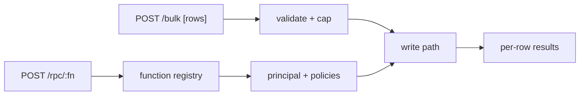

# S0080 — bulk insert/upsert + RPC

> **Status:** todo · **Phase:** [[README]] · Parent: [[../../../feature_list/Jord/todo/jord-F0017-table-api-v2|jord-F0017]] · After ship: [[../../../tech_space/jord/apis/README]]

## Routing (who / how long / which model)

| | |
|--|--|
| **Suggested agent** | mimir → **sindri** (batch path) + **heimdall** (authorization) |
| **Companion skills** | `.agents/skills/supabase-postgres-best-practices/` · `.agents/skills/graft/` · `.agents/skills/hono-typescript/` |
| **Suggested model** | `claude-sonnet-5-5-high` |
| **Est. time** | **3 h** |
| **Parallel?** | **No** |

## Goal

`POST /api/v1/:table/bulk` accepts an array (bounded, e.g. 500) of rows for insert or upsert with an explicit conflict target, returns **per-row** results (index, status, id or error, field reasons), and reports partial success honestly. `POST /api/v1/rpc/:fn` invokes a registered function with the caller's principal.

## Why now

`jord-F0017` lists both; Studio bulk delete/duplicate and client sync both benefit, and RPC is the documented way to call server functions today missing from the table API.

## Context (read before coding)

| Kind | Where |
|------|-------|
| Intent | [[../../../feature_list/Jord/todo/jord-F0017-table-api-v2|jord-F0017]] |
| Depends on | [[S0053-column-settings|S0053]] (validation errors) · functions registry `cloud/jord/src/functions/` · `generated-api/registry.ts` |
| Code today | `cloud/jord/src/table-api/{routes,sql,openapi}.ts` · `cloud/jord/src/functions/{runner,index}.ts` · `cloud/jord/src/queue.ts` |
| Tests | `cloud/jord/src/table-api/__tests__/` · `elements/jord/src/functions.test.ts` |

**Do not break:** single-row write contracts; the write queue remains the only writer for queued jobs; RPC must not bypass policies.

## In scope

- Bulk endpoint: array validation (size cap, per-row shape), insert or upsert with `on_conflict` columns, per-row result array, HTTP 207-style semantics (pick and document: 200 with results vs 207).
- Atomicity choice documented: per-row try (partial success) vs all-or-nothing inside one transaction. Default must be stated and tested.
- Duplicate key → per-row conflict error, not a batch abort.
- RPC: `POST /api/v1/rpc/:fn` `{ args }` → function registry lookup, args validation, execution with the caller's principal, structured result/error; 404 for unknown fn.
- OpenAPI entries for both.

## Out of scope

Streaming/bulk beyond the cap · CSV import · long-running functions (worker runtime is `jord-F0015`, gated).

## Diagram

## Steps (do in order)

1. Read the write path + function registry; decide and write down the atomicity default.
2. Implement the bulk endpoint with per-row results and the size cap.
3. Implement RPC with args validation + policy path.
4. OpenAPI + tests (partial failure, conflict, unknown fn, policy denial).
5. Typecheck + test; paste proof.
6. **docs_man**: apis tech_space bulk/RPC; tick card.

## Done when

- [ ] Bulk insert/upsert return per-row results for success and conflict
- [ ] Atomicity behavior is documented and tested
- [ ] RPC calls a registered function with the caller's principal
- [ ] Unknown function → 404; policy denial → 403
- [ ] Proof pasted

## Proof

| Date | Command | Result |
|------|---------|--------|
| | `pnpm --filter @altr/jord-server test` | |

## After ship

| Update | Path |
|--------|------|
| tech_space | `Docs/tech_space/jord/apis/README.md` |
| Queue | [[README]] |
