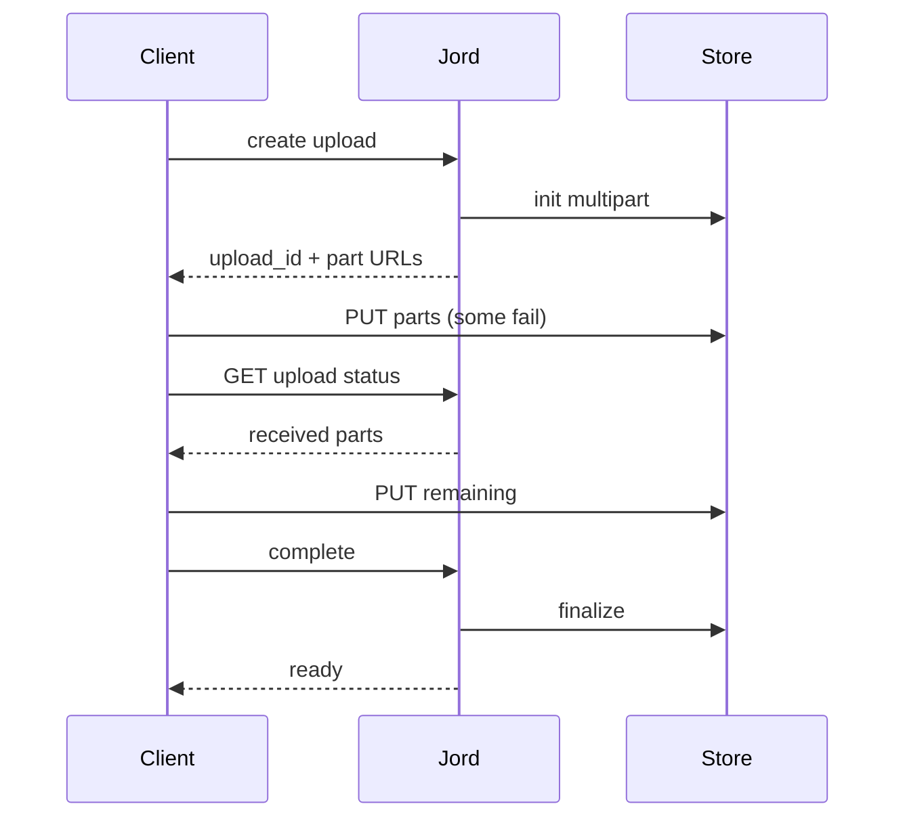

# S0081 — multipart + resumable uploads

> **Status:** todo · **Depends on** [[S0066-bucket-registry|S0066]] · **Phase:** [[README]] · Parent: [[../../../feature_list/Jord/todo/jord-F0018-storage-realtime-v2|jord-F0018]] · After ship: [[../../../tech_space/jord/blobs/README]]

## Routing (who / how long / which model)

| | |
|--|--|
| **Suggested agent** | mimir → **sindri** |
| **Companion skills** | `.agents/skills/supabase-postgres-best-practices/` · `.agents/skills/graft/` |
| **Suggested model** | `claude-sonnet-5-5-high` |
| **Est. time** | **3 h** |
| **Parallel?** | **No** |

## Goal

A 1 GiB upload survives a disconnect: create session → upload parts (presigned part URLs for S3, chunked PUT for local) → resume from the last acknowledged part → finalize → `ready`, with abandon/GC keeping the existing pending-expiry rule.

## Why now

`jord-F0018` acceptance is exactly this; today's path is one-shot PUT, so large files fail on any hiccup.

## Context (read before coding)

| Kind | Where |
|------|-------|
| Intent | [[../../../feature_list/Jord/todo/jord-F0018-storage-realtime-v2|jord-F0018]] |
| As-built | [[../../../tech_space/jord/blobs/README]] (lifecycle, `upload_id` column already reserved) |
| Depends on | [[S0066-bucket-registry|S0066]] (per-bucket provider + limits) |
| Code today | `cloud/jord/src/storage/{s3,local,lifecycle}.ts` · `cloud/jord/src/blobs/routes.ts` · `jord_blobs.upload_id` |
| Tests | `cloud/jord/src/storage/s3-live.test.ts` (MinIO, env-gated) |

**Do not break:** pending → finalize → `blobs_gc`, `PresignResult` shape, size/MIME limits from the bucket, the `502 storage_delete_failed` contract.

## In scope

- Session endpoints: `POST /blobs/:bucket/uploads` → `{ upload_id, parts_expected }`; `POST …/uploads/:id/parts/sign` (batch); `POST …/uploads/:id/complete`; `DELETE …/uploads/:id` (abort).
- S3: `CreateMultipartUpload` + presigned `UploadPart` + `CompleteMultipartUpload`; local: append chunks to a temp file with an offset contract.
- Resume: `GET …/uploads/:id` returns received parts/bytes so a client continues without restarting.
- Validation: chunk size bounds, part numbering, content-type allowlist from the bucket, total size cap.
- Tests: local resume after simulated disconnect; MinIO multipart when `JORD_TEST_S3_ENDPOINT` is set; expired session GC.

## Out of scope

Parallel part concurrency tuning · client-side chunking SDK (note it as the consumer) · resumable uploads through a browser form without the API.

## Diagram

## Steps (do in order)

1. Read the lifecycle + S3 adapter; confirm `upload_id` usage.
2. Add session storage (row fields) + endpoints.
3. Implement S3 multipart and local chunk append.
4. Wire resume status + abort + GC.
5. Tests: local resume, MinIO multipart, expired session cleanup.
6. Typecheck + test; paste proof.
7. **docs_man**: blobs tech_space multipart section; tick card.

## Done when

- [ ] 1 GiB local upload resumes after a simulated disconnect
- [ ] MinIO multipart path works when the live env is set
- [ ] Abandoned sessions are GC'd; finalized objects behave as today
- [ ] Size/MIME limits still enforced
- [ ] Proof pasted

## Proof

| Date | Command | Result |
|------|---------|--------|
| | `pnpm --filter @altr/jord-server test` | |

## After ship

| Update | Path |
|--------|------|
| tech_space | `Docs/tech_space/jord/blobs/README.md` |
| Queue | [[README]] |
