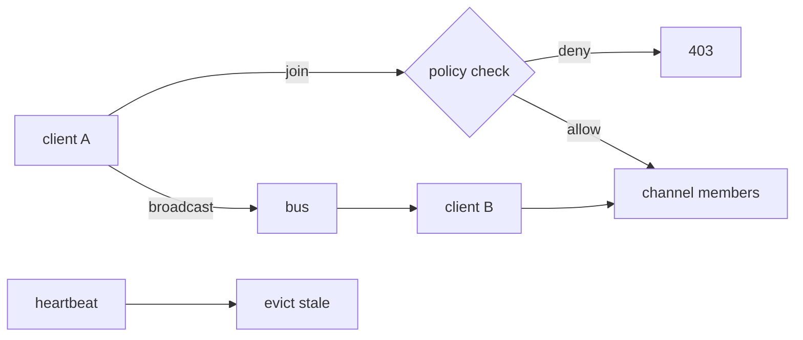

# S0083 — realtime presence + broadcast

> **Status:** todo · **Depends on** [[S0037-listen-seq-fanout|S0037]] · **Phase:** [[README]] · Parent: [[../../../feature_list/Jord/todo/jord-F0018-storage-realtime-v2|jord-F0018]] · After ship: [[../../../tech_space/jord/realtime/README]]

## Routing (who / how long / which model)

| | |
|--|--|
| **Suggested agent** | mimir → **sindri** (transport) + **heimdall** (authorization) |
| **Companion skills** | `.agents/skills/security-and-hardening/` · `.agents/skills/hono-typescript/` · `.agents/skills/graft/` |
| **Suggested model** | `claude-sonnet-5-5-high` |
| **Est. time** | **3 h** |
| **Parallel?** | **No** |

## Goal

Clients join a channel (`presence:room-1`), announce a state, and receive join/leave/sync events; `broadcast` sends an ephemeral message to everyone else on the channel. Join is authorized by the channel's declared policy (table + row), not by possession of a key alone, and nothing is persisted.

## Why now

`jord-F0018` pairs storage with realtime presence/broadcast; today realtime is change-feed only.

## Context (read before coding)

| Kind | Where |
|------|-------|
| Intent | [[../../../feature_list/Jord/todo/jord-F0018-storage-realtime-v2|jord-F0018]] |
| Depends on | [[S0037-listen-seq-fanout|S0037]] (multi-instance delivery) · `jord-F0009` transport |
| Code today | `cloud/jord/src/realtime/{bus,deliver,types}.ts` · `cloud/jord/src/policies/` |
| Tests | `cloud/jord/src/realtime/ws-policy.test.ts` |

**Do not break:** change-feed ordering and retention; presence must not grow unbounded (heartbeat timeout evicts).

## In scope

- Channel join protocol (WS message or SSE query): `{ type: 'join', channel, config }` with authorization via a policy check on the channel's table/row.
- Presence: join/leave/sync events, state payload (bounded size), heartbeat + eviction after timeout, per-channel member count.
- Broadcast: fan out to channel members except the sender, per-message size cap, rate limit per connection.
- Multi-instance: route through the bus so presence/broadcast reach subscribers on other processes (LISTEN from S0037 makes this possible; state can be per-instance with a TTL and merged on read).
- Tests: join denied by policy → 403 and no membership; broadcast reaches one other client only; stale presence evicted.

## Out of scope

Persisted chat history · message acknowledgements/replay · typing indicators (a client concern).

## Diagram

## Steps (do in order)

1. Read the realtime types + `ws-policy.test.ts`; extend the message vocabulary, keep feed events untouched.
2. Implement join authorization through the existing policy path.
3. Add presence state + heartbeat eviction.
4. Add broadcast with size/rate caps through the bus.
5. Tests for denial, fan-out, eviction.
6. Typecheck + test; paste proof.
7. **docs_man**: realtime tech_space presence section; tick card.

## Done when

- [ ] Denied join returns 403 and creates no membership
- [ ] Broadcast reaches other members only
- [ ] Stale presence evicted after the timeout
- [ ] Works across two instances
- [ ] Proof pasted

## Proof

| Date | Command | Result |
|------|---------|--------|
| | `pnpm --filter @altr/jord-server test` | |

## After ship

| Update | Path |
|--------|------|
| tech_space | `Docs/tech_space/jord/realtime/README.md` |
| Queue | [[README]] |
